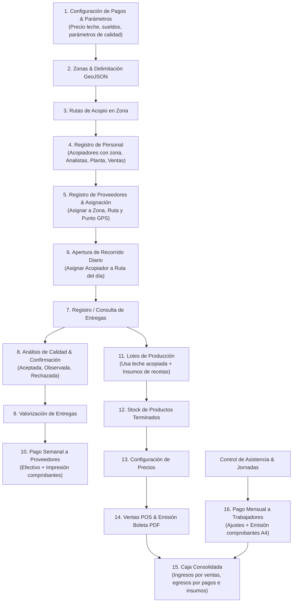

# Inventario de Módulos y Operaciones del Administrador — EcoLactWeb

> **Rol exclusivo:** Administrador (`ADMINISTRADOR`)  
> **Fuente de código inspeccionado:** `EcoLactWeb/routes/web.php`, `app/Http/Controllers/Web/**`, `app/Http/Requests/**`, `resources/views/layouts/admin.blade.php`, `resources/views/admin/**`.  
> **Fecha de levantamiento:** 2026-10-28  
> **Criterio de rigor:** Basado estrictamente en código fuente observado. No se infieren pantallas ni botones inexistentes.  
> **Estado de verificación general:** Observado en código — Pendiente de verificación UI con capturas reales.

---

## 1. Mecanismo de Autorización y Seguridad

Todas las rutas del Administrador en EcoLactWeb están blindadas bajo las siguientes capas:

| Capa | Definición en código | Efecto |
|---|---|---|
| **Autenticación** | `middleware('auth')` | Requiere sesión activa en el sistema. Redirige a `/login` si no está autenticado. |
| **Cuenta activa** | `middleware('active')` | Verifica que el usuario no esté suspendido o inactivo (`EnsureUserIsActive`). |
| **Rol de sistema** | `middleware('role:ADMINISTRADOR')` | Prefijo `/admin/*` con nombre `admin.*`. Exclusivo del usuario con rol `ADMINISTRADOR`. |
| **Autorización global** | `Gate::before(...)` | En `AppServiceProvider`, el Administrador tiene pase maestro (`true`) sobre las Policies, **con una excepción explícita**: `AnalisisCalidadPolicy::update` protege los análisis en estado `CONFIRMADO` volviéndolos inmutables incluso para el Administrador. |

---

## 2. Mapa y Estructura de Módulos del Administrador

A partir de la barra lateral (`layouts/admin.blade.php`) y el árbol de rutas `/admin/*`, los módulos del Administrador se clasifican en:

```
[PANEL DEL ADMINISTRADOR]
│
├── 1. DASHBOARD & PERFIL
│   ├── 1.1 Inicio (Dashboard con métricas globales)
│   ├── 1.2 Mi Perfil (Autovista del Administrador y control de periodo)
│   └── 1.3 Notificaciones (Centro de alertas compartidas)
│
├── 2. OPERACIÓN
│   ├── 2.1 Zonas (Estructura territorial, delimitación GeoJSON, mapa, asignación)
│   ├── 2.2 Rutas (Paradas de acopio, orden de visita, apertura de recorridos diarios)
│   ├── 2.3 Proveedores (Alta, edición, activación/desactivación, historial)
│   └── 2.4 Acopio / Entregas (Listado general, registro directo, ajuste de litros, anulación)
│
├── 3. PERSONAL Y ASISTENCIA
│   ├── 3.1 Asistencia (Control de asistencia diaria del personal con QR/manual)
│   ├── 3.2 Nuevo Trabajador (Formulario unificado para selección de tipo de personal)
│   ├── 3.3 Acopiadores (Gestión de cuentas con zona obligatoria)
│   ├── 3.4 Analistas de Calidad (Gestión de cuentas sin zona)
│   ├── 3.5 Encargados de Planta (Gestión de cuentas para planta)
│   ├── 3.6 Personal de Ventas (Gestión de cuentas para POS/ventas)
│   └── 3.7 Control de Jornadas (Días trabajados por mes y correcciones)
│
├── 4. CALIDAD TÉCNICA
│   ├── 4.1 Análisis de Calidad (Inspecciones técnicas, registro, OCR de ticket de analizador, confirmación)
│   ├── 4.2 Parámetros de Calidad (Catálogo técnico de parámetros)
│   └── 4.3 Reglas de Calidad (Límites, penalidades y bonificaciones)
│
├── 5. CONFIGURACIÓN Y FINANZAS
│   ├── 5.1 Configuración de Pagos (Precio base leche, descuento observado, sueldos de trabajadores)
│   ├── 5.2 Caja (Historial consolidado de movimientos de caja — solo lectura)
│   ├── 5.3 Pagar a Proveedores (Liquidación semanal en efectivo, previsualización, pago e impresión)
│   ├── 5.4 Pagar a Trabajadores (Sueldos mensuales, ajustes por bonificación/descuento, pago y comprobante)
│   ├── 5.5 Pagos Generales (Generación y registro general de obligaciones de pago)
│   └── 5.6 Liquidaciones (Emisión de sobre de pago / hoja imprimible)
│
├── 6. PRODUCCIÓN
│   ├── 6.1 Recetas (Fórmulas de productos, versionado, insumos requeridos)
│   └── 6.2 Lotes de Producción (Requerimientos, deducción de insumos al iniciar, cierre a producto terminado)
│
├── 7. INVENTARIO
│   ├── 7.1 Insumos (Catálogo de insumos, unidades base, presentaciones de compra, ajustes de stock)
│   ├── 7.2 Compras de Insumos (Registro manual y lectura OCR de boleta de compra)
│   └── 7.3 Stock Consolidado (Monitoreo y ajustes de inventario de insumos y productos)
│
├── 8. VENTAS Y CLIENTES
│   ├── 8.1 Ventas / POS (Punto de venta, cobro en efectivo, saldo proveedor, boleta PDF)
│   ├── 8.2 Precios de Productos (Precios por tipo de cliente: mayorista, público, proveedor)
│   └── 8.3 Compradores (Directorio de clientes comerciales y mayoristas)
│
└── 9. COMUNICACIÓN Y AUDITORÍA
    ├── 9.1 Comunicados (Redacción, borrador, edición y publicación)
    └── 9.2 Auditoría (Registrado en backend; pantalla deshabilitada en menú)
```

---

## 3. Catálogo Detallado de Operaciones

### 3.1 Módulo: Dashboard, Perfil y Notificaciones

| ID | Operación | Método | URI | Ruta nombrada | Controlador @ Método | Validación / Request | Entrada | Salida | Estado de Verificación |
|---|---|---|---|---|---|---|---|---|---|
| `ADM-DASH-VER-001` | Consultar Dashboard global | GET | `/admin/dashboard` | `admin.dashboard` | `DashboardController` (`__invoke`) | `DashboardPeriodoRequest` (opcional) | `periodo`, `desde`, `hasta` | Vista `admin.dashboard` con KPIs de acopio, calidad, ventas, pagos | Observado en código |
| `ADM-PERF-VER-001` | Ver perfil del Administrador | GET | `/admin/mi-perfil` | `admin.administrador.show` | `AdministradorController@show` | Ninguna | `mes` (opcional para control de periodo) | Vista `admin.administrador.show` | Observado en código |
| `ADM-NOTIF-LIST-001` | Listar notificaciones | GET | `/notificaciones` | `notificaciones.index` | `NotificacionController@index` | Ninguna | Ninguna | Vista `notificaciones.index` | Observado en código |
| `ADM-NOTIF-LEER-001` | Marcar notificación leída | PATCH | `/notificaciones/{notificacion}/leida` | `notificaciones.marcar-leida` | `NotificacionController@marcarComoLeida` | Ninguna | ID de notificación | JSON / Redirect | Observado en código |
| `ADM-AUTH-LOGOUT-001` | Cerrar sesión | POST | `/logout` | `logout` | `LoginController@logout` | Token CSRF | Ninguna | Redirect a `/login` | Observado en código |

---

### 3.2 Módulo: Zonas y Rutas

| ID | Operación | Método | URI | Ruta nombrada | Controlador @ Método | Validación / Request | Entrada | Salida | Estado de Verificación |
|---|---|---|---|---|---|---|---|---|---|
| `ADM-ZONA-LIST-001` | Listar zonas en mapa | GET | `/admin/zonas` | `admin.zonas.index` | `ZonaController@index` | Ninguna | `zona` (ID opcional para selección) | Vista `admin.zonas.index` con polígonos GeoJSON | Observado en código |
| `ADM-ZONA-SHOW-001` | Consultar detalle de zona | GET | `/admin/zonas/{zona}` | `admin.zonas.show` | `ZonaController@show` | Inyección de modelo | ID de zona | Vista `admin.zonas.show` | Observado en código |
| `ADM-ZONA-PANEL-001` | Obtener panel HTML de zona | GET | `/admin/zonas/{zona}/panel` | `admin.zonas.panel` | `ZonaController@panel` | Inyección de modelo | ID de zona | Fragmento Blade `_panel` vía fetch | Observado en código |
| `ADM-ZONA-CREAR-001` | Registrar nueva zona | POST | `/admin/zonas` | `admin.zonas.store` | `ZonaController@store` | `StoreZonaRequest` | `nombre`, `descripcion`, `color_mapa`, `poligono_geojson` | Redirect a `admin.zonas.index` | Observado en código |
| `ADM-ZONA-EDIT-001` | Actualizar zona y estado | PATCH | `/admin/zonas/{zona}` | `admin.zonas.update` | `ZonaController@update` | `UpdateZonaRequest` | `nombre`, `descripcion`, `estado`, `color_mapa`, `poligono_geojson` | Redirect o JSON con estado actualizado | Observado en código |
| `ADM-ZONA-ELIM-001` | Eliminar zona sin registros | DELETE | `/admin/zonas/{zona}` | `admin.zonas.destroy` | `ZonaController@destroy` | Ninguna | ID de zona | Redirect flash success/error | Observado en código |
| `ADM-ZONA-BUSC-001` | Buscar proveedores de zona | GET | `/admin/zonas/proveedores/buscar` | `admin.zonas.proveedores.buscar` | `ZonaController@buscarProveedores` | Ninguna | `q`, `zona_id` | JSON de proveedores | Observado en código |
| `ADM-ZONA-SINAS-001` | Ver panel sin asignar | GET | `/admin/zonas/panel/sin-asignar` | `admin.zonas.panel.sin-asignar` | `ZonaController@panelSinAsignar` | Ninguna | Ninguna | Fragmento Blade `_panel_sin_asignar` | Observado en código |
| `ADM-ZONA-ASIG-001` | Asignar proveedor a zona/ruta | PUT | `/admin/zonas/proveedores/{proveedor}/asignacion` | `admin.zonas.proveedores.asignacion` | `ZonaController@guardarAsignacion` | `GuardarAsignacionProveedorRequest` | `zona_id`, `ruta_id`, `latitud`, `longitud`, `referencia` | JSON con URL de recarga de mapa | Observado en código |
| `ADM-ZONA-MOVPIN-001` | Mover ubicación de proveedor | PATCH | `/admin/zonas/proveedores/{proveedor}/ubicacion` | `admin.zonas.proveedores.ubicacion` | `ZonaController@moverProveedor` | `MoverProveedorDeZonaRequest` | `latitud`, `longitud`, `ruta_id`, `zona_id` | JSON con mapa recalculado | Observado en código |
| `ADM-RUTA-CREAR-001` | Crear ruta en zona | POST | `/admin/zonas/{zona}/rutas` | `admin.zonas.rutas.store` | `RutaController@store` | `StoreRutaRequest` | `nombre`, `descripcion`, `estado` | Redirect o JSON de ruta creada | Observado en código |
| `ADM-RUTA-SHOW-001` | Ver detalle de ruta | GET | `/admin/rutas/{ruta}` | `admin.rutas.show` | `RutaController@show` | Inyección de modelo | ID de ruta | Vista `admin.rutas.show` | Observado en código |
| `ADM-RUTA-PANEL-001` | Obtener panel HTML de ruta | GET | `/admin/rutas/{ruta}/panel` | `RutaController@panel` | Inyección de modelo | ID de ruta | Fragmento Blade `_panel` vía fetch | Observado en código |
| `ADM-RUTA-EDIT-001` | Actualizar ruta | PATCH | `/admin/rutas/{ruta}` | `admin.rutas.update` | `RutaController@update` | `UpdateRutaRequest` | `nombre`, `descripcion`, `estado` | Redirect con mensaje flash | Observado en código |
| `ADM-RUTA-PROVDISP-001` | Buscar proveedores disponibles para ruta | GET | `/admin/rutas/{ruta}/proveedores-disponibles` | `admin.rutas.proveedores-disponibles` | `RutaController@buscarProveedores` | Ninguna | `q` | JSON de proveedores de la zona | Observado en código |
| `ADM-RUTA-AGREG-001` | Agregar proveedor a ruta | POST | `/admin/rutas/{ruta}/detalles` | `admin.rutas.detalles.store` | `RutaController@agregarProveedor` | `AgregarProveedorARutaRequest` | `proveedor_id`, `orden_visita`, `motivo` | Redirect o JSON | Observado en código |
| `ADM-RUTA-QUIT-001` | Quitar proveedor de ruta | DELETE | `/admin/rutas/{ruta}/detalles/{detalle}` | `admin.rutas.detalles.destroy` | `RutaController@quitarProveedor` | `QuitarProveedorDeRutaRequest` | `motivo` | Redirect o JSON | Observado en código |
| `ADM-RUTA-REORD-001` | Reordenar paradas de ruta | PATCH | `/admin/rutas/{ruta}/detalles/reordenar` | `admin.rutas.detalles.reordenar` | `RutaController@reordenarDetalles` | `ReordenarRutaDetallesRequest` | `orden[]` (array de IDs) | JSON con estado actualizado | Observado en código |
| `ADM-RUTA-ABREC-001` | Abrir recorrido diario | POST | `/admin/rutas/{ruta}/recorridos` | `admin.rutas.recorridos.store` | `RutaController@abrirRecorrido` | `AbrirRecorridoRequest` | `acopiador_id`, `fecha_operativa` | Redirect con recorrido asignado | Observado en código |

---

### 3.3 Módulo: Proveedores

| ID | Operación | Método | URI | Ruta nombrada | Controlador @ Método | Validación / Request | Entrada | Salida | Estado de Verificación |
|---|---|---|---|---|---|---|---|---|---|
| `ADM-PROV-LIST-001` | Listar proveedores | GET | `/admin/proveedores` | `admin.proveedores.index` | `ProveedorController@index` | Ninguna | `q`, `estado`, `zona_id`, `seguimiento`, `page` | Vista `admin.proveedores.index` (2 columnas) | Observado en código |
| `ADM-PROV-SHOW-001` | Consultar proveedor | GET | `/admin/proveedores/{proveedor}` | `admin.proveedores.show` | `ProveedorController@show` | Inyección de modelo | ID de proveedor | Vista `admin.proveedores.show` | Observado en código |
| `ADM-PROV-PANEL-001` | Cargar panel lateral | GET | `/admin/proveedores/{proveedor}/panel` | `admin.proveedores.panel` | `ProveedorController@panel` | Inyección de modelo | ID de proveedor | Fragmento HTML pedido por fetch | Observado en código |
| `ADM-PROV-CREAR-001` | Registrar proveedor | POST | `/admin/proveedores` | `admin.proveedores.store` | `ProveedorController@store` | `StoreProveedorRequest` | `dni`, `nombres`, `apellidos`, `telefono`, `username`, `password`, `fecha_registro` | Redirect con flash de éxito | Observado en código |
| `ADM-PROV-EDIT-001` | Actualizar datos personales | PUT/PATCH | `/admin/proveedores/{proveedor}` | `admin.proveedores.update` | `ProveedorController@update` | `UpdateProveedorRequest` | `dni`, `nombres`, `apellidos`, `telefono` | Redirect o JSON | Observado en código |
| `ADM-PROV-DESACT-001` | Desactivar proveedor | PATCH | `/admin/proveedores/{proveedor}/desactivar` | `admin.proveedores.desactivar` | `ProveedorController@desactivar` | Ninguna | ID de proveedor | JSON o redirect (estado `INACTIVO`) | Observado en código |
| `ADM-PROV-REACT-001` | Reactivar proveedor | PATCH | `/admin/proveedores/{proveedor}/reactivar` | `admin.proveedores.reactivar` | `ProveedorController@reactivar` | `ReactivarProveedorRequest` | `ruta_id` (obligatoria para reubicar) | JSON o redirect (estado `ACTIVO`) | Observado en código |
| `ADM-PROV-ENTREG-001` | Ver entregas de proveedor | GET | `/admin/proveedores/{proveedor}/entregas` | `admin.proveedores.entregas.index` | `EntregaController@porProveedor` | Inyección de modelo | ID de proveedor | Vista con entregas del proveedor | Observado en código |
| `ADM-PROV-PAGOS-001` | Ver historial de pagos (JSON) | GET | `/admin/proveedores/{proveedor}/pagos` | `admin.proveedores.pagos.index` | `ProveedorPagosHistorialController@index` | Ninguna | ID de proveedor | JSON para modal de pagos | Observado en código |
| `ADM-PROV-PAGODET-001` | Ver detalle de obligación (JSON) | GET | `/admin/proveedores/{proveedor}/pagos/{obligacion}` | `admin.proveedores.pagos.show` | `ProveedorPagosHistorialController@show` | Inyección de modelos | ID proveedor, ID obligación | JSON para modal de pagos | Observado en código |
| `ADM-PROV-VENTAS-001` | Ver compras de productos de proveedor | GET | `/admin/proveedores/{proveedor}/ventas` | `admin.proveedores.ventas.index` | `VentaProductoController@porProveedor` | Inyección de modelo | ID de proveedor | Vista `ventas.ventas.index` | Observado en código |

---

### 3.4 Módulo: Personal y Asistencia

| ID | Operación | Método | URI | Ruta nombrada | Controlador @ Método | Validación / Request | Entrada | Salida | Estado de Verificación |
|---|---|---|---|---|---|---|---|---|---|
| `ADM-ASIST-VER-001` | Consultar asistencia diaria | GET | `/admin/asistencia` | `admin.asistencia.index` | `ControlAsistenciaController@index` | Ninguna | `fecha`, `rol`, `estado` | Vista `admin.asistencia.index` | Observado en código |
| `ADM-TRAB-NUEVO-001` | Formulario nuevo trabajador | GET | `/admin/trabajadores/nuevo` | `admin.trabajadores.create` | `NuevoTrabajadorController` (`__invoke`) | Ninguna | `tipo` (`acopiador`, `analista`, `encargado-planta`, `ventas`) | Vista `admin.trabajadores.create` | Observado en código |
| `ADM-TRAB-JORN-001` | Ver jornadas de trabajador | GET | `/admin/trabajadores/{trabajador}/jornadas` | `admin.trabajadores.jornadas.index` | `JornadaPersonalController@index` | Ninguna | `mes` | Vista de jornadas mensuales | Observado en código |
| `ADM-TRAB-JORN-002` | Registrar jornada manual | POST | `/admin/trabajadores/{trabajador}/jornadas` | `admin.trabajadores.jornadas.store` | `JornadaPersonalController@store` | Reglas de formulario | `fecha`, `estado`, `motivo` | Redirect con flash | Observado en código |
| `ADM-TRAB-JORN-003` | Corregir jornada registrada | POST | `/admin/trabajadores/{trabajador}/jornadas/{fecha}/corregir` | `admin.trabajadores.jornadas.corregir` | `JornadaPersonalController@corregir` | Reglas de formulario | `nuevo_estado`, `motivo` | Redirect con flash (auditoría en BD) | Observado en código |
| `ADM-ACOP-LIST-001` | Listar acopiadores | GET | `/admin/acopiadores` | `admin.acopiadores.index` | `AcopiadorController@index` | Ninguna | `q`, `estado`, `zona_id` | Vista `admin.acopiadores.index` | Observado en código |
| `ADM-ACOP-SHOW-001` | Ver ficha acopiador | GET | `/admin/acopiadores/{acopiador}` | `admin.acopiadores.show` | `AcopiadorController@show` | Inyección de modelo | ID acopiador | Vista `admin.acopiadores.show` | Observado en código |
| `ADM-ACOP-PANEL-001` | Cargar panel lateral acopiador | GET | `/admin/acopiadores/{acopiador}/panel` | `admin.acopiadores.panel` | `AcopiadorController@panel` | Inyección de modelo | ID acopiador | Fragmento Blade por fetch | Observado en código |
| `ADM-ACOP-CREAR-001` | Registrar acopiador | POST | `/admin/acopiadores` | `admin.acopiadores.store` | `AcopiadorController@store` | `StoreAcopiadorRequest` | `dni`, `nombres`, `apellidos`, `telefono`, `zona_id`, `username`, `password` | Redirect con mensaje flash | Observado en código |
| `ADM-ACOP-EDIT-001` | Editar acopiador / zona | PATCH | `/admin/acopiadores/{acopiador}` | `admin.acopiadores.update` | `AcopiadorController@update` | `UpdateAcopiadorRequest` | `nombres`, `apellidos`, `telefono`, `zona_id`, `motivo_cambio_zona` | Redirect o JSON | Observado en código |
| `ADM-ACOP-DESACT-001` | Desactivar acopiador | PATCH | `/admin/acopiadores/{acopiador}/desactivar` | `admin.acopiadores.desactivar` | `AcopiadorController@desactivar` | Ninguna | ID acopiador | JSON o redirect (`INACTIVO`) | Observado en código |
| `ADM-ACOP-REACT-001` | Reactivar acopiador | PATCH | `/admin/acopiadores/{acopiador}/reactivar` | `admin.acopiadores.reactivar` | `AcopiadorController@reactivar` | `ReactivarAcopiadorRequest` | `zona_id` | JSON o redirect (`ACTIVO`) | Observado en código |
| `ADM-PLAN-LIST-001` | Listar encargados de planta | GET | `/admin/encargados-planta` | `admin.encargados-planta.index` | `EncargadoPlantaController@index` | Ninguna | `q`, `estado` | Vista `admin.fichas-personal.index` | Observado en código |
| `ADM-PLAN-SHOW-001` | Ver encargado de planta | GET | `/admin/encargados-planta/{encargado}` | `admin.encargados-planta.show` | `EncargadoPlantaController@show` | Inyección de modelo | ID encargado | Vista detalle | Observado en código |
| `ADM-PLAN-PANEL-001` | Cargar panel lateral de planta | GET | `/admin/encargados-planta/{encargado}/panel` | `admin.encargados-planta.panel` | `EncargadoPlantaController@panel` | Inyección de modelo | ID encargado | Fragmento HTML por fetch | Observado en código |
| `ADM-PLAN-CREAR-001` | Registrar encargado de planta | POST | `/admin/encargados-planta` | `admin.encargados-planta.store` | `EncargadoPlantaController@store` | `StoreEncargadoPlantaRequest` | `dni`, `nombres`, `apellidos`, `telefono`, `username`, `password` | Redirect flash de éxito | Observado en código |
| `ADM-PLAN-EDIT-001` | Actualizar encargado de planta | PATCH | `/admin/encargados-planta/{encargado}` | `admin.encargados-planta.update` | `EncargadoPlantaController@update` | `UpdateEncargadoPlantaRequest` | `nombres`, `apellidos`, `telefono` | Redirect flash | Observado en código |
| `ADM-PLAN-DESACT-001` | Desactivar encargado | PATCH | `/admin/encargados-planta/{encargado}/desactivar` | `admin.encargados-planta.desactivar` | `EncargadoPlantaController@desactivar` | Ninguna | ID encargado | JSON o redirect (`INACTIVO`) | Observado en código |
| `ADM-PLAN-REACT-001` | Reactivar encargado | PATCH | `/admin/encargados-planta/{encargado}/reactivar` | `admin.encargados-planta.reactivar` | `EncargadoPlantaController@reactivar` | Ninguna | ID encargado | JSON o redirect (`ACTIVO`) | Observado en código |
| `ADM-VTAS-LIST-001` | Listar personal de ventas | GET | `/admin/personal-ventas` | `admin.personal-ventas.index` | `PersonalVentasController@index` | Ninguna | `q`, `estado` | Vista `admin.fichas-personal.index` | Observado en código |
| `ADM-VTAS-SHOW-001` | Ver personal de ventas | GET | `/admin/personal-ventas/{personalVenta}` | `admin.personal-ventas.show` | `PersonalVentasController@show` | Inyección de modelo | ID personal | Vista detalle | Observado en código |
| `ADM-VTAS-PANEL-001` | Cargar panel lateral ventas | GET | `/admin/personal-ventas/{personalVenta}/panel` | `admin.personal-ventas.panel` | `PersonalVentasController@panel` | Inyección de modelo | ID personal | Fragmento HTML por fetch | Observado en código |
| `ADM-VTAS-CREAR-001` | Registrar personal de ventas | POST | `/admin/personal-ventas` | `admin.personal-ventas.store` | `PersonalVentasController@store` | `StorePersonalVentasRequest` | `dni`, `nombres`, `apellidos`, `telefono`, `username`, `password` | Redirect flash de éxito | Observado en código |
| `ADM-VTAS-EDIT-001` | Actualizar personal de ventas | PATCH | `/admin/personal-ventas/{personalVenta}` | `admin.personal-ventas.update` | `PersonalVentasController@update` | `UpdatePersonalVentasRequest` | `nombres`, `apellidos`, `telefono` | Redirect flash | Observado en código |
| `ADM-VTAS-DESACT-001` | Desactivar personal de ventas | PATCH | `/admin/personal-ventas/{personalVenta}/desactivar` | `admin.personal-ventas.desactivar` | `PersonalVentasController@desactivar` | Ninguna | ID personal | JSON o redirect (`INACTIVO`) | Observado en código |
| `ADM-VTAS-REACT-001` | Reactivar personal de ventas | PATCH | `/admin/personal-ventas/{personalVenta}/reactivar` | `admin.personal-ventas.reactivar` | `PersonalVentasController@reactivar` | Ninguna | ID personal | JSON o redirect (`ACTIVO`) | Observado en código |
| `ADM-ANAL-LIST-001` | Listar analistas de calidad | GET | `/admin/analistas-calidad` | `admin.analistas-calidad.index` | `AnalistaCalidadController@index` | Ninguna | `q`, `estado` | Vista `admin.fichas-personal.index` | Observado en código |
| `ADM-ANAL-SHOW-001` | Ver analista de calidad | GET | `/admin/analistas-calidad/{analista}` | `admin.analistas-calidad.show` | `AnalistaCalidadController@show` | Inyección de modelo | ID analista | Vista detalle | Observado en código |
| `ADM-ANAL-PANEL-001` | Cargar panel lateral analista | GET | `/admin/analistas-calidad/{analista}/panel` | `admin.analistas-calidad.panel` | `AnalistaCalidadController@panel` | Inyección de modelo | ID analista | Fragmento HTML por fetch | Observado en código |
| `ADM-ANAL-CREAR-001` | Registrar analista de calidad | POST | `/admin/analistas-calidad` | `admin.analistas-calidad.store` | `AnalistaCalidadController@store` | `StoreAnalistaCalidadRequest` | `dni`, `nombres`, `apellidos`, `telefono`, `username`, `password` | Redirect flash de éxito | Observado en código |
| `ADM-ANAL-EDIT-001` | Actualizar analista | PATCH | `/admin/analistas-calidad/{analista}` | `admin.analistas-calidad.update` | `AnalistaCalidadController@update` | `UpdateAnalistaCalidadRequest` | `nombres`, `apellidos`, `telefono` | Redirect flash | Observado en código |
| `ADM-ANAL-DESACT-001` | Desactivar analista | PATCH | `/admin/analistas-calidad/{analista}/desactivar` | `admin.analistas-calidad.desactivar` | `AnalistaCalidadController@desactivar` | Ninguna | ID analista | JSON o redirect (`INACTIVO`) | Observado en código |
| `ADM-ANAL-REACT-001` | Reactivar analista | PATCH | `/admin/analistas-calidad/{analista}/reactivar` | `admin.analistas-calidad.reactivar` | `AnalistaCalidadController@reactivar` | Ninguna | ID analista | JSON o redirect (`ACTIVO`) | Observado en código |

---

### 3.5 Módulo: Acopio / Entregas

| ID | Operación | Método | URI | Ruta nombrada | Controlador @ Método | Validación / Request | Entrada | Salida | Estado de Verificación |
|---|---|---|---|---|---|---|---|---|---|
| `ADM-ENTR-LIST-001` | Listar entregas de acopio | GET | `/admin/entregas` | `admin.entregas.index` | `EntregaController@index` | Ninguna | `zona_id`, `acopiador_id`, `estado`, `fecha`, `desde`, `hasta`, `q`, `page` | Vista `admin.entregas.index` paginada (100 filas) | Observado en código |
| `ADM-ENTR-BUSC-001` | Buscar proveedor por DNI | GET | `/admin/entregas/buscar-proveedor` | `admin.entregas.buscar-proveedor` | `EntregaController@buscarProveedorPorDni` | Ninguna | `dni` | JSON con datos del proveedor | Observado en código |
| `ADM-ENTR-SHOW-001` | Consultar entrega | GET | `/admin/entregas/{entrega}` | `admin.entregas.show` | `EntregaController@show` | Inyección de modelo | ID de entrega | Vista `admin.entregas.show` | Observado en código |
| `ADM-ENTR-DET-001` | Cargar modal detalle de entrega | GET | `/admin/entregas/{entrega}/detalle` | `admin.entregas.detalle` | `EntregaController@detalle` | Inyección de modelo | ID de entrega | Fragmento Blade modal | Observado en código |
| `ADM-ENTR-LITROS-001` | Corregir litros de entrega | PATCH | `/admin/entregas/{entrega}/litros` | `admin.entregas.litros.update` | `EntregaController@actualizarLitros` | `CorregirLitrosEntregaRequest` | `litros`, `motivo` | JSON o redirect (auditado) | Observado en código |
| `ADM-ENTR-CREAR-001` | Registrar entrega directa | POST | `/admin/entregas` | `admin.entregas.store` | `EntregaController@store` | `StoreEntregaRequest` | `proveedor_id`, `acopiador_id`, `litros`, `fecha_hora`, `observaciones` | Redirect con mensaje flash | Observado en código |
| `ADM-ENTR-EDIT-001` | Editar entrega | PATCH | `/admin/entregas/{entrega}` | `admin.entregas.update` | `EntregaController@update` | `UpdateEntregaRequest` | `litros`, `motivo_edicion` | Redirect con mensaje flash | Observado en código |
| `ADM-ENTR-ANUL-001` | Anular entrega | PATCH | `/admin/entregas/{entrega}/anular` | `admin.entregas.anular` | `EntregaController@anular` | `AnularEntregaRequest` | `motivo` | Redirect con entrega anulada | Observado en código |

---

### 3.6 Módulo: Calidad Técnica (Análisis, Parámetros y Reglas)

| ID | Operación | Método | URI | Ruta nombrada | Controlador @ Método | Validación / Request | Entrada | Salida | Estado de Verificación |
|---|---|---|---|---|---|---|---|---|---|
| `ADM-CAL-LIST-001` | Listar análisis de calidad | GET | `/admin/analisis-calidad` | `admin.analisis-calidad.index` | `AnalisisCalidadController@index` | Ninguna | `q`, `zona_id`, `resultado`, `estado`, `fecha`, `analista_id`, `por_pagina` | Vista `admin.analisis-calidad.index` | Observado en código |
| `ADM-CAL-PORENTR-001` | Ver análisis de una entrega | GET | `/admin/entregas/{entrega}/analisis-calidad` | `admin.entregas.analisis-calidad.index` | `AnalisisCalidadController@porEntrega` | Inyección de modelo | ID de entrega | Vista de análisis asociados | Observado en código |
| `ADM-CAL-MODDET-001` | Cargar modal detalle de análisis | GET | `/admin/entregas/{entrega}/analisis-calidad/detalle` | `admin.entregas.analisis-calidad.detalle` | `AnalisisCalidadController@detalle` | Inyección de modelo | ID de entrega | Fragmento Blade modal | Observado en código |
| `ADM-CAL-SHOW-001` | Ver análisis específico | GET | `/admin/analisis-calidad/{analisis}` | `admin.analisis-calidad.show` | `AnalisisCalidadController@show` | Inyección de modelo | ID de análisis | Vista `admin.analisis-calidad.show` | Observado en código |
| `ADM-CAL-CREAR-001` | Registrar análisis | POST | `/admin/analisis-calidad` | `admin.analisis-calidad.store` | `AnalisisCalidadController@store` | `StoreAnalisisCalidadRequest` | `entrega_id`, `valores[]` por parámetro, `observaciones` | Redirect flash | Observado en código |
| `ADM-CAL-OCR-001` | Escanear ticket de analizador | POST | `/admin/analisis-calidad/escanear-ticket` | `admin.analisis-calidad.escanear-ticket` | `TicketAnalizadorController` (`__invoke`) | Validación archivo imagen | `ticket` (imagen) | JSON con valores propuestos por OCR | Observado en código |
| `ADM-CAL-FIN-001` | Finalizar/confirmar análisis | PATCH | `/admin/analisis-calidad/{analisis}/finalizar` | `admin.analisis-calidad.finalizar` | `AnalisisCalidadController@finalizar` | `FinalizarAnalisisCalidadRequest` | ID análisis, confirmación | Estado `CONFIRMADO` (inmutable) | Observado en código |
| `ADM-PARAM-LIST-001` | Listar parámetros de calidad | GET | `/admin/parametros-calidad` | `admin.parametros-calidad.index` | `ParametroCalidadController@index` | Ninguna | Ninguna | Vista `admin.parametros-calidad.index` | Observado en código |
| `ADM-PARAM-SHOW-001` | Ver parámetro de calidad | GET | `/admin/parametros-calidad/{parametro}` | `admin.parametros-calidad.show` | `ParametroCalidadController@show` | Inyección de modelo | ID parámetro | Vista detalle | Observado en código |
| `ADM-PARAM-PANEL-001` | Cargar panel de parámetro | GET | `/admin/parametros-calidad/{parametro}/panel` | `admin.parametros-calidad.panel` | `ParametroCalidadController@panel` | Inyección de modelo | ID parámetro | Fragmento Blade por fetch | Observado en código |
| `ADM-PARAM-CREAR-001` | Crear parámetro de calidad | POST | `/admin/parametros-calidad` | `admin.parametros-calidad.store` | `ParametroCalidadController@store` | `StoreParametroCalidadRequest` | `codigo`, `nombre`, `unidad_medida`, `tipo_valor`, `rango_min`, `rango_max` | Redirect flash | Observado en código |
| `ADM-PARAM-EDIT-001` | Editar parámetro de calidad | PATCH | `/admin/parametros-calidad/{parametro}` | `admin.parametros-calidad.update` | `ParametroCalidadController@update` | `UpdateParametroCalidadRequest` | `nombre`, `unidad_medida`, `rango_min`, `rango_max` | Redirect flash | Observado en código |
| `ADM-REGLA-PORPAR-001` | Ver reglas de un parámetro | GET | `/admin/parametros-calidad/{parametro}/reglas-calidad` | `admin.parametros-calidad.reglas-calidad.index` | `ReglaCalidadController@porParametro` | Inyección de modelo | ID parámetro | Vista de reglas del parámetro | Observado en código |
| `ADM-REGLA-LIST-001` | Listar reglas de calidad | GET | `/admin/reglas-calidad` | `admin.reglas-calidad.index` | `ReglaCalidadController@index` | Ninguna | Ninguna | Vista `admin.reglas-calidad.index` | Observado en código |
| `ADM-REGLA-CREAR-001` | Crear regla de calidad | POST | `/admin/reglas-calidad` | `admin.reglas-calidad.store` | `ReglaCalidadController@store` | `StoreReglaCalidadRequest` | `parametro_id`, `condicion`, `valor_referencia`, `accion`, `penalidad_bonificacion` | Redirect flash | Observado en código |
| `ADM-REGLA-EDIT-001` | Editar regla de calidad | PATCH | `/admin/reglas-calidad/{regla}` | `admin.reglas-calidad.update` | `ReglaCalidadController@update` | `UpdateReglaCalidadRequest` | `condicion`, `valor_referencia`, `accion` | Redirect flash | Observado en código |

---

### 3.7 Módulo: Configuración de Pagos, Caja y Finanzas

| ID | Operación | Método | URI | Ruta nombrada | Controlador @ Método | Validación / Request | Entrada | Salida | Estado de Verificación |
|---|---|---|---|---|---|---|---|---|---|
| `ADM-CPAG-LIST-001` | Ver configuración de pagos | GET | `/admin/configuracion-pagos` | `admin.configuracion-pagos.index` | `ConfiguracionPagoController@index` | Ninguna | `tab` (`trabajadores` o `proveedores`), `trabajador` | Vista `admin.configuracion-pagos.index` | Observado en código |
| `ADM-CPAG-PANEL-001` | Cargar panel de trabajador | GET | `/admin/configuracion-pagos/trabajadores/{userId}/panel` | `admin.configuracion-pagos.trabajadores.panel` | `ConfiguracionPagoController@panelTrabajador` | Inyección numérica | ID de usuario trabajador | Fragmento Blade por fetch | Observado en código |
| `ADM-CPAG-CREAR-001` | Crear nueva vigencia de pago | POST | `/admin/configuracion-pagos` | `admin.configuracion-pagos.store` | `ConfiguracionPagoController@store` | `StoreConfiguracionPagoRequest` | `tipo_beneficiario`, `precio_litro`, `descuento_observada`, `sueldo_mensual`, `vigencia_desde` | Redirect flash | Observado en código |
| `ADM-CPAG-EDIT-001` | Actualizar configuración de pago | PATCH | `/admin/configuracion-pagos/{configuracion}` | `admin.configuracion-pagos.update` | `ConfiguracionPagoController@update` | `UpdateConfiguracionPagoRequest` | Valores de ajuste de configuración | Redirect flash | Observado en código |
| `ADM-CAJA-LIST-001` | Consultar movimientos de Caja | GET | `/admin/caja` | `admin.caja.index` | `CajaController@index` | Ninguna | `desde`, `hasta`, `q`, `tipo` (INGRESO/EGRESO), `categoria`, `movimiento` | Vista `admin.caja.index` (solo lectura) | Observado en código |
| `ADM-CAJA-PANEL-001` | Cargar detalle de movimiento de Caja | GET | `/admin/caja/{movimiento}/panel` | `admin.caja.panel` | `CajaController@panel` | Inyección numérica | ID de movimiento de caja | Fragmento Blade `_detalle` por fetch | Observado en código |
| `ADM-PPROV-LIST-001` | Pantalla pago semanal a proveedores | GET | `/admin/pagos/proveedores` | `admin.pagos.proveedores.index` | `PagoSemanalProveedorController@index` | Ninguna | `semana`, `zona`, `estado`, `buscar` | Vista `admin.pagos.proveedores.index` | Observado en código |
| `ADM-PPROV-PREV-001` | Previsualizar comprobantes proveedores | GET | `/admin/pagos/proveedores/preview` | `admin.pagos.proveedores.preview` | `PagoSemanalProveedorController@preview` | `PrevisualizarComprobantesRequest` | IDs de proveedores / obligaciones seleccionadas | Vista previa HTML de comprobantes | Observado en código |
| `ADM-PPROV-PAY-001` | Pagar en efectivo e imprimir | POST | `/admin/pagos/proveedores/imprimir-y-marcar-pagados` | `admin.pagos.proveedores.print-and-pay` | `PagoSemanalProveedorController@imprimirYMarcarPagados` | `ImprimirYMarcarPagadosRequest` | Array de IDs de obligaciones | Estado `PAGADO`, egreso en Caja, ventana de impresión | Observado en código |
| `ADM-PPROV-REC-001` | Ver comprobante individual proveedor | GET | `/admin/pagos/proveedores/comprobante/{obligacion}` | `admin.pagos.proveedores.receipt` | `PagoSemanalProveedorController@receipt` | Inyección de modelo | ID de obligación | Vista de comprobante individual | Observado en código |
| `ADM-PTRAB-LIST-001` | Pantalla pagos a trabajadores | GET | `/admin/pagos/trabajadores` | `admin.pagos.trabajadores.index` | `PagoTrabajadorController@index` | Ninguna | `periodo`, `rol`, `estado`, `trabajador` | Vista `admin.pagos.trabajadores.index` | Observado en código |
| `ADM-PTRAB-PANEL-001` | Cargar panel comprobante trabajador | GET | `/admin/pagos/trabajadores/{obligacion}/panel` | `admin.pagos.trabajadores.panel` | `PagoTrabajadorController@panel` | Inyección de modelo | ID de obligación de pago | Fragmento Blade comprobante A4 | Observado en código |
| `ADM-PTRAB-SINSUEL-001` | Ver aviso trabajador sin sueldo | GET | `/admin/pagos/trabajadores/sin-sueldo/{trabajador}/panel` | `admin.pagos.trabajadores.sin-sueldo` | `PagoTrabajadorController@panelSinSueldo` | Inyección de modelo | ID de trabajador | Fragmento Blade aviso configurar sueldo | Observado en código |
| `ADM-PTRAB-AJUST-001` | Ajustar bonificación / descuento | POST | `/admin/pagos/trabajadores/{obligacion}/ajuste` | `admin.pagos.trabajadores.ajuste` | `PagoTrabajadorController@ajustar` | `AjustarObligacionPersonalRequest` | `tipo_ajuste`, `monto`, `motivo` | JSON o redirect con recálculo | Observado en código |
| `ADM-PTRAB-PAG-001` | Registrar pago a trabajador | POST | `/admin/pagos/trabajadores/{obligacion}/pagar` | `admin.pagos.trabajadores.pagar` | `PagoTrabajadorController@registrarPago` | `RegistrarPagoRequest` | `metodo_pago`, `comprobante_archivo` (opcional) | Estado `PAGADO`, egreso en Caja | Observado en código |
| `ADM-PTRAB-COMP-001` | Imprimir comprobante de sueldo | GET | `/admin/pagos/trabajadores/{obligacion}/comprobante` | `admin.pagos.trabajadores.comprobante` | `PagoTrabajadorController@comprobante` | Inyección de modelo | ID de obligación | Vista de impresión A4 | Observado en código |
| `ADM-PAGO-LIST-001` | Historial general de pagos | GET | `/admin/pagos` | `admin.pagos.index` | `PagoController@index` | Ninguna | `tipo`, `estado`, `periodo` | Vista general de obligaciones | Observado en código |
| `ADM-PAGO-GEN-001` | Generar pagos del periodo manual | POST | `/admin/pagos/generar` | `admin.pagos.generar` | `PagoController@generar` | Ninguna | `periodo`, `tipo_beneficiario` | Redirect flash con obligaciones generadas | Observado en código |
| `ADM-PAGO-PAG-001` | Registrar pago de obligación general | POST | `/admin/pagos/{obligacion}/pagar` | `admin.pagos.pagar` | `PagoController@registrar` | `RegistrarPagoRequest` | `metodo_pago`, comprobante | Estado `PAGADO` | Observado en código |
| `ADM-PAGO-COMP-001` | Comprobante de pago general | GET | `/admin/pagos/{obligacion}/comprobante` | `admin.pagos.comprobante` | `PagoController@comprobante` | Inyección de modelo | ID de obligación | Vista de comprobante | Observado en código |
| `ADM-LIQ-IMP-001` | Imprimir sobre de liquidación | GET | `/admin/liquidaciones/{liquidacion}/imprimir` | `admin.liquidaciones.imprimir` | `LiquidacionController@imprimir` | Inyección de modelo | ID de liquidación | Vista para impresión en papel | Observado en código |

---

### 3.8 Módulo: Producción y Recetas

| ID | Operación | Método | URI | Ruta nombrada | Controlador @ Método | Validación / Request | Entrada | Salida | Estado de Verificación |
|---|---|---|---|---|---|---|---|---|---|
| `ADM-REC-LIST-001` | Listar recetas | GET | `/admin/recetas` | `admin.recetas.index` | `RecetaController@index` | Ninguna | Ninguna | Vista `admin.recetas.index` | Observado en código |
| `ADM-REC-CREAR-001` | Crear nueva receta | POST | `/admin/recetas` | `admin.recetas.store` | `RecetaController@store` | `StoreRecetaRequest` | `producto_nombre`, `categoria_id`, `insumos[]` (cantidades) | Redirect flash con receta creada | Observado en código |
| `ADM-REC-CAT-001` | Crear categoría de producto | POST | `/admin/recetas/categorias` | `admin.recetas.categorias.store` | `CategoriaProductoController@store` | `StoreCategoriaProductoRequest` | `nombre`, `descripcion` | Redirect o JSON | Observado en código |
| `ADM-REC-EDIT-001` | Editar borrador de receta | PATCH | `/admin/recetas/{receta}` | `admin.recetas.update` | `RecetaController@update` | `UpdateRecetaRequest` | Datos editables de receta | Redirect flash | Observado en código |
| `ADM-REC-VERS-001` | Crear nueva versión de receta | POST | `/admin/recetas/{receta}/version` | `admin.recetas.version` | `RecetaController@nuevaVersion` | `VersionRecetaRequest` | Insumos modificados | Versión incrementada (v2, v3...) | Observado en código |
| `ADM-REC-ACT-001` | Activar versión de receta | PATCH | `/admin/recetas/{receta}/activar` | `admin.recetas.activar` | `RecetaController@activar` | Inyección de modelo | ID de receta | Receta en estado `ACTIVA` | Observado en código |
| `ADM-REC-DES-001` | Desactivar versión de receta | PATCH | `/admin/recetas/{receta}/desactivar` | `admin.recetas.desactivar` | `RecetaController@desactivar` | Inyección de modelo | ID de receta | Receta en estado `INACTIVA` | Observado en código |
| `ADM-PROD-LIST-001` | Listar lotes de producción | GET | `/admin/produccion` | `admin.produccion.index` | `ProduccionController@index` | Ninguna | `q`, `estado`, `periodo`, `desde`, `hasta`, `nueva` (bool) | Vista `admin.produccion.index` | Observado en código |
| `ADM-PROD-CREAR-001` | Pantalla de nueva producción | GET | `/admin/produccion/crear` | `admin.produccion.create` | `ProduccionController@create` | Ninguna | Ninguna | Vista de formulación de lote | Observado en código |
| `ADM-PROD-REQ-001` | Previsualizar requerimientos de insumos | POST | `/admin/produccion/requerimientos` | `admin.produccion.requerimientos` | `ProduccionController@requerimientos` | `RequerimientosProduccionRequest` | `receta_id`, `cantidad_planificada` | JSON con insumos a descontar (sin descontar) | Observado en código |
| `ADM-PROD-SHOW-001` | Consultar lote de producción | GET | `/admin/produccion/{lote}` | `admin.produccion.show` | `ProduccionController@show` | Inyección de modelo | ID de lote | Vista `admin.produccion.show` | Observado en código |
| `ADM-PROD-INI-001` | Iniciar producción | POST | `/admin/produccion` | `admin.produccion.store` | `ProduccionController@store` | `RequerimientosProduccionRequest` | `receta_id`, `cantidad_planificada` | Lote `EN_PROCESO`, descuenta insumos | Observado en código |
| `ADM-PROD-FIN-001` | Finalizar producción | POST | `/admin/produccion/{lote}/finalizar` | `admin.produccion.finalizar` | `ProduccionController@finalizar` | `FinalizarProduccionRequest` | `cantidad_obtenida`, `merma`, `observaciones` | Lote `FINALIZADO`, ingresa a stock | Observado en código |

---

### 3.9 Módulo: Inventario y Compras de Insumos

| ID | Operación | Método | URI | Ruta nombrada | Controlador @ Método | Validación / Request | Entrada | Salida | Estado de Verificación |
|---|---|---|---|---|---|---|---|---|---|
| `ADM-INS-LIST-001` | Listar inventario de insumos | GET | `/admin/insumos` | `admin.insumos.index` | `AdminInsumoController@index` | Ninguna | `buscar`, `nivel`, `tipo`, `bajo_minimo`, `insumo` | Vista `admin.insumos.index` con alertas | Observado en código |
| `ADM-INS-SHOW-001` | Consultar ficha de insumo | GET | `/admin/insumos/{insumo}` | `admin.insumos.show` | `AdminInsumoController@show` | Inyección de modelo | ID de insumo | Vista detalle | Observado en código |
| `ADM-INS-PANEL-001` | Cargar panel lateral de insumo | GET | `/admin/insumos/{insumo}/panel` | `admin.insumos.panel` | `AdminInsumoController@panel` | Inyección de modelo | ID de insumo | Fragmento Blade por fetch | Observado en código |
| `ADM-INS-CREAR-001` | Crear ficha de insumo (stock 0) | POST | `/admin/insumos` | `admin.insumos.store` | `AdminInsumoController@store` | `StoreInsumoRequest` | `nombre`, `tipo`, `unidad_medida`, `stock_minimo` | Ficha creada (stock 0) | Observado en código |
| `ADM-INS-EDIT-001` | Editar ficha de insumo | PATCH | `/admin/insumos/{insumo}` | `admin.insumos.update` | `AdminInsumoController@update` | `UpdateInsumoRequest` | `nombre`, `stock_minimo` | Redirect flash | Observado en código |
| `ADM-INS-AJUST-001` | Registrar ajuste manual de insumo | POST | `/admin/insumos/{insumo}/ajuste` | `admin.insumos.ajuste` | `AdminInsumoController@registrarAjuste` | `AjustarStockInsumoRequest` | `tipo_movimiento`, `cantidad`, `motivo` (merma/pérdida/inventario) | Stock ajustado con trazabilidad | Observado en código |
| `ADM-INSPRES-CREAR-001` | Registrar presentación de insumo | POST | `/admin/insumos/{insumo}/presentaciones` | `admin.insumos.presentaciones.store` | `AdminPresentacionInsumoController@store` | Reglas de formulario | `nombre`, `factor_conversion`, `precio_referencial` | Presentación registrada | Observado en código |
| `ADM-INSPRES-EDIT-001` | Editar presentación de insumo | PATCH | `/admin/insumos/{insumo}/presentaciones/{presentacion}` | `admin.insumos.presentaciones.update` | `AdminPresentacionInsumoController@update` | Reglas de formulario | `nombre`, `factor_conversion`, `precio_referencial` | Presentación actualizada | Observado en código |
| `ADM-COMP-OCR-001` | Escanear boleta de insumos (OCR) | POST | `/admin/compras-insumo/boleta` | `admin.compras-insumo.boleta` | `AdminCompraInsumoController@procesarBoleta` | `ProcesarBoletaCompraRequest` | `imagen` de boleta | JSON con datos leídos propuestos | Observado en código |
| `ADM-COMP-PREV-001` | Previsualizar compra de insumos | POST | `/admin/compras-insumo/previsualizar` | `admin.compras-insumo.previsualizar` | `AdminCompraInsumoController@previsualizar` | `CompraInsumosRequest` | Ítems de compra, cantidades, precios | JSON con cálculo en unidad base | Observado en código |
| `ADM-COMP-CREAR-001` | Registrar compra de insumos | POST | `/admin/compras-insumo` | `admin.compras-insumo.store` | `AdminCompraInsumoController@store` | `CompraInsumosRequest` | Proveedor, ítems, boleta adjunta, monto | Sube stock de insumos + Egreso en Caja | Observado en código |
| `ADM-COMP-SHOW-001` | Consultar compra de insumo | GET | `/admin/compras-insumo/{compra}` | `admin.compras-insumo.show` | `AdminCompraInsumoController@show` | Inyección numérica | ID de compra | Vista detalle de compra con boleta | Observado en código |
| `ADM-STK-LIST-001` | Consultar stock consolidado | GET | `/admin/stock` | `admin.stock.index` | `StockController@index` | Ninguna | `tipo` (`producto`/`insumo`), `buscar` | Vista `admin.stock.index` | Observado en código |
| `ADM-STK-SHOW-001` | Ver detalle de stock y movimientos | GET | `/admin/stock/{tipo}/{id}` | `admin.stock.show` | `StockController@show` | `tipo` in `producto,insumo`, ID | ID de producto o insumo | Vista detalle de movimientos | Observado en código |
| `ADM-STK-AJUST-001` | Ajustar stock consolidado | POST | `/admin/stock/ajuste` | `admin.stock.ajuste` | `StockController@ajustar` | `AjustarStockRequest` | `tipo`, `item_id`, `cantidad`, `motivo` | Stock actualizado | Observado en código |

---

### 3.10 Módulo: Productos Terminados, Precios y Ventas

| ID | Operación | Método | URI | Ruta nombrada | Controlador @ Método | Validación / Request | Entrada | Salida | Estado de Verificación |
|---|---|---|---|---|---|---|---|---|---|
| `ADM-PROD-CAT-001` | Consultar catálogo de productos | GET | `/admin/productos` | `admin.productos.index` | `ProductoController@index` | Ninguna | Ninguna | Vista `admin.productos.index` (productos derivados de recetas) | Observado en código |
| `ADM-PRIC-EDIT-001` | Configurar precios por cliente | PUT | `/admin/productos/{producto}/precios` | `admin.producto-precios.update` | `ProductoPrecioController@update` | `UpdateProductoPreciosRequest` | `precios[]` por tipo: mayorista, proveedor, público | JSON o redirect con precios asignados | Observado en código |
| `ADM-PRIC-ELIM-001` | Eliminar precios de producto | DELETE | `/admin/productos/{producto}/precios` | `admin.producto-precios.destroy` | `ProductoPrecioController@destroy` | Ninguna | ID de producto | Precios eliminados | Observado en código |
| `ADM-COMPR-LIST-001` | Listar compradores | GET | `/admin/compradores` | `admin.compradores.index` | `CompradorController@index` | Ninguna | `q` | Vista `admin.compradores.index` | Observado en código |
| `ADM-COMPR-CREAR-001` | Registrar nuevo comprador | POST | `/admin/compradores` | `admin.compradores.store` | `CompradorController@store` | `StoreCompradorRequest` | `tipo_documento`, `numero_documento`, `nombre_o_razon_social`, `telefono` | Redirect flash | Observado en código |
| `ADM-VENT-POS-001` | Punto de venta e historial | GET | `/admin/ventas` | `admin.ventas.index` | `VentaProductoController@index` | Ninguna | `tab` (`nueva` o `historial`), filtros | Vista POS de ventas | Observado en código |
| `ADM-VENT-SALDOPROV-001` | Consultar saldo de proveedor para cobro | GET | `/admin/ventas/saldo-proveedor/{proveedor}` | `admin.ventas.saldo-proveedor` | `VentaProductoController@saldoProveedor` | Inyección numérica | ID de proveedor | JSON con saldo pendiente a favor | Observado en código |
| `ADM-VENT-SHOW-001` | Consultar venta | GET | `/admin/ventas/{venta}` | `admin.ventas.show` | `VentaProductoController@show` | Inyección de modelo | ID de venta | Vista detalle de venta | Observado en código |
| `ADM-VENT-PDF-001` | Descargar/imprimir boleta PDF | GET | `/admin/ventas/{venta}/boleta.pdf` | `admin.ventas.boleta` | `VentaProductoController@boleta` | Inyección de modelo | ID de venta | PDF `EcoLact_Venta_<codigo>.pdf` | Observado en código |
| `ADM-VENT-CREAR-001` | Registrar venta | POST | `/admin/ventas` | `admin.ventas.store` | `VentaProductoController@store` | `StoreVentaProductoRequest` | `comprador_id` o `proveedor_id`, `items[]`, `metodo_pago` | Descuenta producto de stock + Ingreso en Caja | Observado en código |

---

### 3.11 Módulo: Comunicación y Auditoría

| ID | Operación | Método | URI | Ruta nombrada | Controlador @ Método | Validación / Request | Entrada | Salida | Estado de Verificación |
|---|---|---|---|---|---|---|---|---|---|
| `ADM-COM-LIST-001` | Listar comunicados | GET | `/admin/comunicados` | `admin.comunicados.index` | `ComunicadoController@index` | Ninguna | `q`, `tipo`, `estado`, `periodo`, `desde`, `hasta` | Vista `admin.comunicados.index` | Observado en código |
| `ADM-COM-SHOW-001` | Consultar comunicado | GET | `/admin/comunicados/{comunicado}` | `admin.comunicados.show` | `ComunicadoController@show` | Inyección de modelo | ID de comunicado | Vista detalle | Observado en código |
| `ADM-COM-CREAR-001` | Redactar comunicado (Borrador) | POST | `/admin/comunicados` | `admin.comunicados.store` | `ComunicadoController@store` | `StoreComunicadoRequest` | `titulo`, `contenido`, `tipo`, `destinatarios` (zona o global) | Comunicado guardado como `BORRADOR` | Observado en código |
| `ADM-COM-EDIT-001` | Editar borrador de comunicado | PATCH | `/admin/comunicados/{comunicado}` | `admin.comunicados.update` | `ComunicadoController@update` | `UpdateComunicadoRequest` | `titulo`, `contenido`, `destinatarios` | Redirect flash | Observado en código |
| `ADM-COM-PUB-001` | Publicar comunicado | PATCH | `/admin/comunicados/{comunicado}/publicar` | `admin.comunicados.publicar` | `ComunicadoController@publicar` | Inyección de modelo | ID de comunicado | Estado `PUBLICADO` visible para destinatarios | Observado en código |
| `ADM-AUDIT-001` | Auditoría general | — | N/A | N/A | N/A | N/A | N/A | **Pendiente de desarrollo en UI:** Botón `disabled` en sidebar. La base de datos ya registra eventos en tabla `auditorias` (p. ej. correcciones de asistencia). | Pendiente de desarrollo en UI |

---

## 4. Matriz de Dependencias y Trazabilidad Transaccional

A diferencia de la navegación en la barra lateral, las operaciones de negocio del Administrador tienen un orden estricto de precondición:



---

## 5. Hallazgos y Reglas de Negocio Clave Detectadas en Código

1. **Inmutabilidad de Análisis de Calidad Confirmados:**  
   Incluso con `Gate::before`, el método `AnalisisCalidadPolicy::update` protege el estado `CONFIRMADO`. El Administrador no puede sobreescribir un análisis ya ratificado.
2. **Sincronización Automática e Idempotente de Pagos:**  
   Al entrar a `admin/pagos/proveedores` y `admin/pagos/trabajadores`, los controladores ejecutan Use Cases de sincronización (`SincronizarPagosProveedor` y `GenerarObligacionesPersonal`). Esto garantiza que entregas o jornadas válidas pendientes no requieran esperar un cron nocturno para aparecer en la lista de pago.
3. **No Eliminación Física de Proveedores:**  
   No existe ruta ni método `destroy` para proveedores. Solo se admite el cambio de estado mediante `desactivar` y `reactivar` (que exige asignar una ruta válida).
4. **Compras de Insumos y Ventas Alimentan Caja Automáticamente:**  
   Caja es un módulo de **solo lectura**. No existen formularios de creación manual de movimientos de caja: los ingresos provienen exclusivamente de Ventas POS y los egresos provienen de Compras de Insumos y Pagos registrados.
5. **OCR Asistido (No Directo):**  
   Tanto el ticket de analizador (`admin/analisis-calidad/escanear-ticket`) como la boleta de compra (`admin/compras-insumo/boleta`) operan como herramientas de asistencia: el OCR procesa la imagen y **propone valores en JSON al frontend**, pero no guarda el registro en la base de datos hasta que el usuario revisa y confirma el formulario.
6. **Módulo de Auditoría en Menú Lateral:**  
   En `layouts/admin.blade.php`, el enlace a Auditoría tiene el atributo `disabled` con el comentario explícito: *"Pendiente: la tabla auditorias ya registra correcciones de asistencia (CorregirJornada), pero todavía no hay una pantalla de consulta general."*
