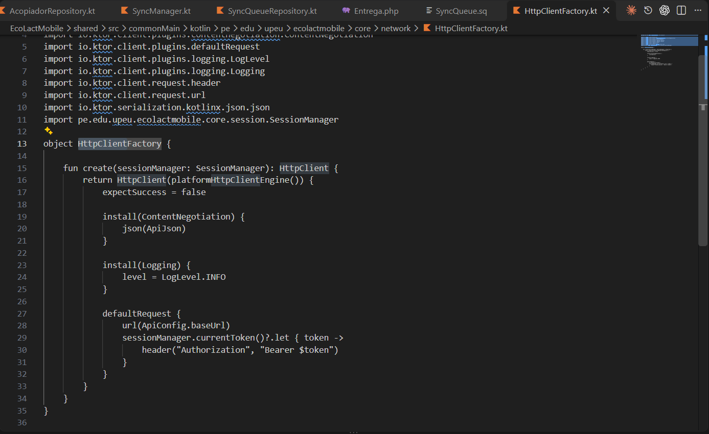
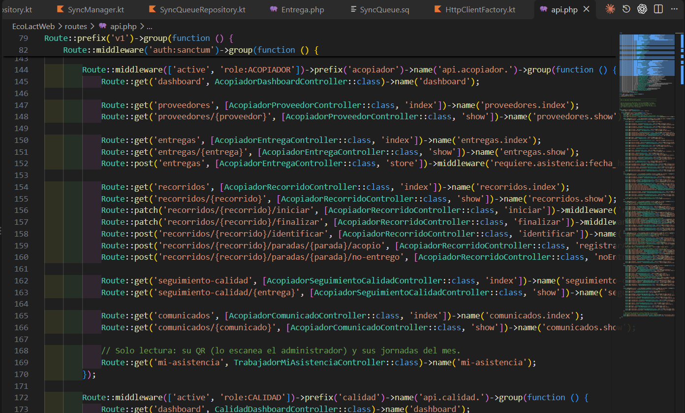

<div class="ec-arquitectura" markdown="1">
<div class="ec-arch-banner" markdown="1">

:material-api: 08 · Comunicación mediante API REST

</div>
<div class="ec-arch-content" markdown="1">

<span class="ec-arch-kicker">EcoLact / Arquitectura de software</span>

# Comunicación mediante API REST

<p class="ec-arch-subtitle">Un contrato HTTP y JSON entre móvil y servidor</p>

La app usa Ktor para comunicarse con rutas versionadas de Laravel. Los endpoints adaptan las solicitudes al modelo del backend y devuelven datos o errores; no exponen acceso directo a la base de datos.

<div class="ec-arch-tech"><span>/api/v1</span><span>HTTP + JSON</span><span>Ktor Client</span><span>Roles</span></div>

## Recorrido de una solicitud API

La cadena muestra responsabilidades. Los middleware adicionales, como asistencia o idempotencia, dependen del endpoint. Las rutas `v1` de `routes/api.php` se montan bajo `/api` desde la configuración de Laravel.

<div class="ec-arch-diagram" markdown="1">



<div class="ec-arch-controls" markdown="1">

[Ampliar diagrama](../assets/diagrams/arquitectura/api-recorrido.svg)
[Fuente Mermaid](../assets/diagrams/arquitectura/api-recorrido.mmd)

</div>
<details markdown="1">
<summary>Consultar la fuente editable</summary>

```text
flowchart TB
  A[Aplicación KMP] --> K[Ktor Client]
  K --> API[API REST: /api/v1]
  API --> M[Middleware: sesión, estado y rol]
  M --> R[Form Request y autorización Gate]
  R --> C[Controller]
  C --> U[Use Case]
  U --> RE[Contrato Repository]
  RE --> E[Adaptador Eloquent]
  E --> DB[(Persistencia central)]
  C -. respuesta JSON y estado HTTP .-> K
  classDef default fill:#eaf3ff,stroke:#79a4df,color:#103b86,rx:7,ry:7;

```

</details>
</div>
## Organización y transporte

Existen grupos `admin`, `acopiador`, `calidad`, `planta`, `ventas` y `proveedor`, con restricciones de rol y estado de cuenta. Login está disponible antes de la autenticación; logout y me están bajo `auth:sanctum`. La existencia de un endpoint no demuestra una pantalla móvil equivalente.

`HttpClientFactory` configura el motor específico de plataforma, serialización JSON, URL base y Bearer desde SessionManager. Usa `expectSuccess = false`: las funciones de lectura de respuesta interpretan explícitamente el estado HTTP. Muchas respuestas se envuelven en `data`; otras operaciones devuelven solo `message`, por lo que existen `toEnvelopeData()` y `requireSuccess()`.

## Ejemplo real de contrato: registrar entrega

**Endpoint implementado:** `POST /api/v1/acopiador/entregas`. El siguiente ejemplo es ilustrativo: el DNI, la clave y el token son valores de ejemplo, no datos ni credenciales reales.

```http
POST /api/v1/acopiador/entregas
Authorization: Bearer TOKEN_DE_SESION
Content-Type: application/json
Accept: application/json
Idempotency-Key: ejemplo-operacion-local-001
```

```json
{
  "metodo_identificacion": "DNI",
  "identificador": "12345678",
  "litros": 12.5,
  "fecha_hora_evento": "2026-10-28T06:20:00-05:00",
  "observacion": "Ejemplo documental"
}
```

El identificador debe corresponder a un proveedor real y habilitado en una ejecución efectiva. El actor no se envía como `acopiador_user_id`: se obtiene del usuario autenticado. `StoreEntregaMovilRequest` toma la clave desde la cabecera y admite la hora del evento; la validación impone formato y límites antes del caso de uso.

Al aceptar, el controlador devuelve **201** con una entrega serializada dentro de `data`, que incluye su identificador, litros, estado y fechas. `fecha_hora` representa el evento de campo; `fecha_registro`, su llegada al servidor. El ejemplo no se ejecutó contra el sistema.

## Errores que la app puede interpretar
<div class="ec-arch-table" markdown="1">

| HTTP | Interpretación en el cliente |
| --- | --- |
| 401 | No autorizado: clase Unauthorized |
| 403 | Prohibido; puede incluir el código ASISTENCIA_REQUERIDA |
| 404 | Recurso no encontrado |
| 409 | Conflicto |
| 422 | Validación, con mensaje y errores por campo cuando existen |
| 5xx | Error de servidor |
| Otros no exitosos | Error Unknown según el adaptador |

</div>
La API de entregas convierte DomainException e InvalidArgumentException a 422. No se generaliza ese mapeo a todas las rutas: el manejador de sincronización de cada funcionalidad determina qué resultado va a revisión o a reintento. Versionar y centralizar el transporte reduce acoplamiento, pero no elimina la necesidad de mantener compatibles los contratos JSON.


## Evidencias de implementación

Las referencias identifican código revisado. El área de imagen está preparada para la captura manual del archivo indicado; el marcador visual no constituye una captura de la implementación.

<section class="ec-arch-evidence" markdown="1">
<div class="ec-arch-evidence-body" markdown="1">

### Cliente HTTP compartido

La fábrica configura el motor de plataforma, JSON y la cabecera de la sesión actual.

</div>
<div class="ec-arch-evidence-image" markdown="1">

[](../assets/images/arquitectura/codigo/api-ktor.png)

</div>
<div class="ec-arch-evidence-body" markdown="1">

**Qué demuestra.** Ktor concentra configuración de transporte. La autorización Bearer se añade desde SessionManager.

<div class="ec-arch-file" markdown="1">

Archivo de imagen: `api-ktor.png` · [Abrir imagen](../assets/images/arquitectura/codigo/api-ktor.png)

**Ubicación en GitHub:** [EcoLactMobile/shared/src/commonMain/kotlin/pe/edu/upeu/ecolactmobile/core/network/HttpClientFactory.kt](https://github.com/MilkonMamani/EcoLact/blob/75901337489dbe3c61bf5e95357ea365790ab565/EcoLactMobile/shared/src/commonMain/kotlin/pe/edu/upeu/ecolactmobile/core/network/HttpClientFactory.kt#L15-L35)

Fragmento sugerido para la captura: líneas 15–35 de la revisión documentada.

</div>
</div>
</section>

<section class="ec-arch-evidence" markdown="1">
<div class="ec-arch-evidence-body" markdown="1">

### Rutas versionadas por rol

La API agrupa endpoints del acopiador y protege sus escrituras con la comprobación de asistencia.

</div>
<div class="ec-arch-evidence-image" markdown="1">

[](../assets/images/arquitectura/codigo/api-rutas.png)

</div>
<div class="ec-arch-evidence-body" markdown="1">

**Qué demuestra.** El registro de entregas existe dentro del prefijo v1, bajo autenticación y restricciones de rol.

<div class="ec-arch-file" markdown="1">

Archivo de imagen: `api-rutas.png` · [Abrir imagen](../assets/images/arquitectura/codigo/api-rutas.png)

**Ubicación en GitHub:** [EcoLactWeb/routes/api.php](https://github.com/MilkonMamani/EcoLact/blob/75901337489dbe3c61bf5e95357ea365790ab565/EcoLactWeb/routes/api.php#L144-L162)

Fragmento sugerido para la captura: líneas 144–162 de la revisión documentada.

</div>
</div>
</section>


<details class="ec-arch-sources" markdown="1">
<summary>Fuentes adicionales y alcance de la revisión</summary>

Revisión estática del repositorio local: 28 de octubre de 2026. Enlaces a la revisión `75901337489d`; la existencia de cada archivo y los fragmentos sugeridos se comprobaron localmente. No se ejecutaron servicios de negocio ni se verificó un despliegue.

- [EcoLactWeb/routes/api.php](https://github.com/MilkonMamani/EcoLact/blob/75901337489dbe3c61bf5e95357ea365790ab565/EcoLactWeb/routes/api.php)
- [EcoLactWeb/bootstrap/app.php](https://github.com/MilkonMamani/EcoLact/blob/75901337489dbe3c61bf5e95357ea365790ab565/EcoLactWeb/bootstrap/app.php)
- [EcoLactWeb/app/Http/Requests/Entrega/StoreEntregaMovilRequest.php](https://github.com/MilkonMamani/EcoLact/blob/75901337489dbe3c61bf5e95357ea365790ab565/EcoLactWeb/app/Http/Requests/Entrega/StoreEntregaMovilRequest.php)
- [EcoLactWeb/app/Http/Controllers/Api/Acopiador/EntregaController.php](https://github.com/MilkonMamani/EcoLact/blob/75901337489dbe3c61bf5e95357ea365790ab565/EcoLactWeb/app/Http/Controllers/Api/Acopiador/EntregaController.php)
- [EcoLactWeb/app/Http/Controllers/Api/Acopiador/Concerns/SerializaEntregasAcopiador.php](https://github.com/MilkonMamani/EcoLact/blob/75901337489dbe3c61bf5e95357ea365790ab565/EcoLactWeb/app/Http/Controllers/Api/Acopiador/Concerns/SerializaEntregasAcopiador.php)
- [EcoLactMobile/shared/src/commonMain/kotlin/pe/edu/upeu/ecolactmobile/feature/acopiador/AcopiadorApi.kt](https://github.com/MilkonMamani/EcoLact/blob/75901337489dbe3c61bf5e95357ea365790ab565/EcoLactMobile/shared/src/commonMain/kotlin/pe/edu/upeu/ecolactmobile/feature/acopiador/AcopiadorApi.kt)
- [EcoLactMobile/shared/src/commonMain/kotlin/pe/edu/upeu/ecolactmobile/core/network/ApiResponseHandling.kt](https://github.com/MilkonMamani/EcoLact/blob/75901337489dbe3c61bf5e95357ea365790ab565/EcoLactMobile/shared/src/commonMain/kotlin/pe/edu/upeu/ecolactmobile/core/network/ApiResponseHandling.kt)

</details>

<div class="ec-arch-links" markdown="1">

[← Persistencia y bases de datos](base-datos.md)

[Vista general](index.md)

[Autenticación y seguridad →](seguridad.md)


</div>
</div>
</div>
