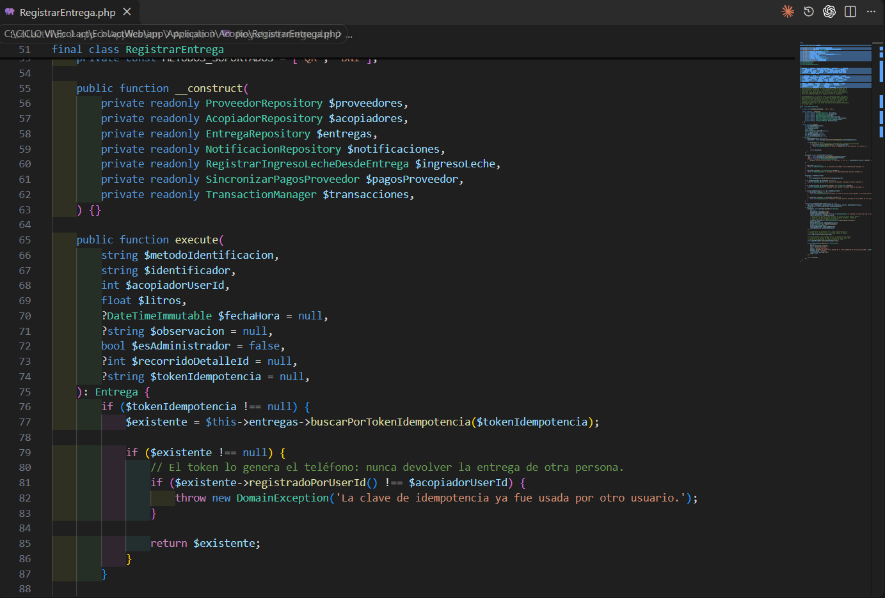
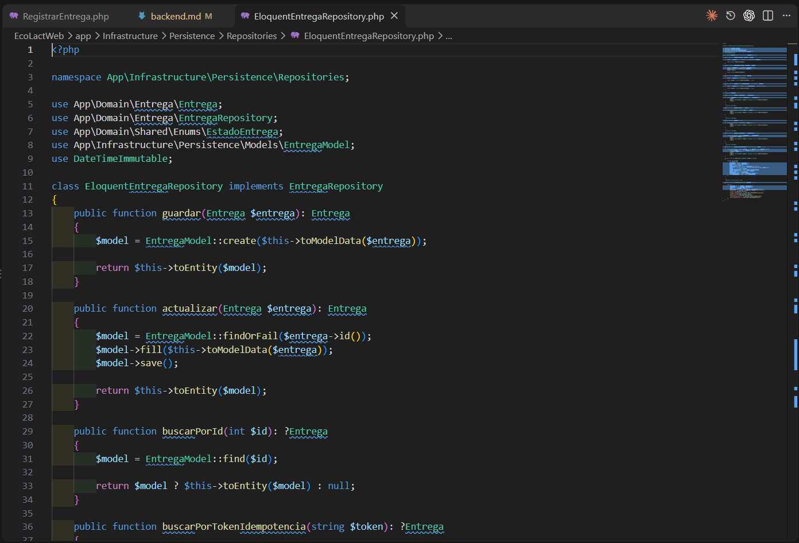

<div class="ec-arquitectura" markdown="1">
<div class="ec-arch-banner" markdown="1">

:material-layers-triple: 02 · Clean Architecture en Laravel

</div>
<div class="ec-arch-content" markdown="1">

<span class="ec-arch-kicker">EcoLact / Arquitectura de software</span>

# Clean Architecture en Laravel

<p class="ec-arch-subtitle">Reglas de negocio detrás de contratos</p>

La organización de EcoLact aplica principios de Clean Architecture: el código que coordina una entrega depende de entidades y contratos, mientras Eloquent resuelve la persistencia. La frontera es útil para compartir operaciones entre web y móvil sin repetir sus reglas.

<div class="ec-arch-tech"><span>Presentación</span><span>Application</span><span>Domain</span><span>Infrastructure</span></div>

<div class="ec-arch-layers" markdown="1">

<div class="ec-arch-card blue" markdown="1">

:material-web:

### Presentación

Controladores, Form Requests, rutas y serialización. Interpretan HTTP, autorizan la acción y preparan HTML o JSON.

</div>

<div class="ec-arch-card green" markdown="1">

:material-cog-outline:

### Aplicación

Los casos de uso coordinan permisos de negocio, entidades, transacciones y operaciones relacionadas.

</div>

<div class="ec-arch-card purple" markdown="1">

:material-cube-outline:

### Dominio

Entidades, enumeraciones y contratos representan el negocio, sus estados y restricciones.

</div>

<div class="ec-arch-card orange" markdown="1">

:material-database:

### Infraestructura

Modelos y repositorios Eloquent, adaptación de datos y transacciones Laravel implementan los contratos.

</div>

</div>
## Recorrido de una solicitud de entrega

**Estas flechas representan llamadas y resultados durante la ejecución.** RegistrarEntrega valida proveedor, acopiador y alcance de la operación. Su transacción incluye entrega, ingreso de leche, sincronización del pago pendiente y notificación.

<div class="ec-arch-diagram" markdown="1">



<div class="ec-arch-controls" markdown="1">

[Ampliar diagrama](../assets/diagrams/arquitectura/backend-ejecucion.svg)
[Fuente Mermaid](../assets/diagrams/arquitectura/backend-ejecucion.mmd)

</div>
<details markdown="1">
<summary>Consultar la fuente editable</summary>

```text
flowchart TB
  H[Solicitud Web o API] --> R[Form Request: validar formato]
  R --> C[Controller: Gate y actor autenticado]
  C --> U[RegistrarEntrega: reglas y coordinación]
  U --> D[Entidad Entrega: invariantes]
  U --> T[TransactionManager: unidad transaccional]
  T --> E[EloquentEntregaRepository: persistir]
  E --> DB[(Base central)]
  T --> I[Ingreso de leche, pendiente y notificación]
  DB --> O[Entidad resultante]
  O --> S[Controller: respuesta HTML o JSON]
  classDef default fill:#eaf3ff,stroke:#79a4df,color:#103b86,rx:7,ry:7;

```

</details>
</div>
## Inversión de dependencias

**Aquí las flechas representan dependencias del código, no el orden temporal.** La infraestructura implementa el contrato definido hacia el núcleo. En ejecución el caso de uso recibe el adaptador concreto mediante la vinculación de AppServiceProvider.

<div class="ec-arch-diagram" markdown="1">



<div class="ec-arch-controls" markdown="1">

[Ampliar diagrama](../assets/diagrams/arquitectura/backend-dependencias.svg)
[Fuente Mermaid](../assets/diagrams/arquitectura/backend-dependencias.mmd)

</div>
<details markdown="1">
<summary>Consultar la fuente editable</summary>

```text
flowchart TB
  C[Controlador HTTP] -->|usa| U[Application: RegistrarEntrega]
  U -->|depende del contrato| I[Domain: EntregaRepository]
  U -->|crea y utiliza| D[Domain: Entrega]
  E[Infrastructure: EloquentEntregaRepository] -->|implementa| I
  E -->|adapta| D
  E --> M[Modelo Eloquent]
  P[AppServiceProvider] -. vincula contrato e implementación .-> I
  P -. registra adaptador .-> E
  classDef default fill:#eaf3ff,stroke:#79a4df,color:#103b86,rx:7,ry:7;

```

</details>
</div>
## RegistrarEntrega como ejemplo verificable

1. El controlador obtiene el actor desde la sesión, valida la entrada y autoriza la acción con Gate.
2. El caso de uso busca al proveedor por QR o DNI, comprueba estados y aplica las reglas de zona o el contexto del recorrido.
3. La entidad impide una entrega con litros no positivos. El caso de uso no confía solo en el formulario.
4. Los repositorios guardan los datos a través de sus contratos. `LaravelTransactionManager` adapta el contrato de transacción a `DB::transaction`.
5. El controlador web redirige al historial; el de API serializa la entidad en JSON. La operación de negocio es compartida.

## Qué problema resuelve la separación

Cambiar una respuesta JSON no exige reescribir las reglas de acopio. Una prueba puede sustituir un contrato por un doble, y la persistencia puede evolucionar sin obligar al caso de uso a crear modelos Eloquent. Son ventajas de diseño; esta revisión no ejecuta pruebas de negocio ni demuestra independencia absoluta de todo el framework.
<div class="ec-arch-note warning" markdown="1">

**Una aplicación de principios, no una pureza absoluta.** RegistrarEntrega utiliza el helper `now()` de Laravel. Otros casos de uso, como RegistrarAsistenciaQr, importan excepciones de Illuminate. Además, algunas consultas de presentación usan modelos directamente. Por ello se describe una separación pragmática de responsabilidades, no un núcleo completamente ajeno al framework.

</div>


## Evidencias de implementación

Las referencias identifican código revisado. El área de imagen está preparada para la captura manual del archivo indicado; el marcador visual no constituye una captura de la implementación.

<section class="ec-arch-evidence" markdown="1">
<div class="ec-arch-evidence-body" markdown="1">

### Un caso de uso para registrar la entrega

La operación recibe sus dependencias mediante contratos y coordina las reglas de acopio.

</div>
<div class="ec-arch-evidence-image" markdown="1">

[](../assets/images/arquitectura/codigo/backend-caso-uso.png)

</div>
<div class="ec-arch-evidence-body" markdown="1">

**Qué demuestra.** La aplicación conoce los contratos del negocio; no necesita construir un modelo Eloquent para expresar la operación.

<div class="ec-arch-file" markdown="1">

</div>
</div>
</section>

<section class="ec-arch-evidence" markdown="1">
<div class="ec-arch-evidence-body" markdown="1">

### Adaptador de persistencia Eloquent

El repositorio convierte una entidad de dominio en datos persistibles y devuelve una entidad.

</div>
<div class="ec-arch-evidence-image" markdown="1">

[](../assets/images/arquitectura/codigo/backend-repositorio.png)

</div>
<div class="ec-arch-evidence-body" markdown="1">

**Qué demuestra.** EloquentEntregaRepository implementa EntregaRepository. La tecnología de persistencia queda en el adaptador.

<div class="ec-arch-file" markdown="1">


</div>
</div>
</section>


<details class="ec-arch-sources" markdown="1">
<summary>Fuentes adicionales y alcance de la revisión</summary>

Revisión estática del repositorio local: 28 de octubre de 2026. Enlaces a la revisión `75901337489d`; la existencia de cada archivo y los fragmentos sugeridos se comprobaron localmente. No se ejecutaron servicios de negocio ni se verificó un despliegue.

- [EcoLactWeb/app/Domain/Entrega/EntregaRepository.php](https://github.com/MilkonMamani/EcoLact/blob/75901337489dbe3c61bf5e95357ea365790ab565/EcoLactWeb/app/Domain/Entrega/EntregaRepository.php)
- [EcoLactWeb/app/Providers/AppServiceProvider.php](https://github.com/MilkonMamani/EcoLact/blob/75901337489dbe3c61bf5e95357ea365790ab565/EcoLactWeb/app/Providers/AppServiceProvider.php)
- [EcoLactWeb/app/Application/Shared/TransactionManager.php](https://github.com/MilkonMamani/EcoLact/blob/75901337489dbe3c61bf5e95357ea365790ab565/EcoLactWeb/app/Application/Shared/TransactionManager.php)
- [EcoLactWeb/app/Infrastructure/Persistence/LaravelTransactionManager.php](https://github.com/MilkonMamani/EcoLact/blob/75901337489dbe3c61bf5e95357ea365790ab565/EcoLactWeb/app/Infrastructure/Persistence/LaravelTransactionManager.php)
- [EcoLactWeb/app/Http/Requests/Entrega/StoreEntregaRequest.php](https://github.com/MilkonMamani/EcoLact/blob/75901337489dbe3c61bf5e95357ea365790ab565/EcoLactWeb/app/Http/Requests/Entrega/StoreEntregaRequest.php)
- [EcoLactWeb/app/Application/Pago/RegistrarAsistenciaQr.php](https://github.com/MilkonMamani/EcoLact/blob/75901337489dbe3c61bf5e95357ea365790ab565/EcoLactWeb/app/Application/Pago/RegistrarAsistenciaQr.php)

</details>

<div class="ec-arch-links" markdown="1">

[← Arquitectura de EcoLact](index.md)

[Vista general](index.md)

[Arquitectura móvil: KMP y MVVM →](mobile.md)


</div>
</div>
</div>
