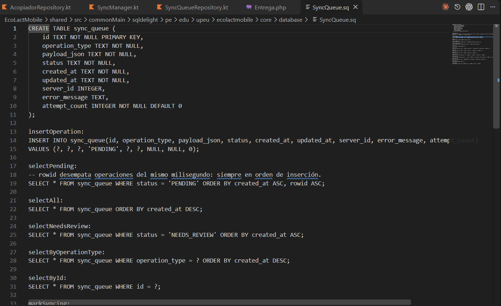

<div class="ec-arquitectura" markdown="1">
<div class="ec-arch-banner" markdown="1">

:material-database: 07 · Persistencia y bases de datos

</div>
<div class="ec-arch-content" markdown="1">

<span class="ec-arch-kicker">EcoLact / Arquitectura de software</span>

# Persistencia y bases de datos

<p class="ec-arch-subtitle">Base central y copia local con responsabilidades distintas</p>

El servidor conserva las operaciones aceptadas del negocio; el teléfono conserva datos útiles para trabajar y operaciones que aún debe enviar. Esta separación responde a necesidades distintas y no implica dos bases de datos idénticas.

<div class="ec-arch-tech"><span>MySQL previsto</span><span>SQLite móvil</span><span>SQLDelight</span><span>Transacciones</span></div>

<div class="ec-arch-grid" markdown="1">

<div class="ec-arch-card blue" markdown="1">

:material-database:

### MySQL · Servidor

Modelo central previsto: registros y relaciones de negocio, operaciones confirmadas y consultas administrativas. Laravel accede mediante repositorios y consultas de infraestructura.

</div>

<div class="ec-arch-card green" markdown="1">

:material-cellphone:

### SQLite / SQLDelight · Móvil

Caché y datos descargados, sesión local, borradores y operaciones pendientes con sus estados. Los drivers abren `ecolact.db` en el dispositivo.

</div>

</div>
## Cómo viajan y se conservan los datos

Los tres bloques SQLite representan responsabilidades dentro de la base local, no tres servidores. La copia se actualiza mediante respuestas API; no existe una flecha de replicación SQL directa entre bases.

<div class="ec-arch-diagram" markdown="1">



<div class="ec-arch-controls" markdown="1">

[Ampliar diagrama](../assets/diagrams/arquitectura/persistencia.svg)
[Fuente Mermaid](../assets/diagrams/arquitectura/persistencia.mmd)

</div>
<details markdown="1">
<summary>Consultar la fuente editable</summary>

```text
flowchart TB
  UI[Compose: consultas y eventos] --> R[Repositorios móviles]
  R --> CACHE[(SQLite: copias y caché)]
  R --> QUEUE[(SQLite: sync_queue)]
  SES[SessionManager] --> SESSION[(SQLite: session)]
  QUEUE --> S[SyncManager y Ktor]
  S --> API[API Laravel: validación]
  API --> U[Casos de uso y repositorios Eloquent]
  U --> CENTRAL[(Base central: MySQL previsto)]
  CENTRAL --> JSON[Respuesta JSON de consultas]
  JSON --> CACHE
  CACHE -. Flow observable .-> UI
  classDef default fill:#eaf3ff,stroke:#79a4df,color:#103b86,rx:7,ry:7;

```

</details>
</div>
## Qué se almacena localmente
<div class="ec-arch-table" markdown="1">

| Recurso SQLDelight | Contenido y función |
| --- | --- |
| `CacheEntry.sq` | Respuesta JSON por clave y fecha `cached_at` |
| `Entrega.sq`, `Proveedor.sq` y otros esquemas | Datos locales de entidades para consulta; su uso concreto depende del repositorio de cada funcionalidad |
| `SyncQueue.sq` | Clave local, tipo, payload, estado, fechas, server_id, error y attempt_count |
| `Session.sq` | Token y datos mínimos de la sesión restaurable |
| Esquemas de borradores de calidad y compras | Trabajo local aún no confirmado |

</div>
SQLDelight genera la API de consultas a partir de archivos `.sq`. La aplicación define `EcoLactDatabase` en Gradle y usa drivers diferentes por plataforma: AndroidSqliteDriver y NativeSqliteDriver. No se trata de un ORM Eloquent ejecutándose en el teléfono.

## Consistencia y responsabilidades

Una operación guardada en la cola es durable localmente, pero todavía no forma parte del registro central confirmado. Su identificador local y `server_id` cumplen funciones distintas. La caché puede estar desactualizada; una copia de una respuesta no sustituye a las reglas del servidor ni reserva definitivamente stock.

En Laravel, los repositorios transforman entidades y modelos. Las transacciones agrupan efectos relacionados, como entrega e ingreso de leche. Índices únicos apoyan restricciones como el token de entrega y la única selección de análisis por entrega. Las migraciones describen la evolución del modelo; un SQL de referencia anterior no sustituye revisar esa evolución.
<div class="ec-arch-note warning" markdown="1">

**Configuración comprobada, despliegue no inspeccionado.** Existe una conexión `mysql` y el archivo `EcoLact_BD_v1_MySQL.sql`; el valor por defecto de `DB_CONNECTION` en el código es `sqlite`. No se afirma qué motor está usando una instalación concreta. No se ejecutaron migraciones ni se leyeron archivos `.env`.

</div>
## Por qué dos persistencias

La base central permite reunir y relacionar operaciones de varios usuarios. SQLite evita perder disponibilidad local al desaparecer la señal. Separarlas evita exigir a un teléfono toda la información administrativa y permite que el servidor mantenga la decisión final sobre los registros aceptados. El coste es gestionar antigüedad de caché, pendientes, rechazos y actualizaciones de esquemas.


## Evidencias de implementación

Las referencias identifican código revisado. El área de imagen está preparada para la captura manual del archivo indicado; el marcador visual no constituye una captura de la implementación.

<section class="ec-arch-evidence" markdown="1">
<div class="ec-arch-evidence-body" markdown="1">

### Esquema y operaciones SQL de la cola

La tabla local guarda el payload, el estado, el identificador del servidor y el contador de intentos.

</div>
<div class="ec-arch-evidence-image" markdown="1">

[](../assets/images/arquitectura/codigo/bd-sqldelight.png)

</div>
<div class="ec-arch-evidence-body" markdown="1">

**Qué demuestra.** Los pendientes son registros SQLite durables; no una lista mantenida solo en memoria.

<div class="ec-arch-file" markdown="1">

Archivo de imagen: `bd-sqldelight.png` · [Abrir imagen](../assets/images/arquitectura/codigo/bd-sqldelight.png)

**Ubicación en GitHub:** [EcoLactMobile/shared/src/commonMain/sqldelight/pe/edu/upeu/ecolactmobile/core/database/SyncQueue.sq](https://github.com/MilkonMamani/EcoLact/blob/75901337489dbe3c61bf5e95357ea365790ab565/EcoLactMobile/shared/src/commonMain/sqldelight/pe/edu/upeu/ecolactmobile/core/database/SyncQueue.sq#L1-L21)

Fragmento sugerido para la captura: líneas 1–21 de la revisión documentada.

</div>
</div>
</section>


<details class="ec-arch-sources" markdown="1">
<summary>Fuentes adicionales y alcance de la revisión</summary>

Revisión estática del repositorio local: 28 de octubre de 2026. Enlaces a la revisión `75901337489d`; la existencia de cada archivo y los fragmentos sugeridos se comprobaron localmente. No se ejecutaron servicios de negocio ni se verificó un despliegue.

- [EcoLactWeb/config/database.php](https://github.com/MilkonMamani/EcoLact/blob/75901337489dbe3c61bf5e95357ea365790ab565/EcoLactWeb/config/database.php)
- [EcoLactWeb/docs/database/EcoLact_BD_v1_MySQL.sql](https://github.com/MilkonMamani/EcoLact/blob/75901337489dbe3c61bf5e95357ea365790ab565/EcoLactWeb/docs/database/EcoLact_BD_v1_MySQL.sql)
- [EcoLactMobile/shared/src/commonMain/sqldelight/pe/edu/upeu/ecolactmobile/core/database/CacheEntry.sq](https://github.com/MilkonMamani/EcoLact/blob/75901337489dbe3c61bf5e95357ea365790ab565/EcoLactMobile/shared/src/commonMain/sqldelight/pe/edu/upeu/ecolactmobile/core/database/CacheEntry.sq)
- [EcoLactMobile/shared/src/commonMain/sqldelight/pe/edu/upeu/ecolactmobile/core/database/Entrega.sq](https://github.com/MilkonMamani/EcoLact/blob/75901337489dbe3c61bf5e95357ea365790ab565/EcoLactMobile/shared/src/commonMain/sqldelight/pe/edu/upeu/ecolactmobile/core/database/Entrega.sq)
- [EcoLactMobile/shared/src/commonMain/sqldelight/pe/edu/upeu/ecolactmobile/core/database/Session.sq](https://github.com/MilkonMamani/EcoLact/blob/75901337489dbe3c61bf5e95357ea365790ab565/EcoLactMobile/shared/src/commonMain/sqldelight/pe/edu/upeu/ecolactmobile/core/database/Session.sq)
- [EcoLactMobile/shared/build.gradle.kts](https://github.com/MilkonMamani/EcoLact/blob/75901337489dbe3c61bf5e95357ea365790ab565/EcoLactMobile/shared/build.gradle.kts)
- [EcoLactMobile/shared/src/androidMain/kotlin/pe/edu/upeu/ecolactmobile/core/database/DatabaseDriverFactory.android.kt](https://github.com/MilkonMamani/EcoLact/blob/75901337489dbe3c61bf5e95357ea365790ab565/EcoLactMobile/shared/src/androidMain/kotlin/pe/edu/upeu/ecolactmobile/core/database/DatabaseDriverFactory.android.kt)
- [EcoLactMobile/shared/src/iosMain/kotlin/pe/edu/upeu/ecolactmobile/core/database/DatabaseDriverFactory.ios.kt](https://github.com/MilkonMamani/EcoLact/blob/75901337489dbe3c61bf5e95357ea365790ab565/EcoLactMobile/shared/src/iosMain/kotlin/pe/edu/upeu/ecolactmobile/core/database/DatabaseDriverFactory.ios.kt)

</details>

<div class="ec-arch-links" markdown="1">

[← Entidades y reglas de negocio](dominio.md)

[Vista general](index.md)

[Comunicación mediante API REST →](api.md)


</div>
</div>
</div>
