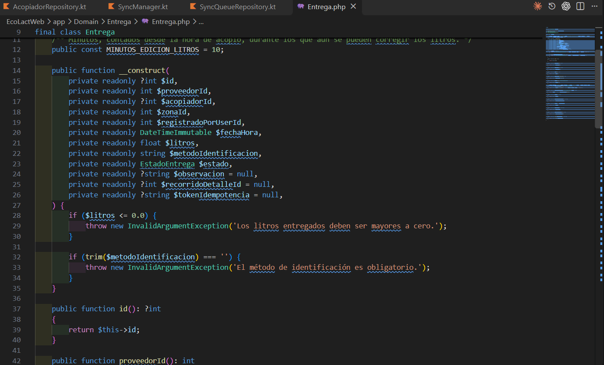

<div class="ec-arquitectura" markdown="1">
<div class="ec-arch-banner" markdown="1">

:material-cube-outline: 06 · Entidades y reglas de negocio

</div>
<div class="ec-arch-content" markdown="1">

<span class="ec-arch-kicker">EcoLact / Arquitectura de software</span>

# Entidades y reglas de negocio

<p class="ec-arch-subtitle">El lenguaje del centro de acopio en el código</p>

El dominio representa las personas, operaciones y restricciones del negocio lácteo. Una entidad tiene significado propio: una entrega no es solamente una fila de base de datos, y un pago no es solamente un importe mostrado en una pantalla.

<div class="ec-arch-tech"><span>Entidades</span><span>Invariantes</span><span>Contratos</span><span>Estados</span></div>

## Relaciones de acopio, calidad y pago

Las relaciones se sustentan en los identificadores de las entidades y en las restricciones de persistencia. Se incluyen Valorización y Detalle para no inventar una relación directa que omita cómo se enlazan entrega y liquidación. Una entrega puede existir sin análisis; `acopiadorId` es nullable.

<div class="ec-arch-diagram" markdown="1">



<div class="ec-arch-controls" markdown="1">

[Ampliar diagrama](../assets/diagrams/arquitectura/dominio-acopio.svg)
[Fuente Mermaid](../assets/diagrams/arquitectura/dominio-acopio.mmd)

</div>
<details markdown="1">
<summary>Consultar la fuente editable</summary>

```text
flowchart TB
  P[Proveedor] -->|realiza| E[Entrega]
  A[Acopiador] -->|registra cuando corresponde| E
  E -->|puede tener un análisis| C[Análisis de calidad]
  E -->|referenciada por| V[Valorización de entrega]
  C -. referencia opcional .-> V
  P -->|titular de| L[Liquidación]
  L -->|contiene| D[Detalle de liquidación]
  D -->|referencia| V
  L -->|referenciada por| PA[Pago de proveedor]
  classDef default fill:#eaf3ff,stroke:#79a4df,color:#103b86,rx:7,ry:7;

```

</details>
</div>
## Relaciones de producción

La receta describe requerimientos; el lote conserva consumos y cantidades realmente obtenidas. La leche es un insumo que entra por acopio. No se dibuja una asignación directa de entregas concretas a lotes: la migración correspondiente elimina ese enlace antiguo si está vacío.

<div class="ec-arch-diagram" markdown="1">



<div class="ec-arch-controls" markdown="1">

[Ampliar diagrama](../assets/diagrams/arquitectura/dominio-produccion.svg)
[Fuente Mermaid](../assets/diagrams/arquitectura/dominio-produccion.mmd)

</div>
<details markdown="1">
<summary>Consultar la fuente editable</summary>

```text
flowchart TB
  P[Producto] -->|tiene versiones de| R[Receta]
  R -->|define ingredientes mediante| RD[Detalle de receta]
  RD -->|referencia| I[Insumo]
  L[Lote de producción] -->|guarda consumos en| LI[LoteProduccionInsumo]
  LI -->|referencia| I
  L -->|planifica y obtiene mediante| PD[ProduccionDetalle]
  PD -->|referencia| P
  PD -. conserva receta y versión utilizadas .-> R
  classDef default fill:#eaf3ff,stroke:#79a4df,color:#103b86,rx:7,ry:7;

```

</details>
</div>
## Responsabilidades de las entidades
<div class="ec-arch-table" markdown="1">

| Concepto | Significado y regla relevante |
| --- | --- |
| Proveedor y Acopiador | Identidad, estado y contexto de participación en acopio |
| Entrega | Litros, fecha, actor, proveedor y estado; cantidad positiva |
| Análisis de calidad | Mediciones y resultado; al confirmar queda inmutable |
| Liquidación y Pago | Cálculo del periodo y registro del desembolso son conceptos distintos |
| Insumo y Receta | Existencias y requerimientos por producto y versión |
| Lote y Producto | Ejecución productiva y resultado disponible para ventas |

</div>
## Una regla que no depende de la pantalla

El constructor de `Entrega` rechaza litros menores o iguales a cero y un método de identificación vacío. Esa restricción se ejecuta al crear la entidad, aunque la petición provenga de web, app o una prueba. La entidad también expresa la ventana de edición de litros mediante `permiteEditarLitros()` y la constante de diez minutos.

La entidad no decide todo por sí sola. Comprobar que un proveedor está activo o que el acopiador puede operar en su zona exige consultar otros registros; `RegistrarEntrega` coordina esas reglas. Los Form Requests validan formato, las Policies autorizan acciones y los casos de uso orquestan la operación. Esta distribución evita atribuir toda la lógica a una sola clase.

El modelo de dominio tampoco es un esquema físico completo. Se omiten tablas auxiliares, consultas y detalles administrativos para mostrar únicamente relaciones relevantes y confirmadas. Los repositorios del dominio definen contratos; las entidades del ejemplo no heredan de Eloquent.


## Evidencias de implementación

Las referencias identifican código revisado. El área de imagen está preparada para la captura manual del archivo indicado; el marcador visual no constituye una captura de la implementación.

<section class="ec-arch-evidence" markdown="1">
<div class="ec-arch-evidence-body" markdown="1">

### La entidad protege sus invariantes

Entrega expresa litros, actor, proveedor, fecha y estado como conceptos del negocio.

</div>
<div class="ec-arch-evidence-image" markdown="1">

[](../assets/images/arquitectura/codigo/dominio-entrega.png)

</div>
<div class="ec-arch-evidence-body" markdown="1">

**Qué demuestra.** Su constructor impide litros no positivos y un método de identificación vacío, sin depender de HTTP o Eloquent.

<div class="ec-arch-file" markdown="1">

Archivo de imagen: `dominio-entrega.png` · [Abrir imagen](../assets/images/arquitectura/codigo/dominio-entrega.png)

**Ubicación en GitHub:** [EcoLactWeb/app/Domain/Entrega/Entrega.php](https://github.com/MilkonMamani/EcoLact/blob/75901337489dbe3c61bf5e95357ea365790ab565/EcoLactWeb/app/Domain/Entrega/Entrega.php#L14-L37)

Fragmento sugerido para la captura: líneas 14–37 de la revisión documentada.

</div>
</div>
</section>


<details class="ec-arch-sources" markdown="1">
<summary>Fuentes adicionales y alcance de la revisión</summary>

Revisión estática del repositorio local: 28 de octubre de 2026. Enlaces a la revisión `75901337489d`; la existencia de cada archivo y los fragmentos sugeridos se comprobaron localmente. No se ejecutaron servicios de negocio ni se verificó un despliegue.

- [EcoLactWeb/app/Domain/Entrega/Entrega.php](https://github.com/MilkonMamani/EcoLact/blob/75901337489dbe3c61bf5e95357ea365790ab565/EcoLactWeb/app/Domain/Entrega/Entrega.php)
- [EcoLactWeb/app/Domain/Calidad/AnalisisCalidad.php](https://github.com/MilkonMamani/EcoLact/blob/75901337489dbe3c61bf5e95357ea365790ab565/EcoLactWeb/app/Domain/Calidad/AnalisisCalidad.php)
- [EcoLactWeb/app/Domain/Pago/ValorizacionEntrega.php](https://github.com/MilkonMamani/EcoLact/blob/75901337489dbe3c61bf5e95357ea365790ab565/EcoLactWeb/app/Domain/Pago/ValorizacionEntrega.php)
- [EcoLactWeb/app/Domain/Pago/LiquidacionDetalle.php](https://github.com/MilkonMamani/EcoLact/blob/75901337489dbe3c61bf5e95357ea365790ab565/EcoLactWeb/app/Domain/Pago/LiquidacionDetalle.php)
- [EcoLactWeb/app/Domain/Pago/PagoProveedor.php](https://github.com/MilkonMamani/EcoLact/blob/75901337489dbe3c61bf5e95357ea365790ab565/EcoLactWeb/app/Domain/Pago/PagoProveedor.php)
- [EcoLactWeb/app/Domain/Produccion/Receta.php](https://github.com/MilkonMamani/EcoLact/blob/75901337489dbe3c61bf5e95357ea365790ab565/EcoLactWeb/app/Domain/Produccion/Receta.php)
- [EcoLactWeb/app/Domain/Produccion/RecetaDetalle.php](https://github.com/MilkonMamani/EcoLact/blob/75901337489dbe3c61bf5e95357ea365790ab565/EcoLactWeb/app/Domain/Produccion/RecetaDetalle.php)
- [EcoLactWeb/app/Domain/Produccion/ProduccionDetalle.php](https://github.com/MilkonMamani/EcoLact/blob/75901337489dbe3c61bf5e95357ea365790ab565/EcoLactWeb/app/Domain/Produccion/ProduccionDetalle.php)
- [EcoLactWeb/app/Domain/Produccion/LoteProduccionInsumo.php](https://github.com/MilkonMamani/EcoLact/blob/75901337489dbe3c61bf5e95357ea365790ab565/EcoLactWeb/app/Domain/Produccion/LoteProduccionInsumo.php)
- [EcoLactWeb/database/migrations/2026_09_21_100009_drop_lote_produccion_entregas_table.php](https://github.com/MilkonMamani/EcoLact/blob/75901337489dbe3c61bf5e95357ea365790ab565/EcoLactWeb/database/migrations/2026_09_21_100009_drop_lote_produccion_entregas_table.php)

</details>

<div class="ec-arch-links" markdown="1">

[← Sincronización de datos](sincronizacion.md)

[Vista general](index.md)

[Persistencia y bases de datos →](base-datos.md)


</div>
</div>
</div>
