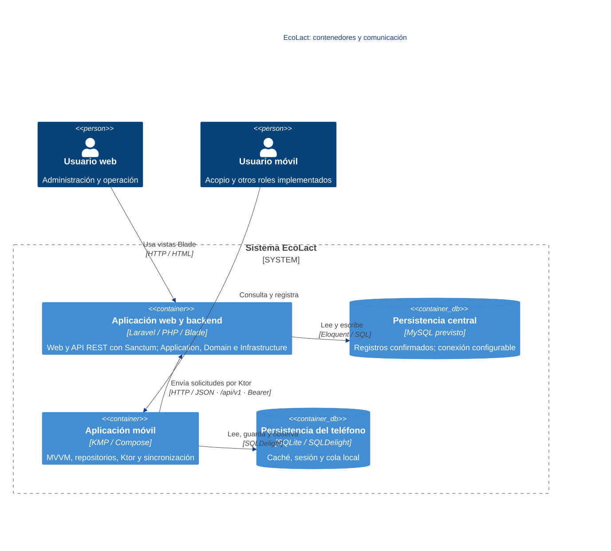
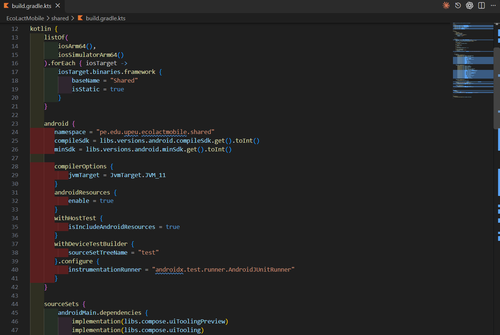

<div class="ec-arquitectura" markdown="1">
<div class="ec-arch-banner" markdown="1">

:material-sitemap: 01 · Arquitectura de EcoLact

</div>
<div class="ec-arch-content" markdown="1">

<span class="ec-arch-kicker">EcoLact / Arquitectura de software</span>

# Arquitectura de EcoLact

<p class="ec-arch-subtitle">Un núcleo de negocio, dos formas de trabajar</p>

EcoLact combina una aplicación Laravel con interfaz web y API, y una aplicación móvil Kotlin Multiplatform con almacenamiento local. El servidor decide qué operaciones son válidas; el teléfono puede conservar información y ciertas escrituras cuando la señal no acompaña el trabajo de campo.

<div class="ec-arch-tech"><span>Cliente–servidor</span><span>Laravel + Blade</span><span>KMP</span><span>API REST</span><span>Persistencia local</span></div>

## Vista C4 de contenedores

La web Blade y la API son entradas del **mismo contenedor Laravel**; no son microservicios separados. Application, Domain e Infrastructure son capas de código dentro de él. El navegador recibe HTML; la app móvil intercambia JSON y mantiene su propia base local.

<div class="ec-arch-diagram" markdown="1">



<div class="ec-arch-controls" markdown="1">

[Ampliar diagrama](../assets/diagrams/arquitectura/contenedores.svg)
[Fuente Mermaid](../assets/diagrams/arquitectura/contenedores.mmd)

</div>
<details markdown="1">
<summary>Consultar la fuente editable</summary>

```text
C4Container
title EcoLact: contenedores y comunicación
Person(admin, "Usuario web", "Administración y operación")
Person(campo, "Usuario móvil", "Acopio y otros roles implementados")
System_Boundary(ecolact, "Sistema EcoLact") {
  Container(laravel, "Aplicación web y backend", "Laravel / PHP / Blade", "Web y API REST con Sanctum; Application, Domain e Infrastructure")
  ContainerDb(central, "Persistencia central", "MySQL previsto", "Registros confirmados; conexión configurable")
  Container(movil, "Aplicación móvil", "KMP / Compose", "MVVM, repositorios, Ktor y sincronización")
  ContainerDb(local, "Persistencia del teléfono", "SQLite / SQLDelight", "Caché, sesión y cola local")
}
Rel(admin, laravel, "Usa vistas Blade", "HTTP / HTML")
Rel(campo, movil, "Consulta y registra")
Rel(movil, laravel, "Envía solicitudes por Ktor", "HTTP / JSON · /api/v1 · Bearer")
Rel(laravel, central, "Lee y escribe", "Eloquent / SQL")
Rel(movil, local, "Lee, guarda y observa", "SQLDelight")
UpdateRelStyle(laravel, central, $offsetY="-30")
UpdateRelStyle(movil, local, $offsetY="-30")
UpdateRelStyle(campo, movil, $offsetX="85", $offsetY="-10")
UpdateLayoutConfig($c4ShapeInRow="2", $c4BoundaryInRow="1")
```

</details>
</div>
## Seis decisiones que organizan el sistema

<div class="ec-arch-grid" markdown="1">

<div class="ec-arch-card blue" markdown="1">

:material-layers-triple:

### Laravel y separación de responsabilidades

**Problema:** evitar reglas dispersas en cada controlador. Los casos de uso coordinan el negocio y los contratos separan persistencia. [Ver backend](backend.md).

</div>

<div class="ec-arch-card " markdown="1">

:material-cellphone-link:

### KMP y presentación MVVM

**Problema:** compartir lógica sin mezclar cada vista con acceso a datos. Compose observa estado y los repositorios coordinan fuentes. [Ver arquitectura móvil](mobile.md).

</div>

<div class="ec-arch-card green" markdown="1">

:material-database:

### MySQL y SQLite con funciones distintas

**Problema:** combinar registros centrales con autonomía del dispositivo. La base local conserva copias y pendientes, no replica todo el servidor. [Ver persistencia](base-datos.md).

</div>

<div class="ec-arch-card orange" markdown="1">

:material-wifi-off:

### Offline-first y Local-First

**Problema:** la conectividad intermitente puede interrumpir el acopio rural. Datos descargados y operaciones compatibles permanecen disponibles. [Ver offline-first](offline-first.md).

</div>

<div class="ec-arch-card purple" markdown="1">

:material-sync:

### Cola y sincronización diferida

**Problema:** una operación guardada en campo debe llegar al servidor sin ocultar rechazos ni duplicar los casos protegidos. [Ver sincronización](sincronizacion.md).

</div>

<div class="ec-arch-card " markdown="1">

:material-shield-lock:

### REST y Sanctum

**Problema:** comunicar el cliente móvil con identidad y permisos verificables. Ktor usa la API; middleware y Policies controlan el acceso. [Ver API](api.md) y [seguridad](seguridad.md).

</div>

</div>
<div class="ec-arch-note " markdown="1">

**Alcance de la explicación.** Las razones expuestas son una justificación técnica deducida de la implementación y del contexto de Huata, Puno. No se presenta como un acta histórica de decisiones del equipo. Se distingue lo implementado de lo configurado o todavía no verificado.

</div>
## Cómo se conectan los patrones

Cliente–servidor describe la distribución de responsabilidades. Clean Architecture orienta la organización interna de Laravel. MVVM estructura el estado y los eventos de la interfaz móvil. REST define el intercambio HTTP/JSON y Sanctum participa en la autenticación de la API. SQLDelight permite conservar datos SQLite en el dispositivo; la cola conecta las escrituras locales con el servidor cuando es posible.

El backend es modular dentro de una aplicación Laravel. No se ha identificado un despliegue por microservicios ni replicación directa entre MySQL y SQLite. La app nunca accede a la base central por SQL: utiliza la API.
<div class="ec-arch-note warning" markdown="1">

**MySQL es el modelo central previsto, no una conexión activa comprobada.** El repositorio incluye configuración MySQL y un esquema SQL de referencia, pero `config/database.php` usa SQLite como valor por defecto si no se indica conexión. No se leyeron archivos de entorno ni se consultó una base en ejecución.

</div>
## Continuar la lectura

[Entidades y reglas de negocio](dominio.md) explica qué modela el núcleo. [Integración Web, Móvil y Backend](integracion.md) sigue una entrega a través de las dos interfaces.


## Evidencias de implementación

Las referencias identifican código revisado. El área de imagen está preparada para la captura manual del archivo indicado; el marcador visual no constituye una captura de la implementación.

<section class="ec-arch-evidence" markdown="1">
<div class="ec-arch-evidence-body" markdown="1">

### Configuración del módulo compartido

Gradle declara los destinos Android e iOS y organiza dependencias compartidas y específicas.

</div>
<div class="ec-arch-evidence-image" markdown="1">

[](../assets/images/arquitectura/codigo/kmp-configuracion.png)

</div>
<div class="ec-arch-evidence-body" markdown="1">

**Qué demuestra.** La configuración habilita Kotlin Multiplatform; declarar un destino no acredita pruebas funcionales en ese dispositivo.

<div class="ec-arch-file" markdown="1">


</div>
</div>
</section>


<details class="ec-arch-sources" markdown="1">
<summary>Fuentes adicionales y alcance de la revisión</summary>

Revisión estática del repositorio local: 28 de octubre de 2026. Enlaces a la revisión `75901337489d`; la existencia de cada archivo y los fragmentos sugeridos se comprobaron localmente. No se ejecutaron servicios de negocio ni se verificó un despliegue.

- [EcoLactWeb/app/Providers/AppServiceProvider.php](https://github.com/MilkonMamani/EcoLact/blob/75901337489dbe3c61bf5e95357ea365790ab565/EcoLactWeb/app/Providers/AppServiceProvider.php)
- [EcoLactWeb/routes/web.php](https://github.com/MilkonMamani/EcoLact/blob/75901337489dbe3c61bf5e95357ea365790ab565/EcoLactWeb/routes/web.php)
- [EcoLactWeb/routes/api.php](https://github.com/MilkonMamani/EcoLact/blob/75901337489dbe3c61bf5e95357ea365790ab565/EcoLactWeb/routes/api.php)
- [EcoLactWeb/config/database.php](https://github.com/MilkonMamani/EcoLact/blob/75901337489dbe3c61bf5e95357ea365790ab565/EcoLactWeb/config/database.php)
- [EcoLactWeb/docs/database/EcoLact_BD_v1_MySQL.sql](https://github.com/MilkonMamani/EcoLact/blob/75901337489dbe3c61bf5e95357ea365790ab565/EcoLactWeb/docs/database/EcoLact_BD_v1_MySQL.sql)
- [EcoLactMobile/shared/src/commonMain/kotlin/pe/edu/upeu/ecolactmobile/di/AppContainer.kt](https://github.com/MilkonMamani/EcoLact/blob/75901337489dbe3c61bf5e95357ea365790ab565/EcoLactMobile/shared/src/commonMain/kotlin/pe/edu/upeu/ecolactmobile/di/AppContainer.kt)

</details>

<div class="ec-arch-links" markdown="1">

[Clean Architecture en Laravel →](backend.md)


</div>
</div>
</div>
