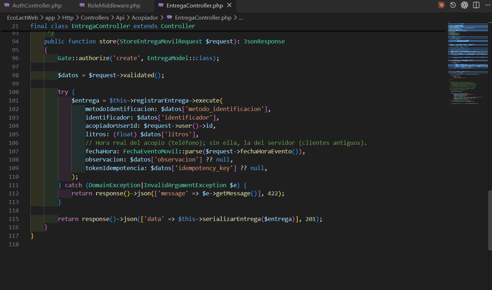

<div class="ec-arquitectura" markdown="1">
<div class="ec-arch-banner" markdown="1">

:material-lan-connect: 10 · Integración Web, Móvil y Backend

</div>
<div class="ec-arch-content" markdown="1">

<span class="ec-arch-kicker">EcoLact / Arquitectura de software</span>

# Integración Web, Móvil y Backend

<p class="ec-arch-subtitle">Dos interfaces, operaciones de negocio compartidas</p>

La web y la app tienen formas de interacción diferentes, pero convergen en casos de uso del backend. La separación permite mantener reglas centrales mientras la interfaz móvil incorpora almacenamiento local para el trabajo de campo.

<div class="ec-arch-tech"><span>Blade</span><span>API REST</span><span>Casos de uso</span><span>Consistencia diferida</span></div>

## Integración de extremo a extremo

Las flechas sólidas muestran interacción y circulación de información; la flecha discontinua señala una dependencia del código. La actualización de SQLite representa respuestas obtenidas mediante la API, no acceso directo de la base central al teléfono.

<div class="ec-arch-diagram" markdown="1">



<div class="ec-arch-controls" markdown="1">

[Ampliar diagrama](../assets/diagrams/arquitectura/integracion-completa.svg)
[Fuente Mermaid](../assets/diagrams/arquitectura/integracion-completa.mmd)

</div>
<details markdown="1">
<summary>Consultar la fuente editable</summary>

```text
flowchart TB
  W[Web: navegador y Blade] --> WC[Controlador Web]
  A[App KMP: Compose y estado] --> R[Repository móvil]
  R --> Q[(SQLite: caché y pendientes)]
  R --> K[Ktor: envío en línea]
  Q --> S[SyncManager: envío diferido]
  S --> API[API REST: controlador móvil]
  K --> API
  WC --> U[Application: casos de uso compartidos]
  API --> U
  U --> D[Domain: entidades y contratos]
  U --> E[Repositorios de infraestructura]
  E -. implementan contratos .-> D
  E --> DB[(Persistencia central)]
  DB --> C[Consultas del backend]
  C --> W
  C --> Q
  classDef default fill:#eaf3ff,stroke:#79a4df,color:#103b86,rx:7,ry:7;

```

</details>
</div>
## La misma entrega desde dos clientes

En la web, `Web/Acopiador/EntregaController::store` autoriza con Gate, toma datos validados y llama a `RegistrarEntrega`. En la API, `Api/Acopiador/EntregaController::store` utiliza el mismo caso de uso y añade el tratamiento de hora del evento e idempotencia móvil. El actor proviene de la sesión en ambos caminos.

La diferencia está en la adaptación: el controlador web redirige a una vista; el controlador API devuelve JSON y un estado HTTP. Los dos reutilizan las validaciones de negocio, los contratos de repositorio y los efectos transaccionales de la operación. No hace falta duplicar el cálculo de inventario en una pantalla para que una entrega lo actualice.

## Consistencia entre clientes

Las operaciones aceptadas convergen en la persistencia central y pueden consultarse desde ambas interfaces. La copia móvil se actualiza al refrescar o sincronizar; no se afirma que el navegador reciba una notificación en tiempo real ni que un pendiente local ya sea visible en la web.

Las transacciones protegen los cambios relacionados dentro del servidor. La cola protege la conservación de ciertas operaciones en el teléfono. Son dos ámbitos distintos: no hay una única transacción que abarque el dispositivo y Laravel. La idempotencia y la revisión de errores ayudan a reconciliar los resultados de envíos diferidos.

## Beneficios y límites de la arquitectura actual
<div class="ec-arch-grid" markdown="1">

<div class="ec-arch-card green" markdown="1">

:material-source-branch:

### Reutilización

El ejemplo de acopio comparte el mismo caso de uso entre Web y API. Las adaptaciones HTTP pueden cambiar sin reescribir esa operación.

</div>

<div class="ec-arch-card blue" markdown="1">

:material-layers-triple:

### Responsabilidades claras

Vista, estado, repositorio, caso de uso y persistencia tienen funciones identificables y fuentes concretas para revisarlas.

</div>

<div class="ec-arch-card orange" markdown="1">

:material-wifi-off:

### Consistencia diferida

La caché puede estar antigua y el backend puede rechazar una operación pendiente. No existe fusión automática universal de conflictos.

</div>

<div class="ec-arch-card purple" markdown="1">

:material-cellphone-cog:

### Portabilidad con límites

Hay destinos Android e iOS, pero el observador iOS es provisional. La configuración compartida no acredita pruebas en ambas plataformas.

</div>

</div>
La separación del backend es pragmática: algunos casos de uso conservan dependencias de Laravel y algunos controladores consultan modelos para preparar información. La sesión móvil persiste el token sin una capa de cifrado explícita en el código revisado. La idempotencia depende de cada endpoint, y el motor central efectivamente desplegado no se verificó.

## Respuesta al contexto de EcoLact

En Huata, una arquitectura de consultas locales y envíos diferidos reduce interrupciones por conectividad sin trasladar al dispositivo la decisión definitiva sobre el negocio. Las reglas centralizadas mantienen un criterio común para acopio, calidad, inventario y pagos. Los pendientes visibles y las referencias de código permiten explicar tanto los beneficios como los límites del sistema implementado.


## Evidencias de implementación

Las referencias identifican código revisado. El área de imagen está preparada para la captura manual del archivo indicado; el marcador visual no constituye una captura de la implementación.

<section class="ec-arch-evidence" markdown="1">
<div class="ec-arch-evidence-body" markdown="1">

### La API reutiliza RegistrarEntrega

El controlador transforma la solicitud validada en una llamada al caso de uso compartido con la web.

</div>
<div class="ec-arch-evidence-image" markdown="1">

[](../assets/images/arquitectura/codigo/integracion-controller.png)

</div>
<div class="ec-arch-evidence-body" markdown="1">

**Qué demuestra.** Gate autoriza la acción, el actor se obtiene de la sesión y RegistrarEntrega ejecuta las reglas centrales.

<div class="ec-arch-file" markdown="1">

Archivo de imagen: `integracion-controller.png` · [Abrir imagen](../assets/images/arquitectura/codigo/integracion-controller.png)

**Ubicación en GitHub:** [EcoLactWeb/app/Http/Controllers/Api/Acopiador/EntregaController.php](https://github.com/MilkonMamani/EcoLact/blob/75901337489dbe3c61bf5e95357ea365790ab565/EcoLactWeb/app/Http/Controllers/Api/Acopiador/EntregaController.php#L94-L111)

Fragmento sugerido para la captura: líneas 94–111 de la revisión documentada.

</div>
</div>
</section>


<details class="ec-arch-sources" markdown="1">
<summary>Fuentes adicionales y alcance de la revisión</summary>

Revisión estática del repositorio local: 28 de octubre de 2026. Enlaces a la revisión `75901337489d`; la existencia de cada archivo y los fragmentos sugeridos se comprobaron localmente. No se ejecutaron servicios de negocio ni se verificó un despliegue.

- [EcoLactWeb/app/Http/Controllers/Web/Acopiador/EntregaController.php](https://github.com/MilkonMamani/EcoLact/blob/75901337489dbe3c61bf5e95357ea365790ab565/EcoLactWeb/app/Http/Controllers/Web/Acopiador/EntregaController.php)
- [EcoLactWeb/app/Http/Controllers/Api/Acopiador/EntregaController.php](https://github.com/MilkonMamani/EcoLact/blob/75901337489dbe3c61bf5e95357ea365790ab565/EcoLactWeb/app/Http/Controllers/Api/Acopiador/EntregaController.php)
- [EcoLactWeb/app/Application/Acopio/RegistrarEntrega.php](https://github.com/MilkonMamani/EcoLact/blob/75901337489dbe3c61bf5e95357ea365790ab565/EcoLactWeb/app/Application/Acopio/RegistrarEntrega.php)
- [EcoLactMobile/shared/src/commonMain/kotlin/pe/edu/upeu/ecolactmobile/feature/acopiador/AcopiadorRepository.kt](https://github.com/MilkonMamani/EcoLact/blob/75901337489dbe3c61bf5e95357ea365790ab565/EcoLactMobile/shared/src/commonMain/kotlin/pe/edu/upeu/ecolactmobile/feature/acopiador/AcopiadorRepository.kt)
- [EcoLactMobile/shared/src/commonMain/kotlin/pe/edu/upeu/ecolactmobile/core/sync/SyncManager.kt](https://github.com/MilkonMamani/EcoLact/blob/75901337489dbe3c61bf5e95357ea365790ab565/EcoLactMobile/shared/src/commonMain/kotlin/pe/edu/upeu/ecolactmobile/core/sync/SyncManager.kt)

</details>

<div class="ec-arch-links" markdown="1">

[← Autenticación y seguridad](seguridad.md)

[Vista general](index.md)


</div>
</div>
</div>
