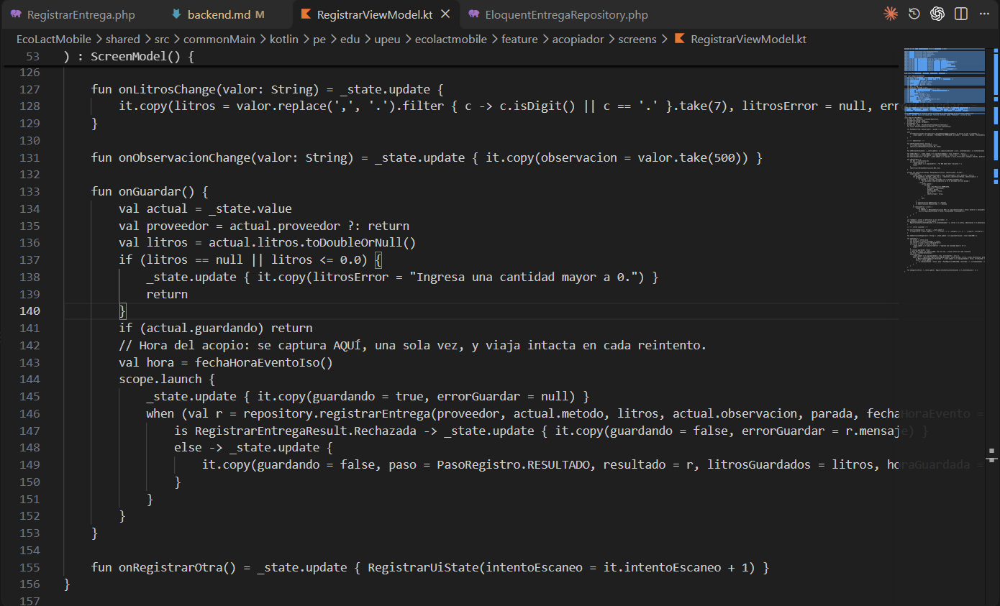
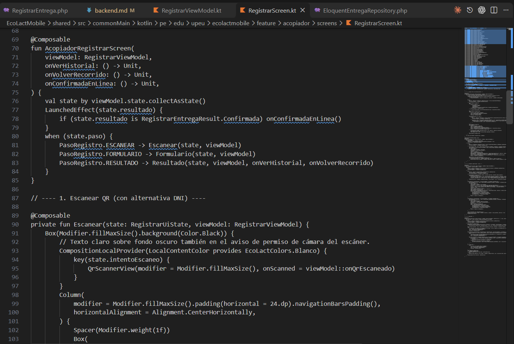

<div class="ec-arquitectura" markdown="1">
<div class="ec-arch-banner" markdown="1">

:material-cellphone-link: 03 · Arquitectura móvil: KMP y MVVM

</div>
<div class="ec-arch-content" markdown="1">

<span class="ec-arch-kicker">EcoLact / Arquitectura de software</span>

# Arquitectura móvil: KMP y MVVM

<p class="ec-arch-subtitle">Interfaz reactiva y lógica compartida</p>

El módulo shared reúne la lógica común de la app: pantallas Compose, estado, repositorios, transporte y persistencia. Las piezas que necesitan funciones del sistema operativo se implementan en source sets específicos.

<div class="ec-arch-tech"><span>Kotlin Multiplatform</span><span>Compose</span><span>StateFlow</span><span>Repository</span></div>

## MVVM aplicado al registro de una entrega

El diagrama separa presentación y acceso a datos. El repositorio coordina la copia local y la API; no debe interpretarse como que toda escritura se guarda localmente antes de intentar la red.

<div class="ec-arch-diagram" markdown="1">



<div class="ec-arch-controls" markdown="1">

[Ampliar diagrama](../assets/diagrams/arquitectura/mobile-mvvm.svg)
[Fuente Mermaid](../assets/diagrams/arquitectura/mobile-mvvm.mmd)

</div>
<details markdown="1">
<summary>Consultar la fuente editable</summary>

```text
flowchart TB
  V[Vista Compose: RegistrarScreen] -->|eventos de usuario| VM[RegistrarViewModel: estado y eventos]
  VM -->|onGuardar| R[AcopiadorRepository]
  VM -. StateFlow y collectAsState .-> V
  R --> L[CacheRepository y SyncQueueRepository]
  L --> DB[(SQLite mediante SQLDelight)]
  R --> API[AcopiadorApi]
  API --> K[Ktor Client]
  K --> B[API REST Laravel]
  DB -. cambios observables .-> R
  classDef default fill:#eaf3ff,stroke:#79a4df,color:#103b86,rx:7,ry:7;

```

</details>
</div>
<div class="ec-arch-grid" markdown="1">

<div class="ec-arch-card blue" markdown="1">

:material-monitor:

### Vista

`AcopiadorRegistrarScreen` observa `state` con `collectAsState()` y muestra ESCANEAR, FORMULARIO o RESULTADO.

</div>

<div class="ec-arch-card purple" markdown="1">

:material-swap-horizontal:

### ViewModel

`RegistrarViewModel` recibe eventos, valida los litros, captura una sola vez la hora del acopio y publica el resultado.

</div>

<div class="ec-arch-card green" markdown="1">

:material-source-branch:

### Repository

`AcopiadorRepository` identifica proveedores, combina consultas locales con pendientes y decide enviar o encolar.

</div>

<div class="ec-arch-card orange" markdown="1">

:material-database:

### Fuentes de datos

SQLDelight conserva caché y cola; Ktor envía solicitudes y traduce respuestas del backend.

</div>

</div>
## Qué ocurre al pulsar Guardar

La vista delega en `onGuardar()`. El ViewModel valida que los litros sean positivos y evita otro envío mientras está guardando. Captura la hora real y llama al repositorio. Una entrega confirmada permite actualizar consultas; una guardada sin red se muestra como pendiente; un rechazo informa el motivo sin presentarlo como éxito.

Este recorrido constituye una implementación MVVM por responsabilidades. **El ejemplo hereda de `ScreenModel`, no de `androidx.lifecycle.ViewModel`.** La clase propia crea un scope y lo cancela en `onDispose`; `rememberScreenModel` vincula su vida a la composición. No se atribuyen aquí `viewModelScope`, Hilt o Koin: `AppContainer` realiza la composición manual de dependencias.

## Código común y código específico
<div class="ec-arch-table" markdown="1">

| Ubicación | Responsabilidad comprobada |
| --- | --- |
| `shared/src/commonMain` | Compose, ViewModel/ScreenModel, repositorios, modelos, Ktor y contratos de plataforma |
| `shared/src/androidMain` | Motor OkHttp, AndroidSqliteDriver y observación de redes Android |
| `shared/src/iosMain` | Motor Darwin, NativeSqliteDriver y adaptaciones iOS |
| `shared/build.gradle.kts` | Destinos Android, iosArm64 e iosSimulatorArm64; dependencias y base EcoLactDatabase |

</div>
<div class="ec-arch-note warning" markdown="1">

**Portabilidad configurada no equivale a validación en iOS.** `ConnectivityObserver.ios.kt` está marcado como pendiente y devuelve siempre `true`. No ofrece todavía detección real de señal. Esta documentación no afirma que las funciones hayan sido compiladas ni probadas en iOS.

</div>
## Justificación técnica

KMP reduce la duplicación de estado, reglas de presentación y acceso a datos entre plataformas. Compose separa la descripción de pantalla de sus eventos. El intercambio por StateFlow permite actualizar la interfaz después de sincronizar sin reconstruir manualmente toda la navegación. Las adaptaciones por plataforma permiten usar motores HTTP y SQLite adecuados a cada sistema.


## Evidencias de implementación

Las referencias identifican código revisado. El área de imagen está preparada para la captura manual del archivo indicado; el marcador visual no constituye una captura de la implementación.

<section class="ec-arch-evidence" markdown="1">
<div class="ec-arch-evidence-body" markdown="1">

### Estado y eventos del registro

El ViewModel valida los litros, evita un doble guardado y captura la hora del evento antes de delegar.

</div>
<div class="ec-arch-evidence-image" markdown="1">

[](../assets/images/arquitectura/codigo/mvvm-viewmodel.png)

</div>
<div class="ec-arch-evidence-body" markdown="1">

**Qué demuestra.** onGuardar coordina el evento de la interfaz y publica su resultado mediante StateFlow.

<div class="ec-arch-file" markdown="1">

Archivo de imagen: `mvvm-viewmodel.png` · [Abrir imagen](../assets/images/arquitectura/codigo/mvvm-viewmodel.png)

**Ubicación en GitHub:** [EcoLactMobile/shared/src/commonMain/kotlin/pe/edu/upeu/ecolactmobile/feature/acopiador/screens/RegistrarViewModel.kt](https://github.com/MilkonMamani/EcoLact/blob/75901337489dbe3c61bf5e95357ea365790ab565/EcoLactMobile/shared/src/commonMain/kotlin/pe/edu/upeu/ecolactmobile/feature/acopiador/screens/RegistrarViewModel.kt#L133-L156)

Fragmento sugerido para la captura: líneas 133–156 de la revisión documentada.

</div>
</div>
</section>

<section class="ec-arch-evidence" markdown="1">
<div class="ec-arch-evidence-body" markdown="1">

### Compose observa el estado

La vista decide qué etapa mostrar a partir del estado emitido por el ViewModel.

</div>
<div class="ec-arch-evidence-image" markdown="1">

[](../assets/images/arquitectura/codigo/mvvm-vista.png)

</div>
<div class="ec-arch-evidence-body" markdown="1">

**Qué demuestra.** collectAsState conecta el estado observable con la pantalla de escaneo, formulario y resultado.

<div class="ec-arch-file" markdown="1">

Archivo de imagen: `mvvm-vista.png` · [Abrir imagen](../assets/images/arquitectura/codigo/mvvm-vista.png)

**Ubicación en GitHub:** [EcoLactMobile/shared/src/commonMain/kotlin/pe/edu/upeu/ecolactmobile/feature/acopiador/screens/RegistrarScreen.kt](https://github.com/MilkonMamani/EcoLact/blob/75901337489dbe3c61bf5e95357ea365790ab565/EcoLactMobile/shared/src/commonMain/kotlin/pe/edu/upeu/ecolactmobile/feature/acopiador/screens/RegistrarScreen.kt#L70-L87)

Fragmento sugerido para la captura: líneas 70–87 de la revisión documentada.

</div>
</div>
</section>


<details class="ec-arch-sources" markdown="1">
<summary>Fuentes adicionales y alcance de la revisión</summary>

Revisión estática del repositorio local: 28 de octubre de 2026. Enlaces a la revisión `75901337489d`; la existencia de cada archivo y los fragmentos sugeridos se comprobaron localmente. No se ejecutaron servicios de negocio ni se verificó un despliegue.

- [EcoLactMobile/shared/build.gradle.kts](https://github.com/MilkonMamani/EcoLact/blob/75901337489dbe3c61bf5e95357ea365790ab565/EcoLactMobile/shared/build.gradle.kts)
- [EcoLactMobile/shared/src/commonMain/kotlin/pe/edu/upeu/ecolactmobile/core/ui/state/ScreenModel.kt](https://github.com/MilkonMamani/EcoLact/blob/75901337489dbe3c61bf5e95357ea365790ab565/EcoLactMobile/shared/src/commonMain/kotlin/pe/edu/upeu/ecolactmobile/core/ui/state/ScreenModel.kt)
- [EcoLactMobile/shared/src/commonMain/kotlin/pe/edu/upeu/ecolactmobile/di/AppContainer.kt](https://github.com/MilkonMamani/EcoLact/blob/75901337489dbe3c61bf5e95357ea365790ab565/EcoLactMobile/shared/src/commonMain/kotlin/pe/edu/upeu/ecolactmobile/di/AppContainer.kt)
- [EcoLactMobile/shared/src/commonMain/kotlin/pe/edu/upeu/ecolactmobile/feature/acopiador/AcopiadorRepository.kt](https://github.com/MilkonMamani/EcoLact/blob/75901337489dbe3c61bf5e95357ea365790ab565/EcoLactMobile/shared/src/commonMain/kotlin/pe/edu/upeu/ecolactmobile/feature/acopiador/AcopiadorRepository.kt)
- [EcoLactMobile/shared/src/iosMain/kotlin/pe/edu/upeu/ecolactmobile/core/sync/ConnectivityObserver.ios.kt](https://github.com/MilkonMamani/EcoLact/blob/75901337489dbe3c61bf5e95357ea365790ab565/EcoLactMobile/shared/src/iosMain/kotlin/pe/edu/upeu/ecolactmobile/core/sync/ConnectivityObserver.ios.kt)

</details>

<div class="ec-arch-links" markdown="1">

[← Clean Architecture en Laravel](backend.md)

[Vista general](index.md)

[Arquitectura offline-first →](offline-first.md)


</div>
</div>
</div>
