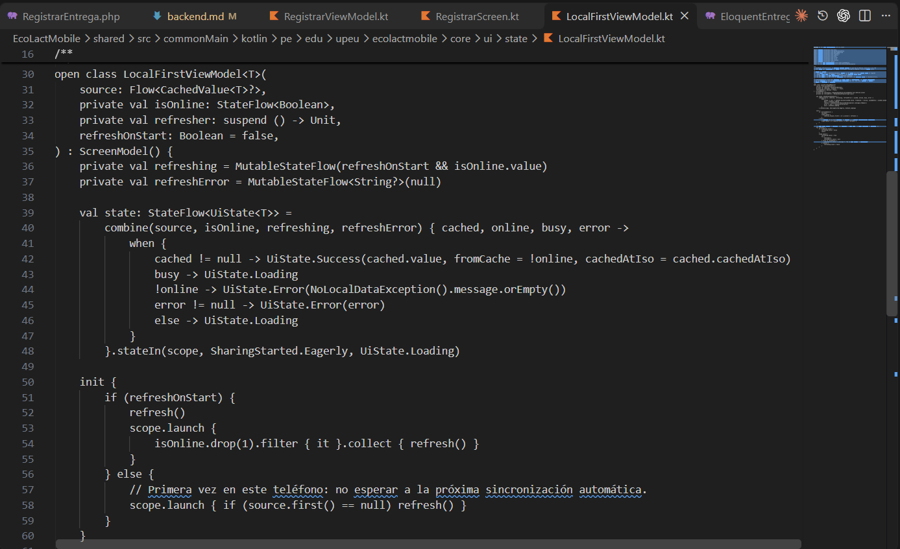
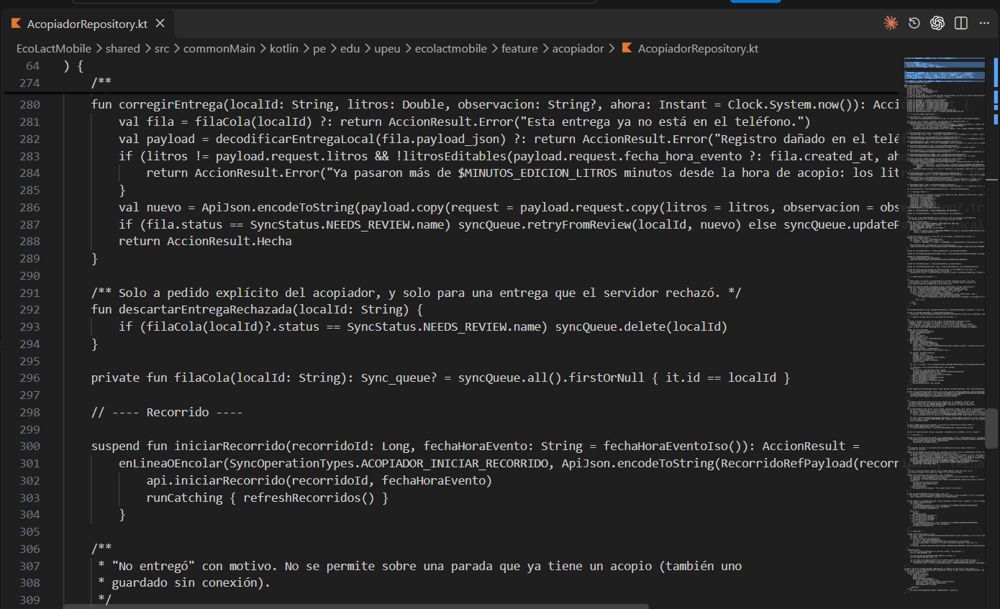

<div class="ec-arquitectura" markdown="1">
<div class="ec-arch-banner" markdown="1">

:material-wifi-off: 04 · Arquitectura offline-first

</div>
<div class="ec-arch-content" markdown="1">

<span class="ec-arch-kicker">EcoLact / Arquitectura de software</span>

# Arquitectura offline-first

<p class="ec-arch-subtitle">Continuidad de trabajo en Huata, Puno</p>

El contexto de acopio rural de Huata, Puno, puede presentar conectividad limitada o intermitente. Una aplicación que exigiera una respuesta de internet para cada consulta o registro podría detener la ruta. EcoLact conserva información y admite determinadas operaciones pendientes para reducir esa dependencia.

<div class="ec-arch-tech"><span>Local-First</span><span>SQLite</span><span>Caché observable</span><span>Operaciones compatibles</span></div>

<div class="ec-arch-offline" markdown="1">

<div class="ec-arch-card green" markdown="1">

:material-wifi:

### Con conexión

Consultar y actualizar información; enviar operaciones; sincronizar la copia local; recibir confirmaciones y errores del servidor. La señal disponible no garantiza que cada petición termine correctamente.

</div>

<div class="ec-arch-card orange" markdown="1">

:material-wifi-off:

### Sin conexión

Consultar datos descargados; registrar operaciones compatibles y autorizadas localmente; conservar pendientes en SQLite; continuar parte del trabajo y sincronizar después.

</div>

</div>
## Con señal / Sin señal

Las consultas y las escrituras tienen decisiones diferentes. Mantener una consulta visible no significa permitir cualquier modificación sin conexión.

<div class="ec-arch-diagram" markdown="1">



<div class="ec-arch-controls" markdown="1">

[Ampliar diagrama](../assets/diagrams/arquitectura/offline-senal.svg)
[Fuente Mermaid](../assets/diagrams/arquitectura/offline-senal.mmd)

</div>
<details markdown="1">
<summary>Consultar la fuente editable</summary>

```text
flowchart TB
  U[Usuario abre una consulta] --> L{¿Hay copia local?}
  L -->|Sí| V[Mostrar datos y fecha de actualización]
  L -->|No| N{¿Hay conexión?}
  N -->|No| E[Informar ausencia de datos locales]
  N -->|Sí| API[Consultar API]
  V --> C{¿Hay conexión?}
  C -->|Sí| API
  API --> S[Guardar respuesta en SQLite]
  S --> O[La fuente observable actualiza la vista]
  C -->|No| KEEP[Conservar la información disponible]
  W[Usuario registra una operación] --> P{¿Admite cola y permiso local?}
  P -->|Sí, sin red| Q[Guardar PENDING en SQLite]
  Q --> R[Enviar al recuperar conexión]
  P -->|No| A[Solicitar conexión o resolver autorización]
  classDef default fill:#eaf3ff,stroke:#79a4df,color:#103b86,rx:7,ry:7;
  classDef decision fill:#fff3df,stroke:#d7a052,color:#754c0c;
  class L,N,C,P decision;
```

</details>
</div>
## Local-First: la interfaz observa una copia persistida

`CacheRepository` guarda la respuesta JSON y `cached_at`. Su método `observe()` usa consultas SQLDelight convertidas a Flow. `LocalFirstViewModel` combina esa fuente con conectividad, actualización y error para producir un `StateFlow<UiState<T>>`.

Si existe una copia, se muestra `Success` aunque falle la actualización remota. Si no existe y se descarga, se muestra `Loading`; si no se puede obtener, se muestra `Error`. El refresco escribe en SQLite y la observación actualiza la pantalla. Así la interrupción de red no borra información ya disponible.

El indicador `fromCache` del ViewModel se basa en estar sin conexión, no en demostrar que el dato es reciente. La fecha almacenada permite interpretar su antigüedad incluso cuando el teléfono vuelve a estar en línea.

## No todas las escrituras siguen el mismo orden

Para una entrega, `AcopiadorRepository` genera una clave local y conserva la hora del evento. **Con conexión intenta enviar primero**; si funciona, registra la operación local como sincronizada. Sin conexión o ante determinados fallos, la encola siempre que `puedeOperarSinConexion()` lo permita. Un rechazo de validación o permiso recibido en línea se muestra como rechazo.

Por tanto, Local-First describe especialmente la lectura de datos y el mantenimiento de la copia. No significa que todas las funciones escriban primero en SQLite ni que exista una transacción distribuida entre teléfono y servidor.

## Matriz de disponibilidad real
<div class="ec-arch-table" markdown="1">

| Acción | Sin conexión | Condición o límite |
| --- | --- | --- |
| Ver proveedores, recorridos e historial | Con datos previamente guardados | No recupera detalles que nunca se descargaron |
| Registrar entrega | Puede quedar pendiente | Proveedor identificable y comprobación local de asistencia válida |
| Iniciar recorrido / marcar No entregó | Operaciones de cola | Reglas locales y autorización final del backend |
| Finalizar recorrido | No | Requiere red y que no queden registros del recorrido por enviar |
| Selección manual de muestra / captura de ticket | Hay soporte local o cola | El procesamiento remoto y la confirmación deben completarse al enviar |
| Sorteo de muestra | No | Depende del servidor y su propuesta firmada |
| Venta al contado | Puede quedar pendiente | Precio y stock conocidos; revalidación posterior |
| Venta con descuento de planilla | No | Necesita consultar saldo disponible |
| Primer inicio de sesión | No | Debe validar credenciales y recibir un token |

</div>
## Sesión, permisos y datos pendientes

Restaurar una sesión guardada permite recuperar el contexto local, pero no comprueba de nuevo en ese instante la vigencia del token, el rol o el estado de cuenta del servidor. El backend revisa autenticación, autorización, asistencia y reglas cuando recibe la operación. Un cambio de proveedor, stock, precio o permisos puede producir una revisión pendiente.

La conectividad Android usa redes validadas y, para ciertas redes no validadas, un sondeo HTTP al servidor. Una respuesta de ese sondeo prueba alcance, no aceptación de una operación. iOS conserva el observador provisional que siempre informa conexión.
<div class="ec-arch-note warning" markdown="1">

**Compromiso arquitectónico.** Se prioriza continuidad con datos locales y consistencia posterior de las operaciones aceptadas. No se promete actualidad permanente, disponibilidad universal ni sincronización garantizada con la app cerrada.

</div>


## Evidencias de implementación

Las referencias identifican código revisado. El área de imagen está preparada para la captura manual del archivo indicado; el marcador visual no constituye una captura de la implementación.

<section class="ec-arch-evidence" markdown="1">
<div class="ec-arch-evidence-body" markdown="1">

### Implementación del enfoque Local-First

La pantalla observa una fuente local y conserva los datos existentes cuando la red falla.

</div>
<div class="ec-arch-evidence-image" markdown="1">

[](../assets/images/arquitectura/codigo/offline-local-first.png)

</div>
<div class="ec-arch-evidence-body" markdown="1">

**Qué demuestra.** combine prioriza la copia disponible y distingue carga, datos y error. La red actualiza esa copia; no reemplaza la pantalla por un error si ya hay información.

<div class="ec-arch-file" markdown="1">

Archivo de imagen: `offline-local-first.png` · [Abrir imagen](../assets/images/arquitectura/codigo/offline-local-first.png)

**Ubicación en GitHub:** [EcoLactMobile/shared/src/commonMain/kotlin/pe/edu/upeu/ecolactmobile/core/ui/state/LocalFirstViewModel.kt](https://github.com/MilkonMamani/EcoLact/blob/75901337489dbe3c61bf5e95357ea365790ab565/EcoLactMobile/shared/src/commonMain/kotlin/pe/edu/upeu/ecolactmobile/core/ui/state/LocalFirstViewModel.kt#L39-L50)

Fragmento sugerido para la captura: líneas 39–50 de la revisión documentada.

</div>
</div>
</section>

<section class="ec-arch-evidence" markdown="1">
<div class="ec-arch-evidence-body" markdown="1">

### Guardar una entrega sin señal

El repositorio elige entre enviar y conservar una operación pendiente con la misma clave local.

</div>
<div class="ec-arch-evidence-image" markdown="1">

[](../assets/images/arquitectura/codigo/offline-repository.png)

</div>
<div class="ec-arch-evidence-body" markdown="1">

**Qué demuestra.** Sin conexión se llama a encolarEntrega; un fallo de red también puede conservar la operación, sujeto a la autorización local de asistencia.

<div class="ec-arch-file" markdown="1">

Archivo de imagen: `offline-repository.png` · [Abrir imagen](../assets/images/arquitectura/codigo/offline-repository.png)

**Ubicación en GitHub:** [EcoLactMobile/shared/src/commonMain/kotlin/pe/edu/upeu/ecolactmobile/feature/acopiador/AcopiadorRepository.kt](https://github.com/MilkonMamani/EcoLact/blob/75901337489dbe3c61bf5e95357ea365790ab565/EcoLactMobile/shared/src/commonMain/kotlin/pe/edu/upeu/ecolactmobile/feature/acopiador/AcopiadorRepository.kt#L251-L274)

Fragmento sugerido para la captura: líneas 251–274 de la revisión documentada.

</div>
</div>
</section>


<details class="ec-arch-sources" markdown="1">
<summary>Fuentes adicionales y alcance de la revisión</summary>

Revisión estática del repositorio local: 28 de octubre de 2026. Enlaces a la revisión `75901337489d`; la existencia de cada archivo y los fragmentos sugeridos se comprobaron localmente. No se ejecutaron servicios de negocio ni se verificó un despliegue.

- [EcoLactMobile/shared/src/commonMain/kotlin/pe/edu/upeu/ecolactmobile/core/cache/CacheRepository.kt](https://github.com/MilkonMamani/EcoLact/blob/75901337489dbe3c61bf5e95357ea365790ab565/EcoLactMobile/shared/src/commonMain/kotlin/pe/edu/upeu/ecolactmobile/core/cache/CacheRepository.kt)
- [EcoLactMobile/shared/src/commonMain/kotlin/pe/edu/upeu/ecolactmobile/feature/auth/AuthRepository.kt](https://github.com/MilkonMamani/EcoLact/blob/75901337489dbe3c61bf5e95357ea365790ab565/EcoLactMobile/shared/src/commonMain/kotlin/pe/edu/upeu/ecolactmobile/feature/auth/AuthRepository.kt)
- [EcoLactMobile/shared/src/commonMain/kotlin/pe/edu/upeu/ecolactmobile/feature/acopiador/AcopiadorRepository.kt](https://github.com/MilkonMamani/EcoLact/blob/75901337489dbe3c61bf5e95357ea365790ab565/EcoLactMobile/shared/src/commonMain/kotlin/pe/edu/upeu/ecolactmobile/feature/acopiador/AcopiadorRepository.kt)
- [EcoLactMobile/shared/src/commonMain/kotlin/pe/edu/upeu/ecolactmobile/feature/calidad/CalidadRepository.kt](https://github.com/MilkonMamani/EcoLact/blob/75901337489dbe3c61bf5e95357ea365790ab565/EcoLactMobile/shared/src/commonMain/kotlin/pe/edu/upeu/ecolactmobile/feature/calidad/CalidadRepository.kt)
- [EcoLactMobile/shared/src/commonMain/kotlin/pe/edu/upeu/ecolactmobile/feature/ventas/VentasRepository.kt](https://github.com/MilkonMamani/EcoLact/blob/75901337489dbe3c61bf5e95357ea365790ab565/EcoLactMobile/shared/src/commonMain/kotlin/pe/edu/upeu/ecolactmobile/feature/ventas/VentasRepository.kt)
- [EcoLactMobile/shared/src/androidMain/kotlin/pe/edu/upeu/ecolactmobile/core/sync/ConnectivityObserver.android.kt](https://github.com/MilkonMamani/EcoLact/blob/75901337489dbe3c61bf5e95357ea365790ab565/EcoLactMobile/shared/src/androidMain/kotlin/pe/edu/upeu/ecolactmobile/core/sync/ConnectivityObserver.android.kt)

</details>

<div class="ec-arch-links" markdown="1">

[← Arquitectura móvil: KMP y MVVM](mobile.md)

[Vista general](index.md)

[Sincronización de datos →](sincronizacion.md)


</div>
</div>
</div>
