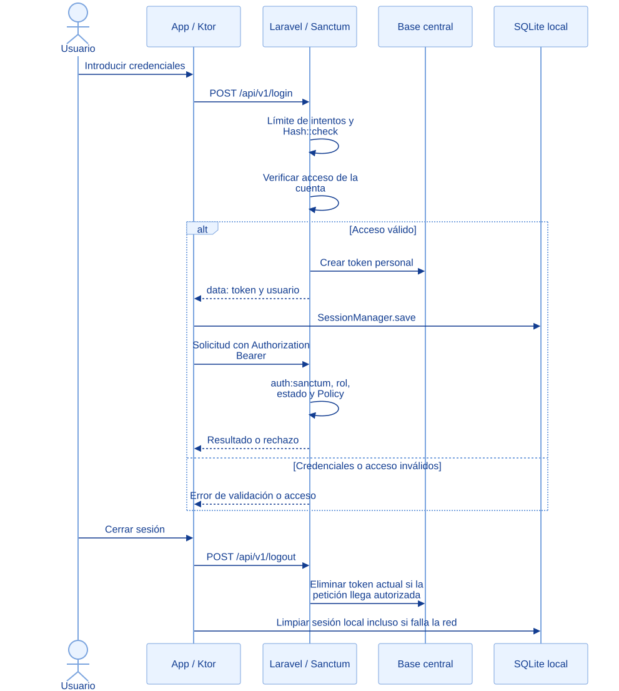
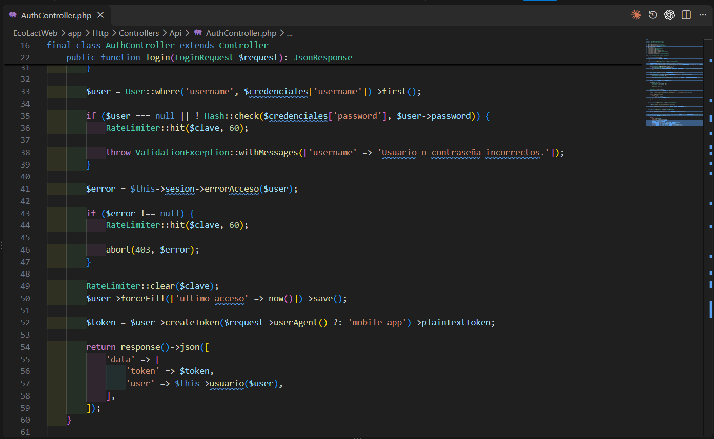
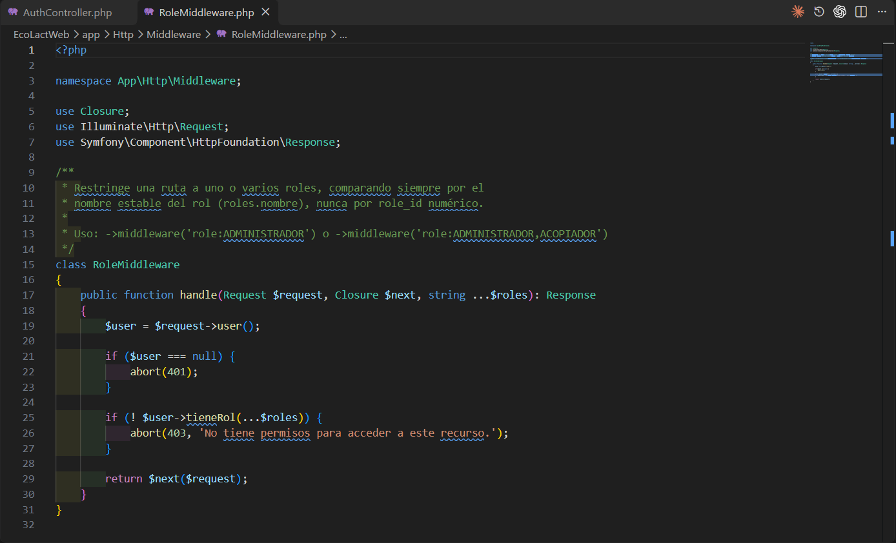

<div class="ec-arquitectura" markdown="1">
<div class="ec-arch-banner" markdown="1">

:material-shield-lock: 09 · Autenticación y seguridad

</div>
<div class="ec-arch-content" markdown="1">

<span class="ec-arch-kicker">EcoLact / Arquitectura de software</span>

# Autenticación y seguridad

<p class="ec-arch-subtitle">Identidad, permisos y contexto de cada operación</p>

Autenticar responde quién realiza la petición; autorizar determina si esa persona puede ejecutar la acción sobre ese recurso. EcoLact aplica ambos controles y añade restricciones de estado de cuenta y asistencia en las rutas correspondientes.

<div class="ec-arch-tech"><span>Sanctum</span><span>Bearer</span><span>Middleware</span><span>Policies</span></div>

## Secuencia de autenticación móvil

La secuencia representa el cliente móvil con token personal. La web Laravel utiliza su sesión web; no se supone que todo acceso Blade use el mismo token Bearer del teléfono.

<div class="ec-arch-diagram" markdown="1">



<div class="ec-arch-controls" markdown="1">

[Ampliar diagrama](../assets/diagrams/arquitectura/seguridad-login.svg)
[Fuente Mermaid](../assets/diagrams/arquitectura/seguridad-login.mmd)

</div>
<details markdown="1">
<summary>Consultar la fuente editable</summary>

```text
sequenceDiagram
  actor U as Usuario
  participant A as App / Ktor
  participant B as Laravel / Sanctum
  participant D as Base central
  participant L as SQLite local
  U->>A: Introducir credenciales
  A->>B: POST /api/v1/login
  B->>B: Límite de intentos y Hash::check
  B->>B: Verificar acceso de la cuenta
  alt Acceso válido
    B->>D: Crear token personal
    B-->>A: data: token y usuario
    A->>L: SessionManager.save
    A->>B: Solicitud con Authorization Bearer
    B->>B: auth:sanctum, rol, estado y Policy
    B-->>A: Resultado o rechazo
  else Credenciales o acceso inválidos
    B-->>A: Error de validación o acceso
  end
  U->>A: Cerrar sesión
  A->>B: POST /api/v1/logout
  B->>D: Eliminar token actual si la petición llega autorizada
  A->>L: Limpiar sesión local incluso si falla la red
```

</details>
</div>
<div class="ec-arch-grid" markdown="1">

<div class="ec-arch-card blue" markdown="1">

:material-account-check:

### Autenticación

Login verifica username y contraseña con Hash::check; Sanctum identifica al portador del token en rutas protegidas.

</div>

<div class="ec-arch-card purple" markdown="1">

:material-shield-account:

### Autorización

RoleMiddleware compara nombres de rol; Gate y Policies verifican el alcance de las acciones sobre los recursos.

</div>

</div>
## Controles implementados

El login aplica un límite de intentos por combinación de usuario e IP, consulta el usuario y valida la contraseña. `SesionWeb::errorAcceso` verifica que exista un rol válido y que la cuenta pueda acceder. Solo después se actualiza el último acceso y se crea un token Sanctum.

`auth:sanctum` protege los grupos autenticados. `RoleMiddleware` devuelve 401 sin identidad y 403 si no tiene un rol permitido. `EntregaPolicy`, por ejemplo, restringe al proveedor a sus entregas y al acopiador a su zona; Calidad tiene lectura de cualquier zona. El caso de uso conserva las reglas definitivas del negocio.

**El estado de cuenta no se resume en “inactivo = sin acceso”.** `EnsureUserIsActive` admite GET/HEAD para cuentas de trabajador o proveedor en modo de solo consulta y rechaza escrituras. Otras cuentas no operativas pierden acceso; el middleware puede revocar el token usado o cerrar la sesión web. Además, las rutas operativas protegidas comprueban asistencia.

## Cómo se guarda la sesión móvil actualmente

`SessionManager` conserva el token y datos de usuario en la tabla SQLDelight `session` y publica un StateFlow en memoria. `restore()` recupera esa fila al iniciar la app; `HttpClientFactory` toma `currentToken()` para construir la cabecera Bearer.

La columna del token es `TEXT`. En los drivers y en SessionManager revisados **no se implementa cifrado explícito del token ni integración con Keychain o Keystore**. No se atribuyen al proyecto esas protecciones ni una renovación automática de token que no se haya comprobado. La existencia de un token local tampoco demuestra que siga autorizado en el servidor.

## Cierre de sesión y límites

El logout API elimina `currentAccessToken()`. La app intenta el logout remoto y luego limpia su sesión local incluso si la petición falla. Por eso **cerrar sesión sin red no confirma la revocación remota**. Tampoco implica borrar toda la caché o la cola: `SessionManager.clear()` elimina la fila de sesión, no todas las tablas.

Sanctum resuelve identidad por token; no sustituye Policies, reglas de negocio ni validación de entradas. La configuración de HTTPS y las protecciones del despliegue no se verificaron en esta revisión. Los ejemplos y marcadores de la documentación no contienen secretos ni credenciales reales.


## Evidencias de implementación

Las referencias identifican código revisado. El área de imagen está preparada para la captura manual del archivo indicado; el marcador visual no constituye una captura de la implementación.

<section class="ec-arch-evidence" markdown="1">
<div class="ec-arch-evidence-body" markdown="1">

### Inicio de sesión y emisión de token

El controlador comprueba las credenciales y el acceso antes de crear el token personal de Sanctum.

</div>
<div class="ec-arch-evidence-image" markdown="1">

[](../assets/images/arquitectura/codigo/seguridad-sanctum.png)

</div>
<div class="ec-arch-evidence-body" markdown="1">

**Qué demuestra.** Hash::check, la comprobación de acceso y createToken forman parte del login real. La captura debe mostrar código, nunca valores de sesión.

<div class="ec-arch-file" markdown="1">

Archivo de imagen: `seguridad-sanctum.png` · [Abrir imagen](../assets/images/arquitectura/codigo/seguridad-sanctum.png)

**Ubicación en GitHub:** [EcoLactWeb/app/Http/Controllers/Api/AuthController.php](https://github.com/MilkonMamani/EcoLact/blob/75901337489dbe3c61bf5e95357ea365790ab565/EcoLactWeb/app/Http/Controllers/Api/AuthController.php#L33-L52)

Fragmento sugerido para la captura: líneas 33–52 de la revisión documentada.

</div>
</div>
</section>

<section class="ec-arch-evidence" markdown="1">
<div class="ec-arch-evidence-body" markdown="1">

### Autorización por nombre de rol

El middleware decide si el usuario autenticado pertenece a uno de los roles permitidos.

</div>
<div class="ec-arch-evidence-image" markdown="1">

[](../assets/images/arquitectura/codigo/seguridad-roles.png)

</div>
<div class="ec-arch-evidence-body" markdown="1">

**Qué demuestra.** Una identidad válida no basta para acceder a cualquier área: se exige el rol autorizado y se responde 403 cuando falta.

<div class="ec-arch-file" markdown="1">

Archivo de imagen: `seguridad-roles.png` · [Abrir imagen](../assets/images/arquitectura/codigo/seguridad-roles.png)

**Ubicación en GitHub:** [EcoLactWeb/app/Http/Middleware/RoleMiddleware.php](https://github.com/MilkonMamani/EcoLact/blob/75901337489dbe3c61bf5e95357ea365790ab565/EcoLactWeb/app/Http/Middleware/RoleMiddleware.php#L17-L29)

Fragmento sugerido para la captura: líneas 17–29 de la revisión documentada.

</div>
</div>
</section>


<details class="ec-arch-sources" markdown="1">
<summary>Fuentes adicionales y alcance de la revisión</summary>

Revisión estática del repositorio local: 28 de octubre de 2026. Enlaces a la revisión `75901337489d`; la existencia de cada archivo y los fragmentos sugeridos se comprobaron localmente. No se ejecutaron servicios de negocio ni se verificó un despliegue.

- [EcoLactWeb/app/Http/Middleware/EnsureUserIsActive.php](https://github.com/MilkonMamani/EcoLact/blob/75901337489dbe3c61bf5e95357ea365790ab565/EcoLactWeb/app/Http/Middleware/EnsureUserIsActive.php)
- [EcoLactWeb/app/Http/Support/SesionWeb.php](https://github.com/MilkonMamani/EcoLact/blob/75901337489dbe3c61bf5e95357ea365790ab565/EcoLactWeb/app/Http/Support/SesionWeb.php)
- [EcoLactWeb/app/Policies/EntregaPolicy.php](https://github.com/MilkonMamani/EcoLact/blob/75901337489dbe3c61bf5e95357ea365790ab565/EcoLactWeb/app/Policies/EntregaPolicy.php)
- [EcoLactWeb/app/Http/Middleware/RequiereAsistencia.php](https://github.com/MilkonMamani/EcoLact/blob/75901337489dbe3c61bf5e95357ea365790ab565/EcoLactWeb/app/Http/Middleware/RequiereAsistencia.php)
- [EcoLactMobile/shared/src/commonMain/kotlin/pe/edu/upeu/ecolactmobile/core/session/SessionManager.kt](https://github.com/MilkonMamani/EcoLact/blob/75901337489dbe3c61bf5e95357ea365790ab565/EcoLactMobile/shared/src/commonMain/kotlin/pe/edu/upeu/ecolactmobile/core/session/SessionManager.kt)
- [EcoLactMobile/shared/src/commonMain/sqldelight/pe/edu/upeu/ecolactmobile/core/database/Session.sq](https://github.com/MilkonMamani/EcoLact/blob/75901337489dbe3c61bf5e95357ea365790ab565/EcoLactMobile/shared/src/commonMain/sqldelight/pe/edu/upeu/ecolactmobile/core/database/Session.sq)
- [EcoLactMobile/shared/src/commonMain/kotlin/pe/edu/upeu/ecolactmobile/feature/auth/AuthRepository.kt](https://github.com/MilkonMamani/EcoLact/blob/75901337489dbe3c61bf5e95357ea365790ab565/EcoLactMobile/shared/src/commonMain/kotlin/pe/edu/upeu/ecolactmobile/feature/auth/AuthRepository.kt)

</details>

<div class="ec-arch-links" markdown="1">

[← Comunicación mediante API REST](api.md)

[Vista general](index.md)

[Integración Web, Móvil y Backend →](integracion.md)


</div>
</div>
</div>
