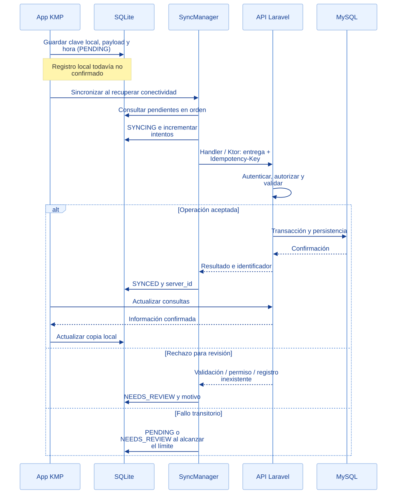
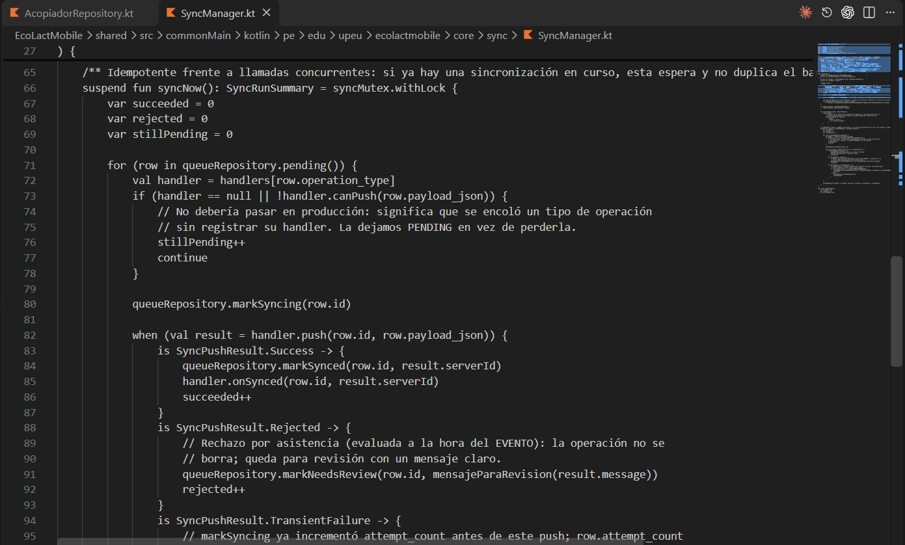
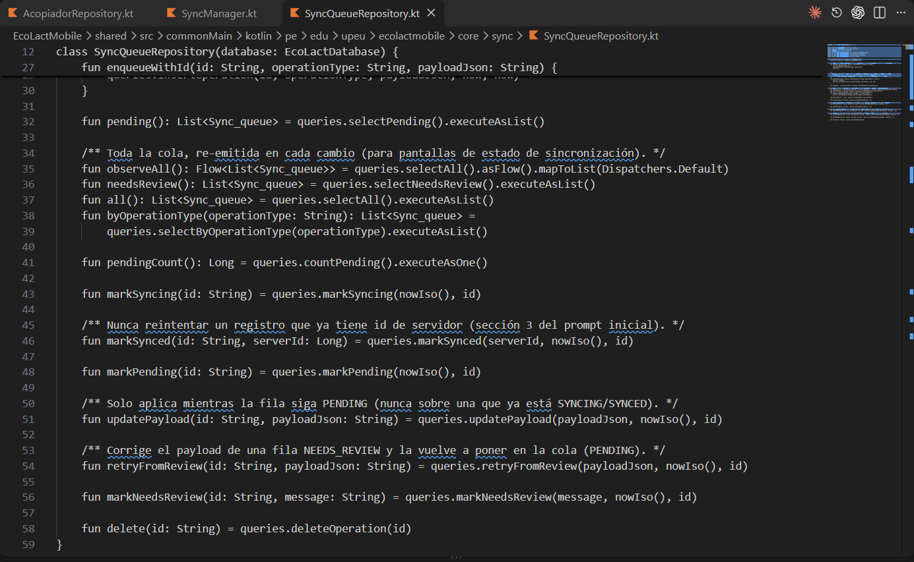

<div class="ec-arquitectura" markdown="1">
<div class="ec-arch-banner" markdown="1">

:material-sync: 05 · Sincronización de datos

</div>
<div class="ec-arch-content" markdown="1">

<span class="ec-arch-kicker">EcoLact / Arquitectura de software</span>

# Sincronización de datos

<p class="ec-arch-subtitle">Del pendiente local a la respuesta del servidor</p>

La cola local conserva operaciones que deben comunicarse al backend. SyncManager las despacha por tipo, interpreta el resultado y deja visible qué fue confirmado, qué sigue pendiente y qué necesita revisión.

<div class="ec-arch-tech"><span>PENDING</span><span>SYNCING</span><span>SYNCED</span><span>NEEDS_REVIEW</span></div>

## Una entrega sin conexión

El ejemplo corresponde al registro de una entrega por el acopiador. MySQL representa el destino central previsto; la conexión efectiva de Laravel depende de su configuración. El manejador utiliza Ktor, no una conexión directa desde SQLite a MySQL.

<div class="ec-arch-diagram" markdown="1">



<div class="ec-arch-controls" markdown="1">

[Ampliar diagrama](../assets/diagrams/arquitectura/sync-secuencia.svg)
[Fuente Mermaid](../assets/diagrams/arquitectura/sync-secuencia.mmd)

</div>
<details markdown="1">
<summary>Consultar la fuente editable</summary>

```text
sequenceDiagram
  participant A as App KMP
  participant D as SQLite
  participant S as SyncManager
  participant B as API Laravel
  participant M as MySQL
  A->>D: Guardar clave local, payload y hora (PENDING)
  Note over A,D: Registro local todavía no confirmado
  A->>S: Sincronizar al recuperar conectividad
  S->>D: Consultar pendientes en orden
  S->>D: SYNCING e incrementar intentos
  S->>B: Handler / Ktor: entrega + Idempotency-Key
  B->>B: Autenticar, autorizar y validar
  alt Operación aceptada
    B->>M: Transacción y persistencia
    M-->>B: Confirmación
    B-->>S: Resultado e identificador
    S->>D: SYNCED y server_id
    A->>B: Actualizar consultas
    B-->>A: Información confirmada
    A->>D: Actualizar copia local
  else Rechazo para revisión
    B-->>S: Validación / permiso / registro inexistente
    S->>D: NEEDS_REVIEW y motivo
  else Fallo transitorio
    S->>D: PENDING o NEEDS_REVIEW al alcanzar el límite
  end
```

</details>
</div>
## Estados y transiciones comprobados

La recuperación de un envío interrumpido está implementada por componentes concretos, como AcopiadorSync; no es una garantía universal añadida por el diagrama. Un pendiente sin manejador o cuyo `canPush` no permite enviarlo conserva su estado.

<div class="ec-arch-diagram" markdown="1">



<div class="ec-arch-controls" markdown="1">

[Ampliar diagrama](../assets/diagrams/arquitectura/sync-estados.svg)
[Fuente Mermaid](../assets/diagrams/arquitectura/sync-estados.mmd)

</div>
<details markdown="1">
<summary>Consultar la fuente editable</summary>

```text
stateDiagram-v2
  [*] --> PENDING: Encolar
  PENDING --> SYNCING: Manejador disponible y canPush
  SYNCING --> SYNCED: Success y server_id
  SYNCING --> PENDING: Fallo transitorio antes del límite
  SYNCING --> NEEDS_REVIEW: Rechazo o límite alcanzado
  NEEDS_REVIEW --> PENDING: Corrección y retryFromReview
  SYNCING --> PENDING: Recuperación específica del rol al reiniciar
  SYNCED --> [*]: No entra en selectPending
```

</details>
</div>
<div class="ec-arch-sync" markdown="1">

<div class="ec-arch-card orange" markdown="1">

:material-clock-outline:

### PENDING

Guardado localmente, todavía debe enviarse. La selección SQL usa fecha de creación y rowid para desempatar.

</div>

<div class="ec-arch-card blue" markdown="1">

:material-sync:

### SYNCING

Envío en curso; `markSyncing` incrementa `attempt_count` antes de llamar al manejador.

</div>

<div class="ec-arch-card green" markdown="1">

:material-check-circle-outline:

### SYNCED

Respuesta aceptada y `server_id` conservado. No forma parte de la consulta de pendientes.

</div>

<div class="ec-arch-card purple" markdown="1">

:material-alert-circle-outline:

### NEEDS_REVIEW

Se conserva el payload y el motivo. No vuelve a enviarse automáticamente hasta que un flujo de revisión lo permita.

</div>

</div>
## Detección, orden y reintentos

SyncManager usa un Mutex para evitar barridos simultáneos y registra manejadores según `operation_type`. Su observador genérico reacciona al retorno de conectividad. AcopiadorSync también sincroniza al entrar o volver la señal mientras su interfaz está activa, actualiza consultas después del envío y repite normalmente cada cinco minutos; los errores de actualización tienen espera creciente hasta ese intervalo.

El límite del motor es **cinco intentos transitorios**, contando el envío que alcanza el límite. No son cinco reintentos adicionales a un primer intento. La tabla incrementa un contador de intentos por operación; `retryFromReview` no lo reinicia. El manejador del acopiador clasifica 422, 403 y 404 como rechazos; los demás errores capturados pueden entrar como transitorios. No todos los manejadores tienen necesariamente la misma clasificación.

## Conflictos que requieren una decisión

Un pendiente puede corresponder a un proveedor desactivado, un recorrido cerrado o datos que ya no son válidos. Se muestra el motivo y se conserva la operación para revisión: **no existe una fusión automática universal de conflictos**. Para entregas, el repositorio permite corregir payload pendiente o rechazado, preservando la hora real; cambiar litros está limitado a diez minutos desde el evento. El descarte explícito está limitado a entregas rechazadas en ese flujo.

## Idempotencia: garantías por operación
<div class="ec-arch-table" markdown="1">

| Operación | Protección comprobada |
| --- | --- |
| Entrega directa | Idempotency-Key llega a RegistrarEntrega; búsqueda por token, comprobación del usuario e índice único |
| Acopio de una parada | Clave local enviada como token de idempotencia y cabecera; delega en RegistrarEntrega |
| Inicio/cierre de producción, compra de insumos y venta | Middleware `idempotente` en esas rutas API; guarda respuesta por usuario y clave |
| Inicio de recorrido / No entregó | Comportamiento específico del caso de uso; no equivale a usar el middleware en todas las rutas |
| Guardar/finalizar análisis de calidad | El manejador no usa la misma cabecera; no se atribuye la garantía genérica |

</div>
<div class="ec-arch-note " markdown="1">

**Repetir no es editar.** El middleware de idempotencia distingue método y ruta, pero no compara el cuerpo. Una operación ya confirmada devuelve su respuesta guardada; cambiar el payload con la misma clave no transforma la operación original. No hay atomicidad distribuida: si la respuesta se pierde, se depende de la protección del endpoint al reintentar.

</div>


## Evidencias de implementación

Las referencias identifican código revisado. El área de imagen está preparada para la captura manual del archivo indicado; el marcador visual no constituye una captura de la implementación.

<section class="ec-arch-evidence" markdown="1">
<div class="ec-arch-evidence-body" markdown="1">

### Despacho y resultado de la sincronización

El motor recorre las operaciones pendientes bajo un bloqueo y usa un manejador según su tipo.

</div>
<div class="ec-arch-evidence-image" markdown="1">

[](../assets/images/arquitectura/codigo/sync-manager.png)

</div>
<div class="ec-arch-evidence-body" markdown="1">

**Qué demuestra.** El resultado del envío cambia la fila a SYNCED, NEEDS_REVIEW o PENDING. MAX_INTENTOS_TRANSITORIOS limita los intentos.

<div class="ec-arch-file" markdown="1">

Archivo de imagen: `sync-manager.png` · [Abrir imagen](../assets/images/arquitectura/codigo/sync-manager.png)

**Ubicación en GitHub:** [EcoLactMobile/shared/src/commonMain/kotlin/pe/edu/upeu/ecolactmobile/core/sync/SyncManager.kt](https://github.com/MilkonMamani/EcoLact/blob/75901337489dbe3c61bf5e95357ea365790ab565/EcoLactMobile/shared/src/commonMain/kotlin/pe/edu/upeu/ecolactmobile/core/sync/SyncManager.kt#L66-L91)

Fragmento sugerido para la captura: líneas 66–91 de la revisión documentada.

</div>
</div>
</section>

<section class="ec-arch-evidence" markdown="1">
<div class="ec-arch-evidence-body" markdown="1">

### Cola persistida y reenvíos

El repositorio encapsula las consultas SQLDelight y conserva la clave de una operación al reintentar.

</div>
<div class="ec-arch-evidence-image" markdown="1">

[](../assets/images/arquitectura/codigo/sync-queue.png)

</div>
<div class="ec-arch-evidence-body" markdown="1">

**Qué demuestra.** enqueueWithId guarda tipo, payload y fechas; los métodos de transición actualizan el estado de la operación.

<div class="ec-arch-file" markdown="1">

Archivo de imagen: `sync-queue.png` · [Abrir imagen](../assets/images/arquitectura/codigo/sync-queue.png)

**Ubicación en GitHub:** [EcoLactMobile/shared/src/commonMain/kotlin/pe/edu/upeu/ecolactmobile/core/sync/SyncQueueRepository.kt](https://github.com/MilkonMamani/EcoLact/blob/75901337489dbe3c61bf5e95357ea365790ab565/EcoLactMobile/shared/src/commonMain/kotlin/pe/edu/upeu/ecolactmobile/core/sync/SyncQueueRepository.kt#L27-L48)

Fragmento sugerido para la captura: líneas 27–48 de la revisión documentada.

</div>
</div>
</section>


<details class="ec-arch-sources" markdown="1">
<summary>Fuentes adicionales y alcance de la revisión</summary>

Revisión estática del repositorio local: 28 de octubre de 2026. Enlaces a la revisión `75901337489d`; la existencia de cada archivo y los fragmentos sugeridos se comprobaron localmente. No se ejecutaron servicios de negocio ni se verificó un despliegue.

- [EcoLactMobile/shared/src/commonMain/kotlin/pe/edu/upeu/ecolactmobile/core/sync/SyncManager.kt](https://github.com/MilkonMamani/EcoLact/blob/75901337489dbe3c61bf5e95357ea365790ab565/EcoLactMobile/shared/src/commonMain/kotlin/pe/edu/upeu/ecolactmobile/core/sync/SyncManager.kt)
- [EcoLactMobile/shared/src/commonMain/sqldelight/pe/edu/upeu/ecolactmobile/core/database/SyncQueue.sq](https://github.com/MilkonMamani/EcoLact/blob/75901337489dbe3c61bf5e95357ea365790ab565/EcoLactMobile/shared/src/commonMain/sqldelight/pe/edu/upeu/ecolactmobile/core/database/SyncQueue.sq)
- [EcoLactMobile/shared/src/commonMain/kotlin/pe/edu/upeu/ecolactmobile/feature/acopiador/AcopiadorSync.kt](https://github.com/MilkonMamani/EcoLact/blob/75901337489dbe3c61bf5e95357ea365790ab565/EcoLactMobile/shared/src/commonMain/kotlin/pe/edu/upeu/ecolactmobile/feature/acopiador/AcopiadorSync.kt)
- [EcoLactMobile/shared/src/commonMain/kotlin/pe/edu/upeu/ecolactmobile/feature/acopiador/AcopiadorSyncHandler.kt](https://github.com/MilkonMamani/EcoLact/blob/75901337489dbe3c61bf5e95357ea365790ab565/EcoLactMobile/shared/src/commonMain/kotlin/pe/edu/upeu/ecolactmobile/feature/acopiador/AcopiadorSyncHandler.kt)
- [EcoLactMobile/shared/src/commonMain/kotlin/pe/edu/upeu/ecolactmobile/feature/calidad/CalidadSyncHandler.kt](https://github.com/MilkonMamani/EcoLact/blob/75901337489dbe3c61bf5e95357ea365790ab565/EcoLactMobile/shared/src/commonMain/kotlin/pe/edu/upeu/ecolactmobile/feature/calidad/CalidadSyncHandler.kt)
- [EcoLactWeb/app/Http/Middleware/IdempotenciaApi.php](https://github.com/MilkonMamani/EcoLact/blob/75901337489dbe3c61bf5e95357ea365790ab565/EcoLactWeb/app/Http/Middleware/IdempotenciaApi.php)
- [EcoLactWeb/database/migrations/2026_09_19_090008_alter_entregas_add_recorrido_y_token.php](https://github.com/MilkonMamani/EcoLact/blob/75901337489dbe3c61bf5e95357ea365790ab565/EcoLactWeb/database/migrations/2026_09_19_090008_alter_entregas_add_recorrido_y_token.php)

</details>

<div class="ec-arch-links" markdown="1">

[← Arquitectura offline-first](offline-first.md)

[Vista general](index.md)

[Entidades y reglas de negocio →](dominio.md)


</div>
</div>
</div>
