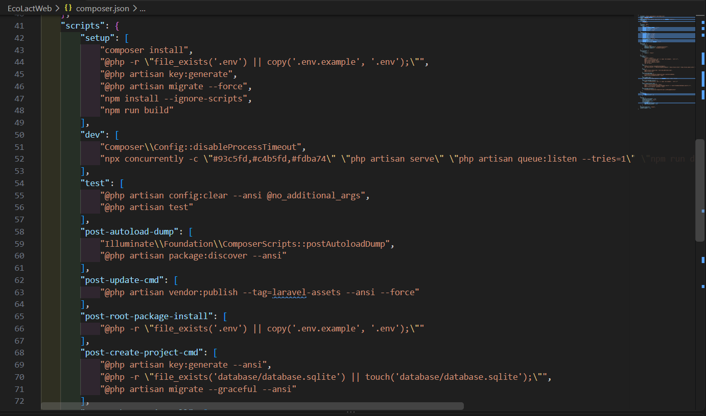
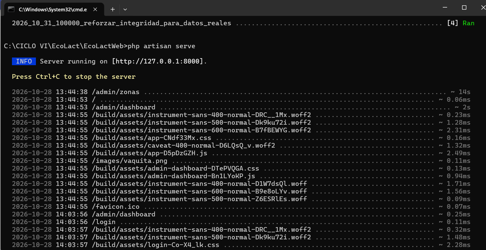

<div class="ec-desarrollo" markdown="1">

<div class="ec-dev-banner" markdown="1">

:material-server: 3. Configurar y ejecutar backend

</div>

<div class="ec-dev-content" markdown="1">

<span class="ec-dev-kicker">EcoLact / Guía de desarrollo</span>

# Backend Laravel 13

El backend atiende la interfaz web y la API móvil. El procedimiento parte de una copia nueva y una base de desarrollo: instala bibliotecas, configura el entorno y levanta los procesos necesarios.

<div class="ec-dev-step" markdown="1">

### Paso 1. Instalar dependencias

Desde la raíz de EcoLact, entra al proyecto PHP. Composer resuelve el autoload y las bibliotecas que necesita Laravel.

<div class="ec-dev-command" markdown="1">

```powershell
cd EcoLactWeb
composer install
composer check-platform-reqs
```

</div>

**Qué hace:** cd cambia el directorio; install usa composer.lock cuando existe. La comprobación contrasta PHP y extensiones con los paquetes instalados.

<div class="ec-dev-result" markdown="1">

**Resultado esperado:** Se crea vendor/ y los requisitos de plataforma se cumplen.

**Comprobación:** Comprueba vendor/autoload.php y revisa que Composer no indique extensiones o versiones incompatibles.

</div>

</div>

<div class="ec-dev-capture" markdown="1">

### Dependencias del backend

[](../assets/images/desarrollo/backend-dependencias.png)

**Archivo:** `backend-dependencias.png`

**Qué debe mostrar:** La finalización de composer install y la comprobación de requisitos PHP.

**Herramienta:** PowerShell.

<div class="ec-dev-meta" markdown="1">

Reemplaza el PNG en `docs/assets/images/desarrollo/` con el mismo nombre y vuelve a generar el sitio. No es necesario editar esta página. Mientras se conserva el marcador, no constituye evidencia de ejecución.

</div>

</div>

<div class="ec-dev-step" markdown="1">

### Paso 2. Crear el entorno local

La plantilla contiene nombres y valores de ejemplo. Cópiala **solo si .env no existe**; si ya existe, revisa la configuración propia sin sobrescribirla. Genera la clave únicamente para una instalación nueva.

<div class="ec-dev-command" markdown="1">

```powershell
if (-not (Test-Path .env)) { Copy-Item .env.example .env }
# Solo en una instalación nueva, sin APP_KEY configurada:
php artisan key:generate
```

</div>

**Qué hace:** La copia prepara las variables locales; key:generate establece la clave criptográfica usada por Laravel. No es la contraseña de MySQL ni un token de Sanctum.

<div class="ec-dev-result" markdown="1">

**Resultado esperado:** Existe .env y APP_KEY tiene un valor generado localmente.

**Comprobación:** Comprueba su presencia en el editor sin mostrarla en capturas. No regeneres una clave de un entorno en uso: puede invalidar información cifrada.

</div>

</div>

<div class="ec-dev-result" markdown="1">

`.env` está ignorado por Git en EcoLactWeb. Configura credenciales propias y no lo compartas; la guía solo muestra valores ficticios. Verifica también `APP_ENV=local` y usa `APP_DEBUG=true` exclusivamente en desarrollo.

</div>

<div class="ec-dev-step" markdown="1">

### Paso 3. Preparar la conexión MySQL

Inicia MySQL y crea una base vacía de desarrollo siguiendo [Base de datos](base-datos.md). Después ajusta estas variables en .env; sustituye los valores ficticios.

<div class="ec-dev-command" markdown="1">

```dotenv
DB_CONNECTION=mysql
DB_HOST=127.0.0.1
DB_PORT=3306
DB_DATABASE=ecolactv1
DB_USERNAME=usuario_local
DB_PASSWORD=valor_privado
```

</div>

**Qué hace:** DB_CONNECTION selecciona el motor; host, puerto y nombre identifican el servicio y el esquema. Usuario y contraseña pertenecen a tu instalación.

<div class="ec-dev-result" markdown="1">

**Resultado esperado:** Laravel apunta a la base ecolactv1 del entorno elegido.

**Comprobación:** Confirma en el cliente MySQL el servidor y esquema seleccionados antes de migrar. Si había configuración cacheada, ejecuta php artisan config:clear.

</div>

</div>

<div class="ec-dev-step" markdown="1">

### Paso 4. Aplicar migraciones

Con la conexión confirmada, crea o actualiza la estructura versionada. Estas órdenes se ejecutan desde EcoLactWeb.

<div class="ec-dev-command" markdown="1">

```powershell
php artisan config:clear
php artisan migrate
php artisan migrate:status
```

</div>

**Qué hace:** config:clear descarta configuración cacheada; migrate aplica migraciones pendientes y status lista su estado.

<div class="ec-dev-result" markdown="1">

**Resultado esperado:** Las migraciones de esta revisión figuran aplicadas.

**Comprobación:** Revisa migrate:status y las tablas en MySQL. Si hay un fallo, identifica la migración y causa antes de repetir; no borres la base para ocultarlo.

</div>

</div>

<div class="ec-dev-step" markdown="1">

### Paso 5. Cargar datos iniciales

Revisa DatabaseSeeder y configura ECOLACT_ADMIN_USERNAME y ECOLACT_ADMIN_PASSWORD con valores locales propios antes de continuar. Los seeders no representan una carga completa de datos operativos.

<div class="ec-dev-command" markdown="1">

```powershell
php artisan db:seed
```

</div>

**Qué hace:** Invoca los siete seeders registrados: roles, administrador, parámetros de calidad, precio de leche, reglas de pago, zonas y delimitaciones iniciales.

<div class="ec-dev-result" markdown="1">

**Resultado esperado:** Los catálogos y el usuario inicial están disponibles.

**Comprobación:** Consulta las tablas de catálogo y prueba el acceso con tus credenciales. Revisa el comportamiento de actualización descrito en [Base de datos](base-datos.md).

</div>

</div>

<div class="ec-dev-result warning" markdown="1">

**Reejecutar seeders modifica datos.** AdminUserSeeder usa updateOrInsert y vuelve a escribir la contraseña del usuario elegido; también activa el cambio obligatorio de contraseña. No ejecutes db:seed indiscriminadamente en una base compartida.

</div>

<div class="ec-dev-step" markdown="1">

### Paso 6. Iniciar Laravel

Abre una terminal en EcoLactWeb y mantenla activa. El servidor de desarrollo atiende rutas web y API.

<div class="ec-dev-command" markdown="1">

```powershell
php artisan serve
```

</div>

**Qué hace:** Inicia el servidor local; normalmente anuncia http://127.0.0.1:8000. Usa siempre la dirección realmente mostrada.

<div class="ec-dev-result" markdown="1">

**Resultado esperado:** La web responde en el navegador y la terminal permanece ejecutándose.

**Comprobación:** Abre la dirección anunciada. Si solicita recursos frontend o la página aparece sin estilos, completa el paso de Vite.

</div>

</div>

<div class="ec-dev-step" markdown="1">

### Paso 7. Ejecutar Vite

En otra terminal ubicada en EcoLactWeb, instala las dependencias JavaScript y arranca el servidor de recursos.

<div class="ec-dev-command" markdown="1">

```powershell
npm install
npm run dev
```

</div>

**Qué hace:** install prepara node_modules; dev ejecuta vite según package.json. Vite sirve CSS/JavaScript y recarga cambios; Laravel sigue atendiendo la aplicación.

<div class="ec-dev-result" markdown="1">

**Resultado esperado:** Ambos procesos permanecen activos y la web carga sus recursos.

**Comprobación:** Recarga la web y comprueba en las herramientas del navegador que CSS y JavaScript no fallan. La terminal de Vite anuncia su propio puerto.

</div>

</div>

<div class="ec-dev-diagram" markdown="1">



[Ampliar diagrama](../assets/diagrams/desarrollo/servidores.svg) · [Fuente Mermaid](../assets/diagrams/desarrollo/servidores.mmd)

</div>

## Comandos de referencia

<div class="ec-dev-command-table" markdown="1">

| Comando | ¿Para qué sirve? |
| --- | --- |
| `cd EcoLactWeb` | Entrar al proyecto PHP desde la raíz. |
| `composer install` | Instalar las dependencias PHP bloqueadas. |
| `Copy-Item .env.example .env` | Crear la configuración inicial, solo si .env no existe. |
| `php artisan key:generate` | Generar APP_KEY en una instalación nueva. |
| `php artisan migrate` | Aplicar cambios de estructura pendientes. |
| `php artisan db:seed` | Ejecutar los seeders registrados y sus actualizaciones. |
| `php artisan serve` | Atender la aplicación en desarrollo. |
| `npm install` | Instalar dependencias frontend. |
| `npm run dev` | Iniciar Vite y su recarga de recursos. |
| `npm run build` | Generar los recursos compilados, sin dejar Vite activo. |
| `composer run dev` | Alternativa definida en composer.json: coordina servidor, queue:listen y Vite. No usar simultáneamente con los procesos ya iniciados. |

</div>

<div class="ec-dev-result" markdown="1">

El script `composer run setup` existe, pero encadena generación de clave y migraciones con `--force`. Para la primera configuración se documentan los pasos separados, de modo que puedas revisar el entorno antes de modificarlo.

</div>

## Errores frecuentes y comprobaciones

<div class="ec-dev-command-table" markdown="1">

| Situación | Qué comprobar |
| --- | --- |
| Composer no reconocido | Revisa instalación y PATH; abre otra terminal y ejecuta composer --version. |
| Base no disponible | Comprueba servicio, host, puerto, usuario y existencia del esquema; no confundir MySQL con el servidor web. |
| Falta .env | Crea la copia inicial y APP_KEY. Si ya existe, no lo reemplaces para resolver otro error. |
| Recursos frontend faltantes | Ejecuta npm install y npm run dev desde EcoLactWeb, o genera npm run build. |
| Puerto ocupado | Identifica el proceso o usa php artisan serve --port=8001. Actualiza la URL móvil para ese puerto. |
| PHP incompatible o extensiones ausentes | Revisa el PHP de la terminal y composer check-platform-reqs. La conexión MySQL necesita pdo_mysql; el preprocesado OCR usa GD. |

</div>

<div class="ec-dev-capture" markdown="1">

### Servidores de desarrollo

[](../assets/images/desarrollo/backend-servidor.png)

**Archivo:** `backend-servidor.png`

**Qué debe mostrar:** Laravel y Vite ejecutándose en terminales separadas y sus direcciones locales.

**Herramienta:** Terminales de VS Code.

<div class="ec-dev-meta" markdown="1">

Reemplaza el PNG en `docs/assets/images/desarrollo/` con el mismo nombre y vuelve a generar el sitio. No es necesario editar esta página. Mientras se conserva el marcador, no constituye evidencia de ejecución.

</div>

</div>

<div class="ec-dev-sources" markdown="1">

<details markdown="1">
<summary>Fuentes verificables del repositorio</summary>

- [EcoLactWeb/composer.json](https://github.com/MilkonMamani/EcoLact/blob/75901337489dbe3c61bf5e95357ea365790ab565/EcoLactWeb/composer.json)
- [EcoLactWeb/composer.lock](https://github.com/MilkonMamani/EcoLact/blob/75901337489dbe3c61bf5e95357ea365790ab565/EcoLactWeb/composer.lock)
- [EcoLactWeb/package.json](https://github.com/MilkonMamani/EcoLact/blob/75901337489dbe3c61bf5e95357ea365790ab565/EcoLactWeb/package.json)
- [EcoLactWeb/.env.example](https://github.com/MilkonMamani/EcoLact/blob/75901337489dbe3c61bf5e95357ea365790ab565/EcoLactWeb/.env.example)
- [EcoLactWeb/.gitignore](https://github.com/MilkonMamani/EcoLact/blob/75901337489dbe3c61bf5e95357ea365790ab565/EcoLactWeb/.gitignore)
- [EcoLactWeb/config/database.php](https://github.com/MilkonMamani/EcoLact/blob/75901337489dbe3c61bf5e95357ea365790ab565/EcoLactWeb/config/database.php)
- [EcoLactWeb/database/seeders/DatabaseSeeder.php](https://github.com/MilkonMamani/EcoLact/blob/75901337489dbe3c61bf5e95357ea365790ab565/EcoLactWeb/database/seeders/DatabaseSeeder.php)
- [EcoLactWeb/database/seeders/AdminUserSeeder.php](https://github.com/MilkonMamani/EcoLact/blob/75901337489dbe3c61bf5e95357ea365790ab565/EcoLactWeb/database/seeders/AdminUserSeeder.php)

Revisión de referencia: `75901337489d`. Los procedimientos se contrastaron con estas fuentes; los comandos de instalación, migración y compilación del producto no se ejecutaron para elaborar esta guía.

</details>

</div>

<div class="ec-dev-nav" markdown="1">

[← Organización del proyecto](repositorio.md)

[Aplicación móvil con Kotlin Multiplatform →](mobile.md)

</div>

</div>

</div>

