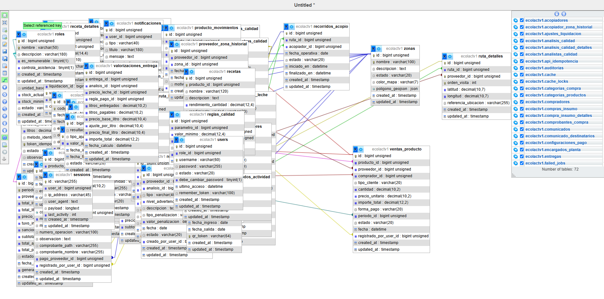
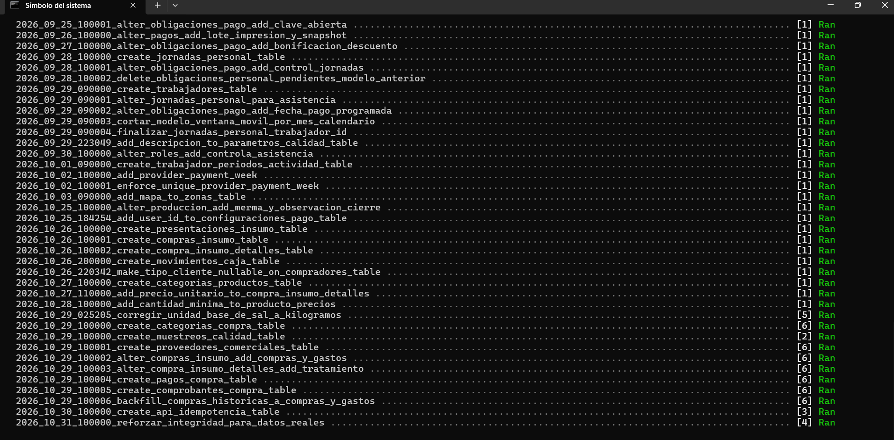

<div class="ec-desarrollo" markdown="1">

<div class="ec-dev-banner" markdown="1">

:material-database-cog: 5. Base de datos y seeders

</div>

<div class="ec-dev-content" markdown="1">

<span class="ec-dev-kicker">EcoLact / Guía de desarrollo</span>

# Configuración de MySQL

MySQL conserva los registros centrales utilizados por Laravel. Preparar una base local identificable permite aplicar la estructura versionada y revisar los catálogos sin intervenir sobre información operativa real.

## Paso 1. Preparar el servicio

Inicia MySQL mediante el gestor de tu instalación y abre un cliente como MySQL Workbench. Comprueba el servidor, puerto y usuario que vas a utilizar. PHP necesita pdo_mysql para establecer la conexión; el cliente gráfico por sí solo no demuestra que PHP pueda conectarse. No se fija una versión de MySQL que el repositorio no declara.

<div class="ec-dev-step" markdown="1">

### Paso 2. Crear la base de desarrollo

La plantilla `.env.example` conserva DB_DATABASE=ecolactv1. Ejecuta el siguiente SQL en tu servidor local de desarrollo, con una cuenta autorizada. Si ese nombre ya contiene datos, utiliza otra base y actualiza DB_DATABASE.

<div class="ec-dev-command" markdown="1">

```sql
CREATE DATABASE IF NOT EXISTS ecolactv1
  CHARACTER SET utf8mb4
  COLLATE utf8mb4_unicode_ci;
```

</div>

**Qué hace:** Crea el esquema si no existe; no crea un usuario ni concede permisos. Charset y collation coinciden con los valores predeterminados de la conexión MySQL del proyecto.

<div class="ec-dev-result" markdown="1">

**Resultado esperado:** Existe el esquema destinado a esta copia.

**Comprobación:** Selecciona el esquema en el cliente. IF NOT EXISTS no valida que una base existente esté vacía ni que corresponda a desarrollo.

</div>

</div>

<div class="ec-dev-step" markdown="1">

### Paso 3. Configurar Laravel

En EcoLactWeb/.env establece estos valores como plantilla; usuario_local y valor_privado son marcadores, no credenciales funcionales.

<div class="ec-dev-command" markdown="1">

```dotenv
DB_CONNECTION=mysql
DB_HOST=127.0.0.1
DB_PORT=3306
DB_DATABASE=ecolactv1
DB_USERNAME=usuario_local
DB_PASSWORD=valor_privado
```

</div>

**Qué hace:** Selecciona MySQL y localiza la base y la cuenta con acceso. config/database.php puede usar SQLite si no se declara DB_CONNECTION; esta guía elige MySQL explícitamente.

<div class="ec-dev-result" markdown="1">

**Resultado esperado:** La aplicación tiene la conexión del entorno correcto.

**Comprobación:** Comprueba la correspondencia con el cliente MySQL y ejecuta php artisan config:clear desde EcoLactWeb.

</div>

</div>

<div class="ec-dev-diagram" markdown="1">



[Ampliar diagrama](../assets/diagrams/desarrollo/mysql.svg) · [Fuente Mermaid](../assets/diagrams/desarrollo/mysql.mmd)

</div>

<div class="ec-dev-step" markdown="1">

### Paso 4. Aplicar la estructura

Las migraciones son la referencia versionada para construir y evolucionar las tablas. Revisa el entorno antes de ejecutar.

<div class="ec-dev-command" markdown="1">

```powershell
php artisan migrate
php artisan migrate:status
```

</div>

**Qué hace:** migrate aplica archivos pendientes de database/migrations; status muestra cuáles quedaron ejecutados.

<div class="ec-dev-result" markdown="1">

**Resultado esperado:** El esquema contiene las tablas previstas por esta revisión.

**Comprobación:** Revisa el estado de todas las migraciones y el listado de tablas. Hay archivos que agregan columnas, índices o transforman estructuras: no importes además un SQL histórico como segundo procedimiento normal.

</div>

</div>

<div class="ec-dev-step" markdown="1">

### Paso 5. Cargar los seeders

Define primero ECOLACT_ADMIN_USERNAME y ECOLACT_ADMIN_PASSWORD con datos propios. Revisa los siete seeders que llama DatabaseSeeder.

<div class="ec-dev-command" markdown="1">

```powershell
php artisan db:seed
```

</div>

**Qué hace:** Inserta o actualiza los datos iniciales según cada implementación; no crea una demostración completa de todos los módulos.

<div class="ec-dev-result" markdown="1">

**Resultado esperado:** Roles, administrador, parámetros, precio inicial, reglas de pago y zonas quedan disponibles.

**Comprobación:** Consulta los catálogos y verifica el acceso inicial. Las delimitaciones referenciales deben revisarse por el administrador.

</div>

</div>

## Qué crea o modifica cada seeder

<div class="ec-dev-command-table" markdown="1">

| Seeder | Comportamiento observado |
| --- | --- |
| RoleSeeder | Seis roles. updateOrInsert actualiza indicadores de remuneración y control de asistencia. |
| AdminUserSeeder | Crea o actualiza el usuario de ECOLACT_ADMIN_USERNAME; vuelve a escribir el hash de la contraseña, lo activa y exige cambio de contraseña. |
| ParametroCalidadSeeder | Siete parámetros: densidad, grasa, proteína, lactosa, pH, agua añadida y temperatura. Actualiza su descripción, unidad y estado. |
| PrecioLecheSeeder | Precio inicial de 1.70 por litro, vigente desde 2020-01-01, asociado al administrador configurado. Si no lo encuentra, no lo crea. |
| ReglaPagoCalidadSeeder | Reglas monetarias para ACEPTADA, OBSERVADA y RECHAZADA. La regla observada tiene ajuste -0.10. |
| ZonaSeeder | Collana 1, Collana 2, Faon y Yasin. Evita duplicar nombres equivalentes y completa colores faltantes. |
| ZonaDelimitacionSeeder | Añade polígonos operativos referenciales alrededor de Huata solo si falta geometría. No son límites oficiales; conserva delimitaciones editadas. |

</div>

<div class="ec-dev-result warning" markdown="1">

**No confundir repetibilidad con ausencia de cambios.** Varios seeders usan updateOrInsert: repetirlos puede sobrescribir valores editados y restablecer la contraseña del administrador. Las delimitaciones iniciales requieren validación operativa.

</div>

<div class="ec-dev-step" markdown="1">

### Paso 6. Verificar la conexión y estructura

En el cliente MySQL, abre la misma base que configuraste en Laravel.

<div class="ec-dev-command" markdown="1">

```sql
USE ecolactv1;
SELECT DATABASE();
SHOW TABLES;
SELECT nombre FROM roles;
SELECT nombre FROM zonas;
```

</div>

**Qué hace:** Las consultas identifican el esquema, enumeran las tablas y revisan catálogos sin mostrar datos personales.

<div class="ec-dev-result" markdown="1">

**Resultado esperado:** Aparecen las tablas migradas y los roles y zonas sembrados.

**Comprobación:** Compara con php artisan migrate:status: el cliente MySQL y Artisan deben observar la misma base. No basta con que Workbench conecte a otro servidor.

</div>

</div>

<div class="ec-dev-result warning" markdown="1">

`migrate:fresh --seed` **elimina las tablas existentes** y vuelve a crear y sembrar la base. No forma parte del procedimiento normal. Solo tiene sentido en un entorno de pruebas desechable cuya pérdida de datos se haya aceptado.

</div>

<div class="ec-dev-capture" markdown="1">

### Base de desarrollo

[](../assets/images/desarrollo/mysql-base-datos.png)

**Archivo:** `mysql-base-datos.png`

**Qué debe mostrar:** El esquema ecolactv1 y su listado de tablas, sin registros personales.

**Herramienta:** MySQL Workbench o cliente MySQL.

<div class="ec-dev-meta" markdown="1">

Reemplaza el PNG en `docs/assets/images/desarrollo/` con el mismo nombre y vuelve a generar el sitio. No es necesario editar esta página. Mientras se conserva el marcador, no constituye evidencia de ejecución.

</div>

</div>

<div class="ec-dev-capture" markdown="1">

### Estado de las migraciones

[](../assets/images/desarrollo/mysql-migraciones.png)

**Archivo:** `mysql-migraciones.png`

**Qué debe mostrar:** La finalización de migrate y el listado migrate:status.

**Herramienta:** PowerShell.

<div class="ec-dev-meta" markdown="1">

Reemplaza el PNG en `docs/assets/images/desarrollo/` con el mismo nombre y vuelve a generar el sitio. No es necesario editar esta página. Mientras se conserva el marcador, no constituye evidencia de ejecución.

</div>

</div>

<div class="ec-dev-sources" markdown="1">

<details markdown="1">
<summary>Fuentes verificables del repositorio</summary>

- [EcoLactWeb/.env.example](https://github.com/MilkonMamani/EcoLact/blob/75901337489dbe3c61bf5e95357ea365790ab565/EcoLactWeb/.env.example)
- [EcoLactWeb/config/database.php](https://github.com/MilkonMamani/EcoLact/blob/75901337489dbe3c61bf5e95357ea365790ab565/EcoLactWeb/config/database.php)
- [EcoLactWeb/database/migrations](https://github.com/MilkonMamani/EcoLact/tree/75901337489dbe3c61bf5e95357ea365790ab565/EcoLactWeb/database/migrations)
- [EcoLactWeb/database/seeders/DatabaseSeeder.php](https://github.com/MilkonMamani/EcoLact/blob/75901337489dbe3c61bf5e95357ea365790ab565/EcoLactWeb/database/seeders/DatabaseSeeder.php)
- [EcoLactWeb/database/seeders/RoleSeeder.php](https://github.com/MilkonMamani/EcoLact/blob/75901337489dbe3c61bf5e95357ea365790ab565/EcoLactWeb/database/seeders/RoleSeeder.php)
- [EcoLactWeb/database/seeders/AdminUserSeeder.php](https://github.com/MilkonMamani/EcoLact/blob/75901337489dbe3c61bf5e95357ea365790ab565/EcoLactWeb/database/seeders/AdminUserSeeder.php)
- [EcoLactWeb/database/seeders/ParametroCalidadSeeder.php](https://github.com/MilkonMamani/EcoLact/blob/75901337489dbe3c61bf5e95357ea365790ab565/EcoLactWeb/database/seeders/ParametroCalidadSeeder.php)
- [EcoLactWeb/database/seeders/PrecioLecheSeeder.php](https://github.com/MilkonMamani/EcoLact/blob/75901337489dbe3c61bf5e95357ea365790ab565/EcoLactWeb/database/seeders/PrecioLecheSeeder.php)
- [EcoLactWeb/database/seeders/ReglaPagoCalidadSeeder.php](https://github.com/MilkonMamani/EcoLact/blob/75901337489dbe3c61bf5e95357ea365790ab565/EcoLactWeb/database/seeders/ReglaPagoCalidadSeeder.php)
- [EcoLactWeb/database/seeders/ZonaSeeder.php](https://github.com/MilkonMamani/EcoLact/blob/75901337489dbe3c61bf5e95357ea365790ab565/EcoLactWeb/database/seeders/ZonaSeeder.php)
- [EcoLactWeb/database/seeders/ZonaDelimitacionSeeder.php](https://github.com/MilkonMamani/EcoLact/blob/75901337489dbe3c61bf5e95357ea365790ab565/EcoLactWeb/database/seeders/ZonaDelimitacionSeeder.php)

Revisión de referencia: `75901337489d`. Los procedimientos se contrastaron con estas fuentes; los comandos de instalación, migración y compilación del producto no se ejecutaron para elaborar esta guía.

</details>

</div>

<div class="ec-dev-nav" markdown="1">

[← Aplicación móvil con Kotlin Multiplatform](mobile.md)

[Configuración del proyecto →](configuracion.md)

</div>

</div>

</div>

