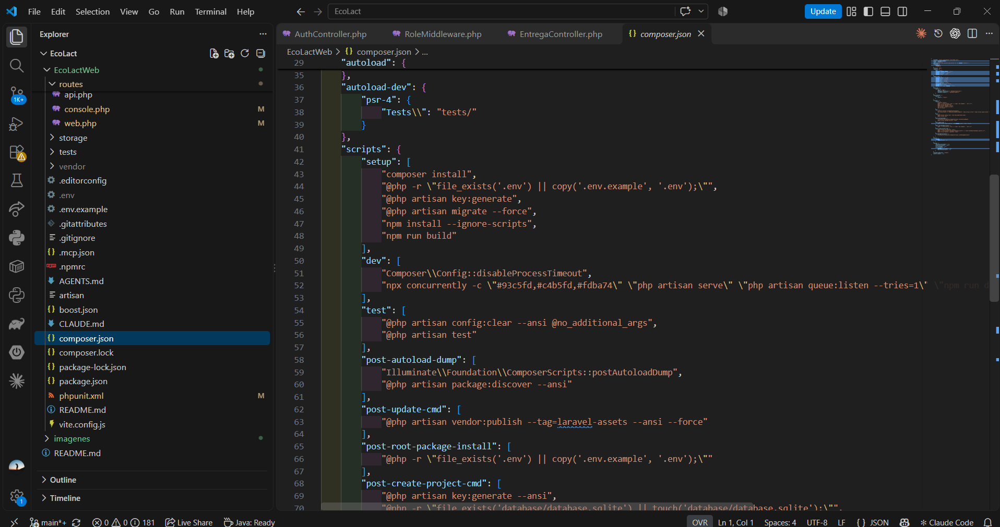

<div class="ec-desarrollo" markdown="1">

<div class="ec-dev-banner" markdown="1">

:material-rocket-launch: 1. Empezar: requisitos y preparación

</div>

<div class="ec-dev-content" markdown="1">

<span class="ec-dev-kicker">EcoLact / Guía de desarrollo</span>

# Comenzar a desarrollar EcoLact

Esta guía prepara el entorno para trabajar con Laravel, Kotlin Multiplatform y la documentación. El objetivo es llegar a una web accesible y una app Android capaz de comunicarse con el mismo backend, antes de modificar funcionalidades.

## De la descarga a una prueba real

<div class="ec-dev-flow" markdown="1">

<div class="ec-dev-flow-item" markdown="1">

:material-source-repository:

Obtener código

</div>

<div class="ec-dev-flow-item" markdown="1">

:material-tools:

Configurar herramientas

</div>

<div class="ec-dev-flow-item" markdown="1">

:material-play-circle:

Ejecutar proyectos

</div>

<div class="ec-dev-flow-item" markdown="1">

:material-test-tube:

Desarrollar y probar

</div>

</div>

<div class="ec-dev-step" markdown="1">

### Paso 1. Obtener una copia del repositorio

Abre PowerShell en la carpeta donde quieras guardar una **copia nueva**. Git descarga el historial y permite trabajar en una rama propia. Si ya tienes EcoLact, abre esa carpeta; no clones encima de ella.

<div class="ec-dev-command" markdown="1">

```powershell
git clone https://github.com/MilkonMamani/EcoLact.git
cd EcoLact
git status
```

</div>

**Qué hace:** clone crea EcoLact; cd establece el directorio de trabajo y status muestra la rama y los cambios locales.

<div class="ec-dev-result" markdown="1">

**Resultado esperado:** La raíz contiene EcoLactWeb, EcoLactMobile y docs.

**Comprobación:** Comprueba esas tres carpetas en el explorador y que git status reconoce el repositorio.

</div>

</div>

## Herramientas y compatibilidad

Las versiones siguientes provienen de los manifiestos y del bloqueo de dependencias revisados, no de la versión instalada en este equipo.

<div class="ec-dev-tools" markdown="1">

<div class="ec-dev-card blue" markdown="1">

:material-language-php:

### PHP

`composer.json` declara **^8.3** y Laravel **^13.17**. El intérprete y sus extensiones deben satisfacer también `composer.lock`; verifica con `composer check-platform-reqs`.

</div>

<div class="ec-dev-card " markdown="1">

:material-package-variant:

### Composer

Instala las bibliotecas PHP y respeta el archivo de bloqueo con `composer install`. No se fija aquí una versión de Composer que el proyecto no declara.

</div>

<div class="ec-dev-card green" markdown="1">

:material-nodejs:

### Node.js y npm

Vite 8.2.2 y laravel-vite-plugin 3.2.0 bloqueados exigen `^20.19.0` o `>=22.12.0`; la dependencia opcional multiplex exige `>=22.13.0`. Node **22.13.0 o superior dentro de 22.x** satisface estos rangos; no significa que sea la única versión válida. npm no tiene versión fijada.

</div>

<div class="ec-dev-card " markdown="1">

:material-database:

### MySQL

Servicio de base de datos para la guía local. `.env.example` selecciona MySQL y `ecolactv1`; no fija una versión del servidor. Necesitas un usuario propio con permisos sobre la base de desarrollo.

</div>

<div class="ec-dev-card " markdown="1">

:material-git:

### Git

Obtiene el repositorio, permite revisar diferencias y registra cambios. Confirma su disponibilidad con `git --version`.

</div>

<div class="ec-dev-card blue" markdown="1">

:material-android-studio:

### Android Studio

Abre EcoLactMobile, sincroniza Gradle y administra SDK y dispositivos. Selecciona una versión compatible con **AGP 9.0.1**.

</div>

<div class="ec-dev-card orange" markdown="1">

:material-language-java:

### JDK de Gradle

AGP 9.0 requiere **JDK 17** como mínimo. JVM 11 en los módulos define el bytecode objetivo: **no** autoriza ejecutar Gradle con JDK 11. Selecciona JDK 17 para Gradle y comprueba el valor efectivo con el Wrapper.

</div>

<div class="ec-dev-card " markdown="1">

:material-elephant:

### Gradle Wrapper

Incluido: **Gradle 9.1.0**. Usa `gradlew.bat` en Windows; no hace falta instalar otro Gradle global. SDK Android: compile/target **36**, minSdk **24**.

</div>

<div class="ec-dev-card " markdown="1">

:material-web:

### Navegador

Permite revisar la web, la consola y las solicitudes. La app móvil usa la API, mientras el navegador carga la interfaz Blade y los recursos de Vite.

</div>

<div class="ec-dev-card purple" markdown="1">

:material-microsoft-visual-studio-code:

### Editor de código

VS Code puede usarse para PHP, configuración y Markdown; Android Studio facilita el trabajo móvil. Conserva los formatos y archivos de bloqueo del repositorio.

</div>

</div>

La distinción entre JDK y bytecode se apoya en la [compatibilidad oficial de AGP 9.0](https://developer.android.com/build/releases/agp-9-0-0-release-notes). El catálogo declara Kotlin 2.4.10 y Compose Multiplatform 1.11.1; se debe comprobar que todas las dependencias resuelvan al sincronizar, sin cambiar versiones para ocultar un error.

## Comprobar las herramientas

<div class="ec-dev-command" markdown="1">

```powershell
php --version
composer --version
node --version
npm --version
git --version
java -version
```

</div>

<div class="ec-dev-result" markdown="1">

**Resultado esperado:** cada programa muestra su versión. Si uno no se reconoce, revisa su instalación y PATH y abre una terminal nueva. `java -version` describe la terminal; Android Studio puede usar otro JDK de Gradle.

</div>

## Windows y macOS

En Windows usa PowerShell, rutas entre comillas si contienen espacios, Android Studio con SDK 36 y un emulador o teléfono con depuración USB. MySQL y Laravel se ejecutan como procesos distintos.

En macOS, la copia inicial del entorno se hace con `cp .env.example .env` y el Wrapper con `./gradlew`. **iOS necesita macOS y Xcode**, el proyecto `iosApp/iosApp.xcodeproj` y una configuración de firma cuando corresponda. Declarar destinos iOS no demuestra que la app esté completamente validada.

## Ruta de lectura

Continúa con [la estructura](repositorio.md), prepara [Laravel](backend.md) y [MySQL](base-datos.md), y luego configura [Android](mobile.md). Revisa [las variables](configuracion.md) antes de conectar los proyectos y [Git](git.md) antes de compartir cambios.
<div class="ec-dev-capture" markdown="1">

### Entorno de desarrollo

[](../assets/images/desarrollo/entorno-desarrollo.png)

**Archivo:** `entorno-desarrollo.png`

**Qué debe mostrar:** El editor abierto en EcoLact y las herramientas instaladas, sin información privada.

**Herramienta:** VS Code y terminal.

<div class="ec-dev-meta" markdown="1">

Reemplaza el PNG en `docs/assets/images/desarrollo/` con el mismo nombre y vuelve a generar el sitio. No es necesario editar esta página. Mientras se conserva el marcador, no constituye evidencia de ejecución.

</div>

</div>

<div class="ec-dev-sources" markdown="1">

<details markdown="1">
<summary>Fuentes verificables del repositorio</summary>

- [EcoLactWeb/composer.json](https://github.com/MilkonMamani/EcoLact/blob/75901337489dbe3c61bf5e95357ea365790ab565/EcoLactWeb/composer.json)
- [EcoLactWeb/composer.lock](https://github.com/MilkonMamani/EcoLact/blob/75901337489dbe3c61bf5e95357ea365790ab565/EcoLactWeb/composer.lock)
- [EcoLactWeb/package.json](https://github.com/MilkonMamani/EcoLact/blob/75901337489dbe3c61bf5e95357ea365790ab565/EcoLactWeb/package.json)
- [EcoLactWeb/package-lock.json](https://github.com/MilkonMamani/EcoLact/blob/75901337489dbe3c61bf5e95357ea365790ab565/EcoLactWeb/package-lock.json)
- [EcoLactWeb/.env.example](https://github.com/MilkonMamani/EcoLact/blob/75901337489dbe3c61bf5e95357ea365790ab565/EcoLactWeb/.env.example)
- [EcoLactMobile/gradle/libs.versions.toml](https://github.com/MilkonMamani/EcoLact/blob/75901337489dbe3c61bf5e95357ea365790ab565/EcoLactMobile/gradle/libs.versions.toml)
- [EcoLactMobile/gradle/wrapper/gradle-wrapper.properties](https://github.com/MilkonMamani/EcoLact/blob/75901337489dbe3c61bf5e95357ea365790ab565/EcoLactMobile/gradle/wrapper/gradle-wrapper.properties)
- [EcoLactMobile/androidApp/build.gradle.kts](https://github.com/MilkonMamani/EcoLact/blob/75901337489dbe3c61bf5e95357ea365790ab565/EcoLactMobile/androidApp/build.gradle.kts)

Revisión de referencia: `75901337489d`. Los procedimientos se contrastaron con estas fuentes; los comandos de instalación, migración y compilación del producto no se ejecutaron para elaborar esta guía.

</details>

</div>

<div class="ec-dev-nav" markdown="1">

[Organización del proyecto →](repositorio.md)

</div>

</div>

</div>

