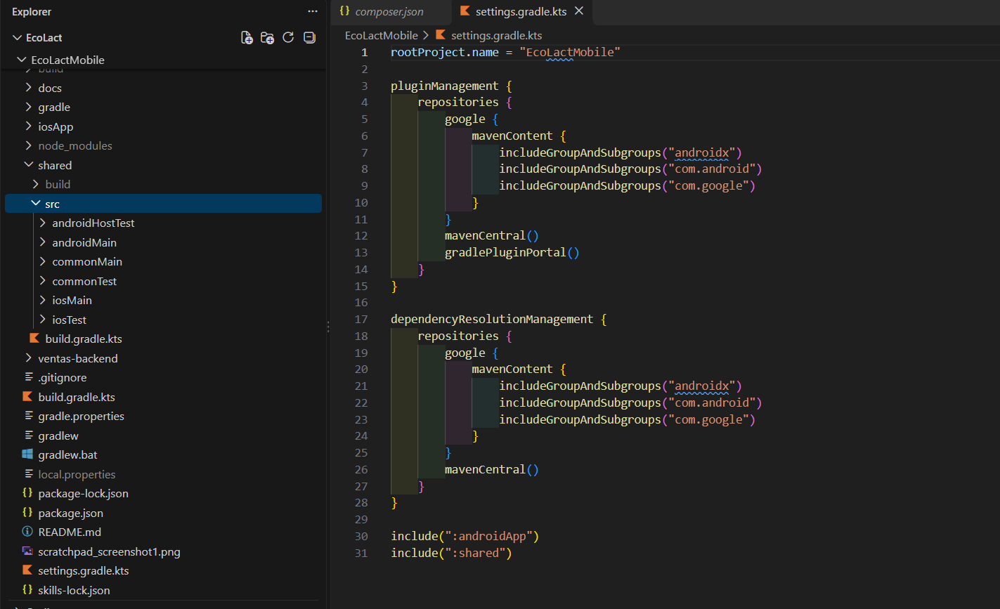
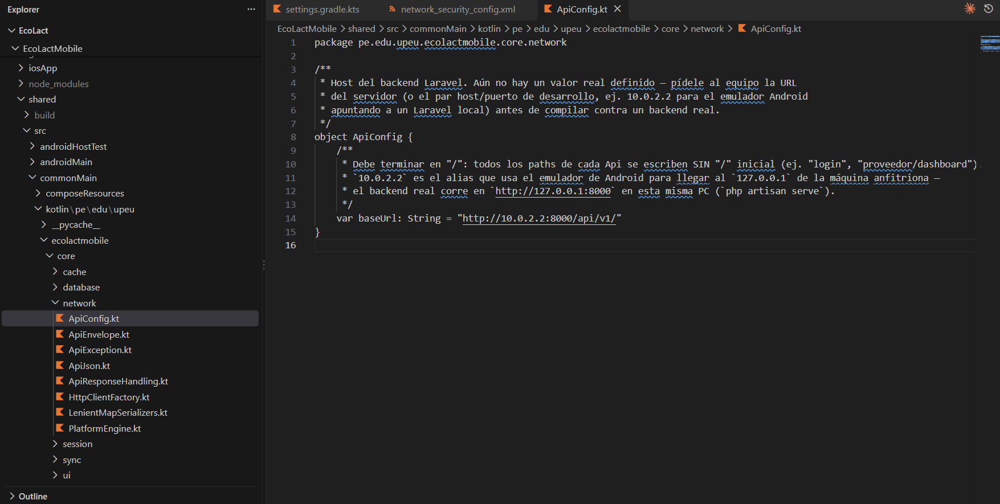
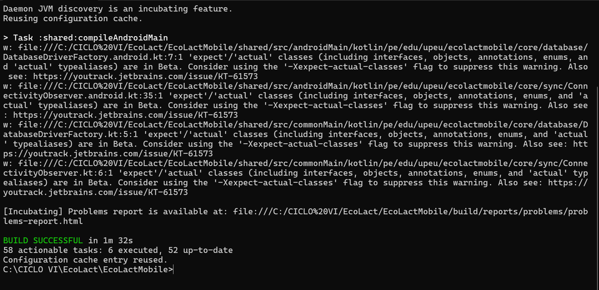

<div class="ec-desarrollo" markdown="1">

<div class="ec-dev-banner" markdown="1">

:material-cellphone-cog: 4. Configurar y ejecutar aplicación móvil

</div>

<div class="ec-dev-content" markdown="1">

<span class="ec-dev-kicker">EcoLact / Guía de desarrollo</span>

# Aplicación móvil con Kotlin Multiplatform

El módulo compartido reúne lógica y UI; Android tiene su propia aplicación de entrada y iOS su proyecto Xcode. Esta guía compila la variante Android de desarrollo y conecta el cliente a Laravel.

## Paso 1. Abrir Android Studio

Selecciona **Open** y abre `EcoLactMobile`, donde está `settings.gradle.kts`. No abras solo shared: el proyecto raíz coordina plugins, repositorios y módulos. **Resultado esperado:** aparecen androidApp y shared; compruébalo en la vista Project.

<div class="ec-dev-capture" markdown="1">

### Proyecto móvil abierto

[](../assets/images/desarrollo/android-studio.png)

**Archivo:** `android-studio.png`

**Qué debe mostrar:** EcoLactMobile importado y los módulos androidApp y shared visibles.

**Herramienta:** Android Studio.

<div class="ec-dev-meta" markdown="1">

Reemplaza el PNG en `docs/assets/images/desarrollo/` con el mismo nombre y vuelve a generar el sitio. No es necesario editar esta página. Mientras se conserva el marcador, no constituye evidencia de ejecución.

</div>

</div>

## Paso 2. Sincronizar Gradle

Selecciona JDK 17 para Gradle en la configuración de Android Studio, instala SDK Platform 36 y las herramientas que solicite el proyecto. Ejecuta **Sync Project with Gradle Files**. Gradle lee los scripts, descarga plugins y dependencias y construye el modelo de tareas. Necesita red para la primera resolución y un SDK localizado por Android Studio o local.properties.

<div class="ec-dev-command" markdown="1">

```powershell
.\gradlew.bat --version
.\gradlew.bat projects
```

</div>

<div class="ec-dev-result" markdown="1">

**Resultado esperado:** el Wrapper informa Gradle 9.1.0 y un JVM compatible, y projects reconoce :androidApp y :shared. **Comprobación:** revisa Gradle JVM en el IDE y la salida del Wrapper; el Java de otra terminal puede ser distinto. No copies local.properties de otro equipo.

</div>

## Paso 3. Reconocer la estructura

<div class="ec-dev-folder-tree" markdown="1">

```text
EcoLactMobile/
├── androidApp/         # Aplicación Android
├── iosApp/             # Proyecto Xcode
├── shared/             # Kotlin y Compose compartidos
├── gradle/             # Catálogo y Wrapper
├── gradlew.bat
├── build.gradle.kts
└── settings.gradle.kts
```

</div>

Los módulos usan objetivo JVM 11. El catálogo declara AGP 9.0.1, Kotlin 2.4.10 y SQLDelight 2.3.2. Estas declaraciones describen el repositorio; la sincronización debe confirmar su resolución en el equipo.

## Paso 4. Configurar la API

En `shared/src/commonMain/kotlin/pe/edu/upeu/ecolactmobile/core/network/ApiConfig.kt`, el valor actual es:

<div class="ec-dev-command" markdown="1">

```kotlin
var baseUrl: String = "http://10.0.2.2:8000/api/v1/"
```

</div>

El comentario antiguo dice que falta definir el host, pero el valor ejecutable ya apunta al emulador. La URL debe terminar en `/`; los paths del cliente, como `login`, no empiezan con barra. Cambiar `APP_URL` en Laravel **no** reconfigura ApiConfig.

<div class="ec-dev-command-table" markdown="1">

| Entorno | Dirección y comprobación |
| --- | --- |
| Emulador Android | 10.0.2.2 es el alias del equipo anfitrión. Laravel puede atender en 127.0.0.1:8000. localhost dentro de Android apunta al propio Android. |
| Android físico | Usa la IP real del equipo obtenida con ipconfig, la misma red y un puerto accesible. No copies una IP de ejemplo como si fuera universal. |
| Servidor remoto | Usa el dominio real con HTTPS y el prefijo /api/v1/. Confirma certificado y disponibilidad del servidor. |

</div>

<div class="ec-dev-diagram" markdown="1">



[Ampliar diagrama](../assets/diagrams/desarrollo/conexion-mobile.svg) · [Fuente Mermaid](../assets/diagrams/desarrollo/conexion-mobile.mmd)

</div>

Para una prueba en teléfono físico, Laravel debe escuchar fuera del loopback. Desde EcoLactWeb, en una red de desarrollo controlada:

<div class="ec-dev-command" markdown="1">

```powershell
php artisan serve --host=0.0.0.0 --port=8000
```

</div>

Permite el puerto correspondiente en el firewall de la red privada y configura la IP real en ApiConfig. **0.0.0.0 es una dirección de escucha, no la URL que debes poner en el teléfono.** El archivo `androidApp/src/main/res/xml/network_security_config.xml` permite HTTP solo para los hosts enumerados: una nueva IP local puede requerir una entrada de desarrollo explícita. No permite cualquier red local por el mero comentario del archivo. Para un servidor remoto utiliza HTTPS.

<div class="ec-dev-result" markdown="1">

**Comprobación:** confirma que la web del servidor sea accesible desde el dispositivo y después realiza un login de prueba desde la app. Una respuesta HTTP 401/403 significa que existe comunicación pero falta autenticación o autorización; no equivale a un fallo de red.

</div>

<div class="ec-dev-capture" markdown="1">

### Dirección de la API móvil

[](../assets/images/desarrollo/mobile-api.png)

**Archivo:** `mobile-api.png`

**Qué debe mostrar:** ApiConfig.kt con la dirección del entorno, sin cabeceras ni tokens.

**Herramienta:** Android Studio.

<div class="ec-dev-meta" markdown="1">

Reemplaza el PNG en `docs/assets/images/desarrollo/` con el mismo nombre y vuelve a generar el sitio. No es necesario editar esta página. Mientras se conserva el marcador, no constituye evidencia de ejecución.

</div>

</div>

<div class="ec-dev-step" markdown="1">

### Paso 5. Compilar Android

En PowerShell, situado en EcoLactMobile, construye el paquete debug. No es una publicación ni una instalación automática en el dispositivo.

<div class="ec-dev-command" markdown="1">

```powershell
.\gradlew.bat :androidApp:assembleDebug
```

</div>

**Qué hace:** El Wrapper ejecuta la tarea de empaquetado debug del módulo androidApp y sus dependencias.

<div class="ec-dev-result" markdown="1">

**Resultado esperado:** La compilación termina correctamente y produce un APK debug.

**Comprobación:** Revisa androidApp/build/outputs/apk/debug/ y la salida final de Gradle. Si falla, conserva el primer error relevante antes de cambiar configuración.

</div>

</div>

<div class="ec-dev-capture" markdown="1">

### Compilación Android

[](../assets/images/desarrollo/mobile-gradle.png)

**Archivo:** `mobile-gradle.png`

**Qué debe mostrar:** El resultado real de :androidApp:assembleDebug y la variante debug.

**Herramienta:** Android Studio o PowerShell.

<div class="ec-dev-meta" markdown="1">

Reemplaza el PNG en `docs/assets/images/desarrollo/` con el mismo nombre y vuelve a generar el sitio. No es necesario editar esta página. Mientras se conserva el marcador, no constituye evidencia de ejecución.

</div>

</div>

## Paso 6. Ejecutar la aplicación

Crea un emulador compatible con minSdk 24 o conecta un teléfono con depuración USB autorizada. En Android Studio selecciona la configuración del módulo **androidApp**, el dispositivo y **Run**. Mantén Laravel activo. **Resultado esperado:** la pantalla inicial se muestra y permite probar el acceso; verifica una consulta de datos con un usuario del entorno. El APK compilado por sí solo no demuestra conectividad ni corrección funcional.

## Paso 7. Integración iOS

En macOS abre `iosApp/iosApp.xcodeproj` con Xcode y selecciona simulador o dispositivo compatible. shared declara `iosArm64` e `iosSimulatorArm64` y genera el framework estático Shared. Revisa firma y configuración antes de ejecutar en dispositivo. No hay un destino Intel iosX64 declarado.

<div class="ec-dev-result warning" markdown="1">

No se afirma validación completa de iOS. El observador `ConnectivityObserver.ios.kt` revisado conserva una implementación provisional que informa conexión; requiere trabajo y pruebas en macOS. Véase [Offline-first](../arquitectura/offline-first.md).

</div>

## Comandos y diagnóstico

<div class="ec-dev-command-table" markdown="1">

| Comando | ¿Para qué sirve? |
| --- | --- |
| `.\gradlew.bat --version` | Consultar Gradle y JVM efectivos. |
| `.\gradlew.bat projects` | Listar los módulos reconocidos. |
| `.\gradlew.bat :androidApp:assembleDebug` | Construir el APK de desarrollo. |
| `.\gradlew.bat :androidApp:assembleDebug --stacktrace` | Repetir con detalles del error cuando haga falta diagnosticar. |
| `./gradlew :androidApp:assembleDebug` | Equivalente del Wrapper desde una terminal macOS. |

</div>

Si Gradle no sincroniza, revisa JVM, SDK, acceso a google()/Maven Central y el primer error de resolución. Si Laravel no responde, comprueba host, puerto, firewall y permiso HTTP para ese host. Si la API devuelve errores de acceso, revisa credenciales, rol y estado del usuario sin registrar tokens en capturas.
<div class="ec-dev-sources" markdown="1">

<details markdown="1">
<summary>Fuentes verificables del repositorio</summary>

- [EcoLactMobile/settings.gradle.kts](https://github.com/MilkonMamani/EcoLact/blob/75901337489dbe3c61bf5e95357ea365790ab565/EcoLactMobile/settings.gradle.kts)
- [EcoLactMobile/build.gradle.kts](https://github.com/MilkonMamani/EcoLact/blob/75901337489dbe3c61bf5e95357ea365790ab565/EcoLactMobile/build.gradle.kts)
- [EcoLactMobile/gradle/libs.versions.toml](https://github.com/MilkonMamani/EcoLact/blob/75901337489dbe3c61bf5e95357ea365790ab565/EcoLactMobile/gradle/libs.versions.toml)
- [EcoLactMobile/gradle/wrapper/gradle-wrapper.properties](https://github.com/MilkonMamani/EcoLact/blob/75901337489dbe3c61bf5e95357ea365790ab565/EcoLactMobile/gradle/wrapper/gradle-wrapper.properties)
- [EcoLactMobile/androidApp/build.gradle.kts](https://github.com/MilkonMamani/EcoLact/blob/75901337489dbe3c61bf5e95357ea365790ab565/EcoLactMobile/androidApp/build.gradle.kts)
- [EcoLactMobile/shared/build.gradle.kts](https://github.com/MilkonMamani/EcoLact/blob/75901337489dbe3c61bf5e95357ea365790ab565/EcoLactMobile/shared/build.gradle.kts)
- [EcoLactMobile/shared/src/commonMain/kotlin/pe/edu/upeu/ecolactmobile/core/network/ApiConfig.kt](https://github.com/MilkonMamani/EcoLact/blob/75901337489dbe3c61bf5e95357ea365790ab565/EcoLactMobile/shared/src/commonMain/kotlin/pe/edu/upeu/ecolactmobile/core/network/ApiConfig.kt)
- [EcoLactMobile/shared/src/commonMain/kotlin/pe/edu/upeu/ecolactmobile/core/network/HttpClientFactory.kt](https://github.com/MilkonMamani/EcoLact/blob/75901337489dbe3c61bf5e95357ea365790ab565/EcoLactMobile/shared/src/commonMain/kotlin/pe/edu/upeu/ecolactmobile/core/network/HttpClientFactory.kt)
- [EcoLactMobile/androidApp/src/main/res/xml/network_security_config.xml](https://github.com/MilkonMamani/EcoLact/blob/75901337489dbe3c61bf5e95357ea365790ab565/EcoLactMobile/androidApp/src/main/res/xml/network_security_config.xml)
- [EcoLactMobile/iosApp/iosApp.xcodeproj](https://github.com/MilkonMamani/EcoLact/tree/75901337489dbe3c61bf5e95357ea365790ab565/EcoLactMobile/iosApp/iosApp.xcodeproj)
- [EcoLactMobile/shared/src/iosMain/kotlin/pe/edu/upeu/ecolactmobile/core/sync/ConnectivityObserver.ios.kt](https://github.com/MilkonMamani/EcoLact/blob/75901337489dbe3c61bf5e95357ea365790ab565/EcoLactMobile/shared/src/iosMain/kotlin/pe/edu/upeu/ecolactmobile/core/sync/ConnectivityObserver.ios.kt)

Revisión de referencia: `75901337489d`. Los procedimientos se contrastaron con estas fuentes; los comandos de instalación, migración y compilación del producto no se ejecutaron para elaborar esta guía.

</details>

</div>

<div class="ec-dev-nav" markdown="1">

[← Backend Laravel 13](backend.md)

[Configuración de MySQL →](base-datos.md)

</div>

</div>

</div>

