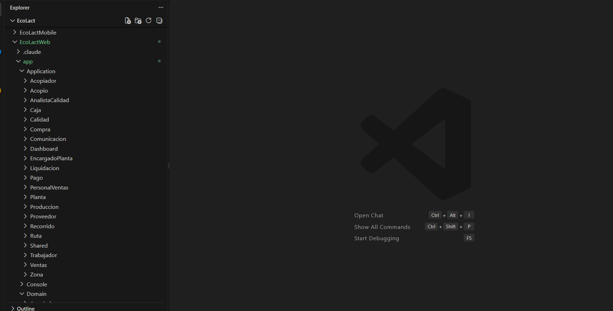

<div class="ec-desarrollo" markdown="1">

<div class="ec-dev-banner" markdown="1">

:material-folder-multiple: 2. Estructura del repositorio

</div>

<div class="ec-dev-content" markdown="1">

<span class="ec-dev-kicker">EcoLact / Guía de desarrollo</span>

# Organización del proyecto

EcoLact reúne tres áreas dentro de un mismo repositorio. Ubicar cada responsabilidad antes de editar evita mezclar reglas de negocio, interfaces y documentación.

## Árbol de trabajo

Vista resumida de directorios comprobados; se omiten carpetas generadas y auxiliares.

<div class="ec-dev-folder-tree" markdown="1">

```text
EcoLact/
├── EcoLactWeb/
│   ├── app/
│   │   ├── Application/
│   │   ├── Domain/
│   │   ├── Http/
│   │   └── Infrastructure/
│   ├── routes/
│   ├── database/
│   │   ├── migrations/
│   │   └── seeders/
│   ├── resources/
│   ├── tests/
│   ├── composer.json
│   ├── package.json
│   └── .env.example
├── EcoLactMobile/
│   ├── androidApp/
│   ├── iosApp/
│   ├── shared/src/
│   │   ├── commonMain/
│   │   ├── androidMain/
│   │   └── iosMain/
│   ├── gradle/
│   ├── gradlew.bat
│   ├── build.gradle.kts
│   └── settings.gradle.kts
└── docs/informeEcoLact/
    ├── mkdocs.yml
    └── docs/
        ├── desarrollo/
        ├── assets/
        └── stylesheets/
```

</div>

<div class="ec-dev-grid" markdown="1">

<div class="ec-dev-card blue" markdown="1">

:material-server:

### Backend Laravel

`app/` contiene dominio, casos de uso, adaptadores y controladores; `routes/` registra entradas web y API. `resources/` contiene las vistas y recursos frontend; `tests/` conserva pruebas.

</div>

<div class="ec-dev-card green" markdown="1">

:material-cellphone-link:

### Aplicación KMP

`shared/` comparte lógica y UI. `androidApp/` es la entrada Android; `iosApp/` contiene el proyecto Xcode. `settings.gradle.kts` incluye los módulos Android y shared.

</div>

<div class="ec-dev-card purple" markdown="1">

:material-book-open-page-variant:

### Documentación

`mkdocs.yml` define navegación y extensiones. Se edita `docs/`, mientras `site/` es salida de compilación. No se crea otro proyecto MkDocs.

</div>

</div>

## ¿Dónde modificar una funcionalidad?

<div class="ec-dev-command-table" markdown="1">

| Necesidad | Dónde buscar |
| --- | --- |
| Modificar una regla de negocio | `EcoLactWeb/app/Domain/` o `EcoLactWeb/app/Application/`. |
| Modificar un endpoint | `EcoLactWeb/routes/api.php` y `EcoLactWeb/app/Http/Controllers/Api/`. |
| Modificar una vista web | `EcoLactWeb/resources/views/` y el controlador correspondiente. |
| Modificar una pantalla móvil | `EcoLactMobile/shared/src/commonMain/kotlin/pe/edu/upeu/ecolactmobile/feature/`. |
| Modificar persistencia local | Archivos `.sq` de `shared/src/commonMain/sqldelight/` y repositorios de `core/database/` o cada funcionalidad. |
| Modificar documentación | `docs/informeEcoLact/docs/`; estilos específicos en `docs/stylesheets/`. |

</div>

<div class="ec-dev-result" markdown="1">

**Ejemplo práctico:** para cambiar una entrega, sigue la pantalla móvil hasta su repositorio, identifica el endpoint y revisa `RegistrarEntrega.php`. La regla compartida por web y API debe mantenerse en el lugar donde realmente se aplica; consulta [Arquitectura](../arquitectura/backend.md).

</div>

## Verificar que estás en la carpeta correcta

<div class="ec-dev-command" markdown="1">

```powershell
Get-Location
Get-ChildItem -Name
```

</div>

**Resultado esperado:** en la raíz aparecen los tres proyectos. Ejecuta Composer y npm desde `EcoLactWeb`, el Wrapper desde `EcoLactMobile` y MkDocs desde `docs/informeEcoLact`. Cambiar de carpeta evita buscar manifiestos o tareas en el proyecto equivocado.
<div class="ec-dev-capture" markdown="1">

### Vista del repositorio

[](../assets/images/desarrollo/estructura-repositorio.png)

**Archivo:** `estructura-repositorio.png`

**Qué debe mostrar:** Las carpetas EcoLactWeb, EcoLactMobile y docs desplegadas.

**Herramienta:** Explorador de VS Code.

<div class="ec-dev-meta" markdown="1">

Reemplaza el PNG en `docs/assets/images/desarrollo/` con el mismo nombre y vuelve a generar el sitio. No es necesario editar esta página. Mientras se conserva el marcador, no constituye evidencia de ejecución.

</div>

</div>

<div class="ec-dev-sources" markdown="1">

<details markdown="1">
<summary>Fuentes verificables del repositorio</summary>

- [EcoLactWeb/app/Domain](https://github.com/MilkonMamani/EcoLact/tree/75901337489dbe3c61bf5e95357ea365790ab565/EcoLactWeb/app/Domain)
- [EcoLactWeb/app/Application](https://github.com/MilkonMamani/EcoLact/tree/75901337489dbe3c61bf5e95357ea365790ab565/EcoLactWeb/app/Application)
- [EcoLactWeb/app/Http/Controllers/Api](https://github.com/MilkonMamani/EcoLact/tree/75901337489dbe3c61bf5e95357ea365790ab565/EcoLactWeb/app/Http/Controllers/Api)
- [EcoLactWeb/resources/views](https://github.com/MilkonMamani/EcoLact/tree/75901337489dbe3c61bf5e95357ea365790ab565/EcoLactWeb/resources/views)
- [EcoLactWeb/tests](https://github.com/MilkonMamani/EcoLact/tree/75901337489dbe3c61bf5e95357ea365790ab565/EcoLactWeb/tests)
- [EcoLactMobile/settings.gradle.kts](https://github.com/MilkonMamani/EcoLact/blob/75901337489dbe3c61bf5e95357ea365790ab565/EcoLactMobile/settings.gradle.kts)
- [EcoLactMobile/shared/src/commonMain/sqldelight](https://github.com/MilkonMamani/EcoLact/tree/75901337489dbe3c61bf5e95357ea365790ab565/EcoLactMobile/shared/src/commonMain/sqldelight)
- [EcoLactMobile/shared/src/androidMain](https://github.com/MilkonMamani/EcoLact/tree/75901337489dbe3c61bf5e95357ea365790ab565/EcoLactMobile/shared/src/androidMain)
- [EcoLactMobile/shared/src/iosMain](https://github.com/MilkonMamani/EcoLact/tree/75901337489dbe3c61bf5e95357ea365790ab565/EcoLactMobile/shared/src/iosMain)
- [EcoLactMobile/iosApp/iosApp.xcodeproj](https://github.com/MilkonMamani/EcoLact/tree/75901337489dbe3c61bf5e95357ea365790ab565/EcoLactMobile/iosApp/iosApp.xcodeproj)
- [docs/informeEcoLact/mkdocs.yml](https://github.com/MilkonMamani/EcoLact/blob/75901337489dbe3c61bf5e95357ea365790ab565/docs/informeEcoLact/mkdocs.yml)

Revisión de referencia: `75901337489d`. Los procedimientos se contrastaron con estas fuentes; los comandos de instalación, migración y compilación del producto no se ejecutaron para elaborar esta guía.

</details>

</div>

<div class="ec-dev-nav" markdown="1">

[← Comenzar a desarrollar EcoLact](index.md)

[Backend Laravel 13 →](backend.md)

</div>

</div>

</div>

