<div class="ec-flujos" markdown="1">
<div class="ec-flow-banner">02 · Flujo de acopio de leche</div>
<div class="ec-flow-content" markdown="1">

<div class="ec-flow-hero" markdown="1">
<div markdown="1">

<span class="ec-flow-kicker">EcoLact / Flujos de negocio</span>

# Flujo de acopio de leche

<p class="ec-flow-subtitle">De la ruta al registro de la entrega</p>

El acopiador atiende los recorridos asignados, identifica al proveedor y registra la entrega real. Elegir una parada no equivale a haber recolectado su leche.

</div>
<figure markdown="1">

{ width="1200" height="800" }

<figcaption>Recurso visual del proyecto. Ilustración del proceso.</figcaption>
</figure>
</div>

<div class="ec-flow-actors" markdown="1">

<div class="ec-flow-card" markdown="1">

:material-account-cog:

**Administrador**

Registra proveedores y organiza zonas, rutas y recorridos.

</div>

<div class="ec-flow-card" markdown="1">

:material-truck-delivery:

**Acopiador**

Identifica, mide, registra y finaliza su recorrido.

</div>

<div class="ec-flow-card" markdown="1">

:material-account:

**Proveedor**

Se identifica con QR o DNI y entrega la leche.

</div>

</div>

## Así funciona el proceso

<div class="ec-flow-diagram" markdown="1">



[Ampliar diagrama](../assets/diagrams/flujos/acopio.svg) · [Descargar fuente Mermaid](../assets/diagrams/flujos/acopio.mmd)

<details markdown="1">
<summary>Ver la fuente editable del diagrama</summary>

```text
flowchart TB
  subgraph ADM[Administrador]
    A([Inicio]) --> B[Registrar proveedores y zonas]
    B --> C[Organizar ruta y asignar recorrido]
  end
  subgraph PRO[Proveedor]
    P[Presentar QR o DNI y entrega]
  end
  subgraph ACO[Acopiador]
    C --> D[Iniciar recorrido propio]
    D --> E[Identificar proveedor]
    P --> E
    E --> F{¿Entregó leche?}
    F -->|Sí| G[Registrar litros]
    F -->|No| H[Marcar NO_ENTREGO]
  end
  subgraph SIS[EcoLact]
    G --> I{¿Datos y permisos válidos?}
    I -->|No| X[Mostrar error y corregir]
    X --> G
    I -->|Sí| J[Guardar entrega e ingreso de leche]
    J --> K[Sincronizar pago pendiente]
    K --> L[Parada RECOLECTADO y notificación]
  end
  H --> M[Actualizar recorrido]
  L --> M
  M --> N{¿Continuar visitas?}
  N -->|Sí| E
  N -->|No| O[Acopiador · Finalizar recorrido]
  O --> Z([Fin · Historial consultable])
  classDef default fill:#eaf3ff,stroke:#7ca5df,color:#123d91,rx:7,ry:7;
  classDef decision fill:#fff3df,stroke:#dca34d,color:#754c0c;
  classDef terminal fill:#e6f7ed,stroke:#72b692,color:#145d3b;
  class F,I,N decision;
  class A,Z terminal;
```

</details>
</div>

## Paso a paso

<div class="ec-flow-steps" markdown="1">

1. El administrador registra proveedores, organiza zonas y rutas y asigna un recorrido con sus paradas al acopiador.
2. El acopiador inicia el recorrido y usa QR o DNI para identificar al proveedor. Debe operar un recorrido propio y abierto.
3. Si recibió leche, registra una cantidad válida de litros; si no recibió, marca «No entregó». No puede marcar así una parada que ya tenga acopio.
4. EcoLact guarda la entrega, ingresa leche y actualiza el pago pendiente en la misma transacción. Solo entonces la parada queda RECOLECTADO.
5. El acopiador revisa el avance y finaliza el recorrido. El caso de uso de cierre verifica propietario y estado abierto; no exige que todas las paradas estén resueltas.

</div>

<div class="ec-flow-grid" markdown="1">

<div class="ec-flow-card green" markdown="1">

### Con entrega

La entrega nace como **PENDIENTE_ANALISIS**, pero ese nombre no obliga a muestrearla. El movimiento **INGRESO_ACOPIO** incorpora la leche inmediatamente.

</div>

<div class="ec-flow-card orange" markdown="1">

### Sin entrega

**NO_ENTREGO** describe la parada. No crea una entrega de cero litros, ingreso de leche ni pago.

</div>

<div class="ec-flow-card purple" markdown="1">

### Reintentos

La clave de idempotencia reutiliza la entrega existente del mismo usuario. Protege contra duplicados al reenviar desde el teléfono.

</div>

</div>

## Validaciones y excepciones

El proveedor y el acopiador deben estar activos. En el registro directo se comprueba la misma zona; en un recorrido se verifica que la parada pertenezca al recorrido del acopiador. El proveedor necesita una zona para guardar la entrega. Las rutas operativas exigen asistencia válida.

Si falta precio o configuración de pago, el acopio no se bloquea: las entregas quedan sin asignar a un pago; las omisiones se reportan al calcular cuando corresponde. La ausencia total de configuraciones hace que el sincronizador termine sin generar pagos.


<div class="ec-flow-result" markdown="1">

**Resultado del proceso**

Entrega e historial disponibles, leche en inventario, parada actualizada y notificación al proveedor. El pendiente se genera o recalcula si hay datos suficientes.

</div>

<details class="ec-flow-evidence" markdown="1">
<summary>Trazabilidad con el código revisado</summary>

Revisión documental: 28 de octubre de 2026. Las rutas siguientes identifican las fuentes locales; no implican haber ejecutado el sistema de negocio.

- `EcoLactWeb/app/Application/Acopio/RegistrarEntrega.php`
- `EcoLactWeb/app/Application/Recorrido/RegistrarAcopioDeRecorrido.php`
- `EcoLactWeb/app/Application/Recorrido/MarcarNoEntrego.php`
- `EcoLactWeb/app/Application/Recorrido/FinalizarRecorrido.php`
- `EcoLactWeb/routes/web.php` y `EcoLactWeb/routes/api.php`

</details>

<div class="ec-flow-links" markdown="1">

[← Todos los flujos](index.md)

[Flujo de control de calidad →](calidad.md)

[Flujo de producción →](produccion.md)

[Valorización, liquidación y pagos →](liquidacion-pagos.md)

</div>
</div>
</div>
