<div class="ec-flujos" markdown="1">
<div class="ec-flow-banner">03 · Flujo de control de calidad</div>
<div class="ec-flow-content" markdown="1">

<div class="ec-flow-hero" markdown="1">
<div markdown="1">

<span class="ec-flow-kicker">EcoLact / Flujos de negocio</span>

# Flujo de control de calidad

<p class="ec-flow-subtitle">Muestreo, revisión y confirmación</p>

El analista trabaja con muestras seleccionadas. La lectura del ticket propone valores; la decisión definitiva se obtiene al confirmar el análisis contra las reglas vigentes.

</div>
<figure markdown="1">

{ width="1200" height="800" }

<figcaption>Recurso visual del proyecto. Ilustración del proceso.</figcaption>
</figure>
</div>

<div class="ec-flow-actors" markdown="1">

<div class="ec-flow-card" markdown="1">

:material-flask:

**Analista de calidad**

Selecciona muestras, revisa valores y confirma.

</div>

<div class="ec-flow-card" markdown="1">

:material-account-cog:

**Administrador**

Configura parámetros y reglas de calidad.

</div>

<div class="ec-flow-card" markdown="1">

:material-account:

**Proveedor**

Recibe el resultado y las advertencias que correspondan.

</div>

</div>

## Así funciona el proceso

<div class="ec-flow-diagram" markdown="1">



[Ampliar diagrama](../assets/diagrams/flujos/calidad.svg) · [Descargar fuente Mermaid](../assets/diagrams/flujos/calidad.mmd)

<details markdown="1">
<summary>Ver la fuente editable del diagrama</summary>

```text
flowchart TB
  A([Inicio · Analista]) --> B[Seleccionar entrega elegible]
  B --> C[Registrar muestra]
  C --> D[Analizar leche]
  D --> E{¿Origen de valores?}
  E -->|Manual| F[Ingresar mediciones]
  E -->|Ticket| G[OCR propone valores]
  F --> H[Revisión humana]
  G --> H
  H --> I[BORRADOR]
  I --> J{¿Valores y reglas disponibles?}
  J -->|No| K[Informar lo que falta]
  K --> H
  J -->|Sí| L{¿Incumplimiento de rechazo?}
  L -->|Sí| R[RECHAZADA]
  L -->|No| M{¿Incumplimiento de observación?}
  M -->|Sí| O[OBSERVADA]
  M -->|No| N[ACEPTADA]
  R --> S[CONFIRMADO · Inmutable]
  O --> S
  N --> S
  S --> T[Notificar y recalcular pago pendiente]
  T --> Z([Fin · Muestra analizada])
  classDef default fill:#eaf3ff,stroke:#7ca5df,color:#123d91,rx:7,ry:7;
  classDef decision fill:#fff3df,stroke:#dca34d,color:#754c0c;
  classDef terminal fill:#e6f7ed,stroke:#72b692,color:#145d3b;
  class E,J,L,M decision;
  class A,Z terminal;
```

</details>
</div>

## Paso a paso

<div class="ec-flow-steps" markdown="1">

1. Seleccionar una entrega existente, no anulada ni analizada, de proveedor activo. La selección aleatoria requiere un sorteo firmado por el servidor; la selección manual también está implementada.
2. Registrar la muestra y realizar el análisis. El sistema evita seleccionar la misma entrega por distintos analistas; el reenvío equivalente del mismo analista devuelve la selección existente.
3. Ingresar valores manualmente o escanear el ticket. Revisar las propuestas OCR y guardar el BORRADOR. La muestra pasa a EN_ANALISIS.
4. Solicitar confirmación. EcoLact evalúa cada valor registrado con la regla vigente a la fecha del análisis y determina el peor incumplimiento.
5. Guardar el análisis CONFIRMADO, marcar la entrega ANALIZADA, actualizar la muestra, notificar al proveedor y recalcular su pago pendiente. OBSERVADA y RECHAZADA generan advertencia.

</div>

<div class="ec-flow-grid" markdown="1">

<div class="ec-flow-card green" markdown="1">

### ACEPTADA

Ningún valor registrado incumple una regla que determine observación o rechazo.

</div>

<div class="ec-flow-card orange" markdown="1">

### OBSERVADA

Hay incumplimiento de observación y no hay uno de rechazo.

</div>

<div class="ec-flow-card red" markdown="1">

### RECHAZADA

Existe incumplimiento de rechazo. **Prevalece sobre OBSERVADA**, aunque otros parámetros sean conformes.

</div>

</div>

## Parámetros y datos incompletos

El catálogo es configurable. El lector de tickets reconoce grasa, SNG, densidad, proteína, lactosa, sales, sólidos totales, agua añadida, punto de congelación, temperatura y pH. Reconocer una etiqueta no sustituye tener el parámetro y su regla configurados.

- Un valor en blanco se omite; no se convierte en cero.
- Un código de parámetro inexistente produce error al guardar.
- Sin valores registrados, no se puede calcular el resultado.
- Si un valor registrado carece de regla vigente, la confirmación falla e indica el parámetro pendiente de configurar.
- No se exige completar automáticamente todo el catálogo: se evalúan los valores registrados.
- Un análisis confirmado no se edita ni se confirma por segunda vez.

<div class="ec-flow-info warning" markdown="1">

**La muestra no representa una etapa obligatoria de cada entrega.** No se inventan límites de grasa, densidad ni otros parámetros: el resultado depende de las reglas configuradas. La confirmación no vuelve a ingresar la leche al inventario.

</div>


<div class="ec-flow-result" markdown="1">

**Resultado del proceso**

Resultado trazable e inmutable, consulta del proveedor y actualización del pendiente. La falta de configuración de pagos no bloquea la confirmación de calidad.

</div>

<details class="ec-flow-evidence" markdown="1">
<summary>Trazabilidad con el código revisado</summary>

Revisión documental: 28 de octubre de 2026. Las rutas siguientes identifican las fuentes locales; no implican haber ejecutado el sistema de negocio.

- `EcoLactWeb/app/Application/Calidad/SeleccionarMuestraCalidad.php`
- `EcoLactWeb/app/Application/Calidad/RegistrarAnalisisCalidad.php`
- `EcoLactWeb/app/Application/Calidad/CalcularResultadoCalidad.php`
- `EcoLactWeb/app/Application/Calidad/FinalizarAnalisisCalidad.php`
- `EcoLactWeb/app/Application/Calidad/TicketAnalizadorParser.php`
- `EcoLactWeb/routes/web.php` y `EcoLactWeb/routes/api.php`

</details>

<div class="ec-flow-links" markdown="1">

[← Todos los flujos](index.md)

[Flujo de acopio de leche →](acopio.md)

[Valorización, liquidación y pagos →](liquidacion-pagos.md)

[Consulta del proveedor →](consulta-proveedor.md)

</div>
</div>
</div>
