<div class="ec-flujos" markdown="1">
<div class="ec-flow-banner">05 · Consulta del proveedor</div>
<div class="ec-flow-content" markdown="1">

<div class="ec-flow-hero" markdown="1">
<div markdown="1">

<span class="ec-flow-kicker">EcoLact / Flujos de negocio</span>

# Consulta del proveedor

<p class="ec-flow-subtitle">Su información, en un solo recorrido</p>

El proveedor accede a sus propios registros para conocer cuánto entregó, qué resultados obtuvo y cómo se compone su pago. Las consultas no equivalen a permisos para modificar las operaciones.

</div>
<figure markdown="1">

{ width="1200" height="800" }

<figcaption>Fotografía ilustrativa generada para esta documentación.</figcaption>
</figure>
</div>

<div class="ec-flow-actors" markdown="1">

<div class="ec-flow-card" markdown="1">

:material-account:

**Proveedor**

Inicia sesión y consulta su información personal.

</div>

</div>

## Así funciona el proceso

<div class="ec-flow-diagram" markdown="1">



[Ampliar diagrama](../assets/diagrams/flujos/consulta-proveedor.svg) · [Descargar fuente Mermaid](../assets/diagrams/flujos/consulta-proveedor.mmd)

<details markdown="1">
<summary>Ver la fuente editable del diagrama</summary>

```text
flowchart TB
  A([Inicio · Proveedor]) --> B[Acceder al portal o app]
  B --> C{¿Sesión y acceso válidos?}
  C -->|No| D[Resolver acceso]
  D --> B
  C -->|Sí| E[Inicio y resumen personal]
  E --> F[Entregas y detalles]
  E --> G[Calidad y análisis]
  E --> H[Liquidaciones y pagos]
  E --> I[Compras de productos]
  E --> J[QR personal]
  E --> K[Comunicados y notificaciones]
  F --> L[Consultar detalle propio]
  G --> L
  H --> L
  I --> L
  J --> M([Fin · Identificación disponible])
  K --> N([Fin · Información consultada])
  L --> N
  classDef default fill:#eaf3ff,stroke:#7ca5df,color:#123d91,rx:7,ry:7;
  classDef decision fill:#fff3df,stroke:#dca34d,color:#754c0c;
  classDef terminal fill:#e6f7ed,stroke:#72b692,color:#145d3b;
  class C decision;
  class A,M,N terminal;
```

</details>
</div>

## Paso a paso

<div class="ec-flow-steps" markdown="1">

1. Iniciar sesión con la cuenta de proveedor y acceder al resumen personal.
2. Elegir entregas, calidad, pagos, compras o comunicaciones y abrir el detalle disponible.
3. Mostrar el QR personal cuando se necesite identificar al proveedor durante el acopio.
4. Actualizar las consultas con conexión. La app puede mostrar información previamente almacenada; eso no garantiza que el saldo o los estados sean los más recientes.

</div>

<div class="ec-flow-grid" markdown="1">

<div class="ec-flow-card " markdown="1">

### Entregas

Litros e historial de registros propios, con acceso al detalle.

</div>

<div class="ec-flow-card " markdown="1">

### Mi calidad

Análisis disponibles y sus resultados; una entrega sin muestra no implica un análisis faltante obligatorio.

</div>

<div class="ec-flow-card green" markdown="1">

### Pagos

Liquidaciones y sus detalles, importe y pago asociado según el registro existente.

</div>

<div class="ec-flow-card " markdown="1">

### Mis compras

Productos comprados y detalles; permite reconocer descuentos de planilla.

</div>

<div class="ec-flow-card purple" markdown="1">

### QR personal

Identificación del proveedor, visible en Inicio de la app.

</div>

<div class="ec-flow-card orange" markdown="1">

### Comunicaciones

Comunicados y notificaciones dirigidos al usuario.

</div>

</div>

## Qué existe en cada canal

<div class="ec-flow-table" markdown="1">

| Información | Portal web | API | App implementada |
| --- | --- | --- | --- |
| Entregas | Lista y detalle | Lista y detalle propios | Entregas y EntregaDetalle |
| Calidad | Análisis y detalle | Análisis y detalle | MiCalidad y AnalisisDetalle |
| Liquidaciones | Mis liquidaciones | Liquidaciones | **Pagos** y detalle de pago |
| Pagos | Rutas conservadas; integrados en detalle de liquidación | Rutas de pagos | Se presentan mediante el recorrido de Pagos; no se supone otra pantalla independiente |
| Compras | Lista y detalle | Lista y detalle | MisCompras y CompraDetalle |
| QR | Página QR | Consulta QR | Dentro de Inicio |
| Comunicaciones | Comunicados y notificaciones | Consultas y lectura | Comunicados, detalles y Notificaciones |

</div>

La navegación móvil está comprobada en `ProveedorRoutes.kt` y `ProveedorApp.kt`. El nombre «Pagos» de la app presenta liquidaciones del backend; no son dos secciones móviles diferentes.


<div class="ec-flow-result" markdown="1">

**Resultado del proceso**

El proveedor puede revisar sus registros sin conocer el código y distinguir una entrega, su análisis, una liquidación y un pago realizado.

</div>

<details class="ec-flow-evidence" markdown="1">
<summary>Trazabilidad con el código revisado</summary>

Revisión documental: 28 de octubre de 2026. Las rutas siguientes identifican las fuentes locales; no implican haber ejecutado el sistema de negocio.

- `EcoLactWeb/app/Application/Proveedor/ObtenerMiQr.php`
- `EcoLactWeb/app/Application/Proveedor/ObtenerDashboardProveedor.php`
- `EcoLactWeb/app/Application/Calidad/ObtenerAnalisisProveedor.php`
- `EcoLactWeb/routes/web.php` y `EcoLactWeb/routes/api.php`
- `EcoLactMobile/shared/src/commonMain/kotlin/pe/edu/upeu/ecolactmobile/feature/` (rutas, repositorios y pantallas del rol correspondiente).

</details>

<div class="ec-flow-links" markdown="1">

[← Todos los flujos](index.md)

[Flujo de acopio de leche →](acopio.md)

[Flujo de control de calidad →](calidad.md)

[Valorización, liquidación y pagos →](liquidacion-pagos.md)

[Integración móvil y web →](integracion.md)

</div>
</div>
</div>
