<div class="ec-flujos" markdown="1">
<div class="ec-flow-banner">09 · Flujo de caja y finanzas</div>
<div class="ec-flow-content" markdown="1">

<div class="ec-flow-hero" markdown="1">
<div markdown="1">

<span class="ec-flow-kicker">EcoLact / Flujos de negocio</span>

# Flujo de caja y finanzas

<p class="ec-flow-subtitle">Cada movimiento tiene una operación de origen</p>

Caja reúne las entradas y salidas registradas por las operaciones del negocio. El administrador consulta el saldo y puede seguir cada movimiento hasta la venta, compra o pago que lo originó.

</div>
<figure markdown="1">

{ width="1200" height="800" }

<figcaption>Recurso visual del proyecto. Ilustración del proceso.</figcaption>
</figure>
</div>

<div class="ec-flow-actors" markdown="1">

<div class="ec-flow-card" markdown="1">

:material-account-cog:

**Administrador**

Consulta saldo, historial y detalle de los movimientos.

</div>

<div class="ec-flow-card" markdown="1">

:material-cash-register:

**Ventas**

Origina entradas al registrar ventas al contado.

</div>

<div class="ec-flow-card" markdown="1">

:material-factory:

**Planta y pagos**

Originan salidas por compras y pagos registrados.

</div>

</div>

## Así funciona el proceso

<div class="ec-flow-diagram" markdown="1">



[Ampliar diagrama](../assets/diagrams/flujos/finanzas.svg) · [Descargar fuente Mermaid](../assets/diagrams/flujos/finanzas.mmd)

<details markdown="1">
<summary>Ver la fuente editable del diagrama</summary>

```text
flowchart TB
  A([Inicio · Confirmar operación]) --> B{¿Qué operación mueve dinero?}
  B --> C[Venta al contado]
  B --> D[Compra de insumos con total positivo]
  B --> E[Pago al proveedor]
  B --> F[Pago al trabajador]
  C -->|ENTRADA · VENTA| G[Caja EcoLact]
  D -->|SALIDA · INSUMOS| G
  E -->|SALIDA · PROVEEDOR| G
  F -->|SALIDA · TRABAJADOR| G
  G --> H[Concepto, fecha, importe y referencia]
  H --> I[Administrador · Historial y detalle]
  I --> J[Saldo: entradas menos salidas]
  J --> Z([Fin · Seguimiento financiero])
  X[Venta de planilla] -. Sin entrada inmediata .-> Y[Descuento del pago semanal]
  W[Compra sin total conocido] -. Sin salida inventada .-> V[Solo inventario]
  classDef default fill:#eaf3ff,stroke:#7ca5df,color:#123d91,rx:7,ry:7;
  classDef decision fill:#fff3df,stroke:#dca34d,color:#754c0c;
  classDef terminal fill:#e6f7ed,stroke:#72b692,color:#145d3b;
  class B decision;
  class A,Z terminal;
```

</details>
</div>

## Paso a paso

<div class="ec-flow-steps" markdown="1">

1. Confirmar la operación que mueve dinero: una venta al contado, una compra con total positivo o un pago realizado.
2. Registrar el movimiento de caja dentro de la misma transacción. Si falla el registro de caja, la operación tampoco queda confirmada.
3. Guardar categoría, concepto, descripción, importe, fecha, referencia de origen y usuario que registró la operación.
4. Consultar el historial y abrir el detalle para reconocer comprador, proveedor o trabajador y su operación asociada.
5. Seguir el saldo acumulado y los indicadores de ingresos, salidas y número de movimientos de hoy.

</div>

<div class="ec-flow-grid" markdown="1">

<div class="ec-flow-card green" markdown="1">

### Entradas

**VENTA:** importe de las ventas registradas al contado.

</div>

<div class="ec-flow-card red" markdown="1">

### Salidas de compras

**INSUMOS:** compra con total conocido mayor que cero.

</div>

<div class="ec-flow-card orange" markdown="1">

### Salidas de pagos

**PROVEEDOR** y **TRABAJADOR:** importe neto del pago realizado.

</div>

</div>

## Cómo leer un movimiento

<div class="ec-flow-table" markdown="1">

| Dato | Para qué sirve |
| --- | --- |
| Origen y categoría | Distinguir una venta, compra o pago |
| Concepto y descripción | Saber qué se registró y a quién corresponde |
| Importe y dirección | Reconocer cuánto entró o salió |
| Fecha | Ubicar cuándo se registró el movimiento |
| Referencia y detalle | Relacionar el movimiento con la operación concreta |
| Usuario de registro | Identificar quién confirmó la operación |

</div>

Las ventas conservan la fecha de su operación. Las compras usan la hora de registro en caja y conservan la fecha de compra en el detalle. Los pagos usan el momento efectivo de registro (`pagadoAt`) cuando está disponible.

<div class="ec-flow-result" markdown="1">

**Saldo = suma de entradas − suma de salidas.** Es el saldo de los movimientos registrados. Una compra sin total no genera salida y, por tanto, su desembolso desconocido no aparece en ese saldo.

</div>

## Evitar duplicar el dinero

Los movimientos se guardan una sola vez por tipo e identificador de referencia. Una venta a cuenta del pago no entra a caja: reduce el neto que luego sale al pagar al proveedor. Tampoco se registra dinero al guardar un borrador OCR, planificar producción o calcular un pendiente.

Las rutas de Caja revisadas ofrecen consulta y panel de detalle al administrador. No se documenta un formulario de movimientos manuales: no aparece en ese flujo implementado.


<div class="ec-flow-result" markdown="1">

**Resultado del proceso**

Historial financiero relacionado con operaciones reales. El administrador puede explicar cada entrada, cada salida y el saldo registrado.

</div>

<details class="ec-flow-evidence" markdown="1">
<summary>Trazabilidad con el código revisado</summary>

Revisión documental: 28 de octubre de 2026. Las rutas siguientes identifican las fuentes locales; no implican haber ejecutado el sistema de negocio.

- `EcoLactWeb/app/Application/Caja/RegistrarMovimientoCaja.php`
- `EcoLactWeb/app/Application/Caja/CajaResumen.php`
- `EcoLactWeb/app/Application/Caja/Contracts/CajaQuery.php`
- `EcoLactWeb/app/Application/Pago/RegistrarPagoObligacion.php`
- `EcoLactWeb/routes/web.php` y `EcoLactWeb/routes/api.php`

</details>

<div class="ec-flow-links" markdown="1">

[← Todos los flujos](index.md)

[Flujo de ventas y compradores →](ventas-caja.md)

[Flujo de insumos y compras →](insumos.md)

[Valorización, liquidación y pagos →](liquidacion-pagos.md)

[Asistencia y personal →](personal-asistencia.md)

</div>
</div>
</div>
