<div class="ec-flujos" markdown="1">
<div class="ec-flow-banner">01 · Vista general de flujos</div>
<div class="ec-flow-content" markdown="1">

<div class="ec-flow-hero" markdown="1">
<div markdown="1">

<span class="ec-flow-kicker">EcoLact / Flujos de negocio</span>

# Flujos de EcoLact

<p class="ec-flow-subtitle">Visión completa del proceso</p>

Desde la entrega de leche hasta la venta de productos: cada operación conecta personas, inventario e información de pago. Explora los diez procesos para entender qué ocurre, quién participa y qué se registra.

</div>
<figure markdown="1">

{ width="1200" height="800" }

<figcaption>Recurso visual del proyecto. Ilustración del proceso.</figcaption>
</figure>
</div>

<div class="ec-flow-actors" markdown="1">

<div class="ec-flow-card" markdown="1">

:material-account-cog:

**Administración**

Configura proveedores,acopiadores, rutas, precios y reglas.

</div>

<div class="ec-flow-card" markdown="1">

:material-truck-delivery:

**Operación**

Acopio, calidad, planta y ventas registran su trabajo.

</div>

<div class="ec-flow-card" markdown="1">

:material-account-check:

**Proveedor**

Entrega leche y consulta sus resultados y pagos.

</div>

</div>

## Así funciona el proceso

<div class="ec-flow-diagram" markdown="1">



[Ampliar diagrama](../assets/diagrams/flujos/index.svg) · [Descargar fuente Mermaid](../assets/diagrams/flujos/index.mmd)

<details markdown="1">
<summary>Ver la fuente editable del diagrama</summary>

```text
flowchart TB
  A([Inicio · Administrador]) --> B[Proveedores, zonas y rutas]
  B --> C[Acopiador · Recorrido y entrega]
  C --> D[Ingreso de leche al inventario]
  C --> E[Pago semanal pendiente]
  C -. Muestreo opcional .-> F[Calidad · Análisis confirmado]
  F --> E
  D --> G[Planta · Producción con insumos]
  H[Compra de insumos] --> G
  G --> I[Ventas · Productos terminados]
  I --> J{Forma de pago}
  J -->|Contado| K[Caja · Entrada]
  J -->|Planilla| E
  E --> L[Administración · Pago al proveedor]
  L --> M[Caja · Salida]
  H -->|Con importe positivo| M
  N[Pago a trabajadores] --> M
  C --> O[Proveedor · Historial y consultas]
  F --> O
  L --> O
  O --> P([Fin · Información disponible])
  classDef default fill:#eaf3ff,stroke:#7ca5df,color:#123d91,rx:7,ry:7;
  classDef decision fill:#fff3df,stroke:#dca34d,color:#754c0c;
  classDef terminal fill:#e6f7ed,stroke:#72b692,color:#145d3b;
  class J decision;
  class A,P terminal;
```

</details>
</div>

## Paso a paso

<div class="ec-flow-steps" markdown="1">

1. Preparar los datos del negocio: personas, zonas, rutas, recetas, precios y reglas vigentes.
2. Registrar el acopio. Una entrega genera inventario y activa el cálculo del pendiente cuando existe configuración suficiente.
3. Seleccionar muestras de calidad cuando corresponda. Su resultado confirmado puede recalcular el pago aún pendiente.
4. Transformar leche e insumos, vender productos y registrar los movimientos de dinero asociados.
5. Consultar el historial desde los portales web y las pantallas móviles implementadas.

</div>

<div class="ec-flow-info" markdown="1">

**Tres recorridos relacionados.** El inventario sigue las cantidades físicas; el pago sigue la semana del proveedor; la caja sigue el dinero efectivamente registrado. No todos avanzan al mismo tiempo.

</div>

## Explorar los procesos

<div class="ec-flow-grid" markdown="1">

[**02 · Flujo de acopio de leche**<span>De la ruta al registro de la entrega →</span>](acopio.md){ .ec-flow-card }

[**03 · Flujo de control de calidad**<span>Muestreo, revisión y confirmación →</span>](calidad.md){ .ec-flow-card }

[**04 · Valorización, liquidación y pagos**<span>De los litros al pago semanal →</span>](liquidacion-pagos.md){ .ec-flow-card }

[**05 · Consulta del proveedor**<span>Su información, en un solo recorrido →</span>](consulta-proveedor.md){ .ec-flow-card }

[**06 · Flujo de producción**<span>De la materia prima al producto terminado →</span>](produccion.md){ .ec-flow-card }

[**07 · Flujo de insumos y compras**<span>Revisar antes de ingresar al almacén →</span>](insumos.md){ .ec-flow-card }

[**08 · Flujo de ventas y compradores**<span>Vender con stock y tarifa vigentes →</span>](ventas-caja.md){ .ec-flow-card }

[**09 · Flujo de caja y finanzas**<span>Cada movimiento tiene una operación de origen →</span>](finanzas.md){ .ec-flow-card }

[**10 · Asistencia y personal**<span>De la marcación al pago del trabajador →</span>](personal-asistencia.md){ .ec-flow-card }

[**11 · Integración móvil y web**<span>Una operación local no es aún una confirmación →</span>](integracion.md){ .ec-flow-card }

</div>

<div class="ec-flow-result" markdown="1">

**Resultado del proceso**

Entregas, análisis, lotes, ventas y pagos conservan sus referencias. La calidad no es una barrera obligatoria entre el acopio y la producción.

</div>

<details class="ec-flow-evidence" markdown="1">
<summary>Trazabilidad con el código revisado</summary>

Revisión documental: 28 de octubre de 2026. Las rutas siguientes identifican las fuentes locales; no implican haber ejecutado el sistema de negocio.

- `EcoLactWeb/app/Application/Acopio/RegistrarEntrega.php`
- `EcoLactWeb/app/Application/Calidad/FinalizarAnalisisCalidad.php`
- `EcoLactWeb/app/Application/Pago/SincronizarPagosProveedor.php`
- `EcoLactWeb/app/Application/Caja/RegistrarMovimientoCaja.php`
- `EcoLactWeb/routes/web.php` y `EcoLactWeb/routes/api.php`

</details>

<div class="ec-flow-links" markdown="1">

[Flujo de acopio de leche →](acopio.md)

[Flujo de caja y finanzas →](finanzas.md)

</div>
</div>
</div>
