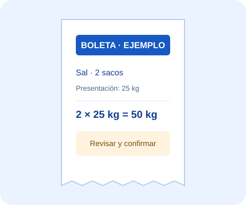

<div class="ec-flujos" markdown="1">
<div class="ec-flow-banner">07 · Flujo de insumos y compras</div>
<div class="ec-flow-content" markdown="1">

<div class="ec-flow-hero" markdown="1">
<div markdown="1">

<span class="ec-flow-kicker">EcoLact / Flujos de negocio</span>

# Flujo de insumos y compras

<p class="ec-flow-subtitle">Revisar antes de ingresar al almacén</p>

Una compra física se convierte en inventario cuando una persona revisa y confirma sus datos. El OCR ayuda a leer la boleta, pero no identifica por sí solo equivalencias ni confirma la compra.

</div>
<figure markdown="1">

{ width="1200" height="800" }

<figcaption>Recurso visual del proyecto. Ilustración del proceso.</figcaption>
</figure>
</div>

<div class="ec-flow-actors" markdown="1">

<div class="ec-flow-card" markdown="1">

:material-factory:

**Encargado de planta**

Revisa la boleta y confirma la compra.

</div>

<div class="ec-flow-card" markdown="1">

:material-account-cog:

**Administrador**

Mantiene el catálogo y las presentaciones.

</div>

<div class="ec-flow-card" markdown="1">

:material-store:

**Proveedor comercial**

Entrega insumos y comprobante físico.

</div>

</div>

## Así funciona el proceso

<div class="ec-flow-diagram" markdown="1">



[Ampliar diagrama](../assets/diagrams/flujos/insumos.svg) · [Descargar fuente Mermaid](../assets/diagrams/flujos/insumos.mmd)

<details markdown="1">
<summary>Ver la fuente editable del diagrama</summary>

```text
flowchart TB
  A([Inicio · Compra física]) --> B[Recibir boleta e insumos]
  B --> C{¿Cómo registrar?}
  C -->|Boleta| D[Escanear y extraer con OCR]
  C -->|Manual| E[Ingresar datos]
  D --> F[Planta · Revisar datos]
  E --> F
  F --> G[Seleccionar insumos y presentaciones]
  G --> H[Convertir a unidad base configurada]
  H --> I[Previsualizar movimiento]
  I --> J{¿Datos correctos?}
  J -->|No| F
  J -->|Sí| K[Persona confirma compra]
  K --> L[Servidor recalcula e incrementa stock]
  L --> M{¿Total conocido y positivo?}
  M -->|Sí| N[Salida de caja · INSUMOS]
  M -->|No| O[Sin movimiento de caja]
  N --> Z([Fin · Compra y detalle guardados])
  O --> Z
  classDef default fill:#eaf3ff,stroke:#7ca5df,color:#123d91,rx:7,ry:7;
  classDef decision fill:#fff3df,stroke:#dca34d,color:#754c0c;
  classDef terminal fill:#e6f7ed,stroke:#72b692,color:#145d3b;
  class C,J,M decision;
  class A,Z terminal;
```

</details>
</div>

## Paso a paso

<div class="ec-flow-steps" markdown="1">

1. Comprar físicamente los insumos y recibir la boleta; estas son actividades externas previas al registro.
2. Escanear la boleta para obtener propuestas OCR o ingresar los datos manualmente.
3. Revisar los datos, asociar cada línea al insumo correcto y elegir su presentación comercial activa.
4. Convertir las presentaciones a la unidad base mediante la equivalencia configurada y previsualizar el stock resultante.
5. Confirmar expresamente. El servidor recalcula, guarda la compra, sus detalles y los movimientos INGRESO_COMPRA.
6. Si el total es conocido y positivo, registrar la salida de caja. Sin importe conocido, la compra sí puede ingresar al inventario, pero no se inventa una salida de dinero.

</div>

<figure class="ec-flow-inline-image" markdown="1">

{ width="480" height="400" }

<figcaption>Boleta ilustrativa: los datos se revisan antes de confirmar.</figcaption>
</figure>
<div class="ec-flow-grid" markdown="1">

<div class="ec-flow-card " markdown="1">

### Presentación

**2 sacos × 25 kg = 50 kg.** Si la unidad base del catálogo es gramo, el ingreso equivale a 50 000 g. Es un ejemplo, no una equivalencia inferida del texto OCR.

</div>

<div class="ec-flow-card orange" markdown="1">

### Revisión obligatoria

La presentación debe pertenecer al insumo y estar activa. La cantidad debe ser positiva y el precio, si se indica, no negativo.

</div>

<div class="ec-flow-card green" markdown="1">

### Importe de compra

Se usa el total indicado; si falta y todas las líneas tienen precio, se calcula cantidad × precio. Si falta un precio de línea, el total calculado queda desconocido.

</div>

</div>

## Excepciones que debe resolver la persona

No se admiten líneas vacías, insumos inactivos ni presentaciones inválidas. La leche se rechaza en este formulario: su stock aumenta mediante Acopio. Corregir una propuesta OCR o una vista previa no mueve existencias; solo la confirmación registra la compra.


<div class="ec-flow-result" markdown="1">

**Resultado del proceso**

Compra, presentación utilizada y movimiento de inventario quedan vinculados. La salida de caja se registra únicamente si existe un total positivo conocido.

</div>

<details class="ec-flow-evidence" markdown="1">
<summary>Trazabilidad con el código revisado</summary>

Revisión documental: 28 de octubre de 2026. Las rutas siguientes identifican las fuentes locales; no implican haber ejecutado el sistema de negocio.

- `EcoLactWeb/app/Application/Produccion/ProcesarBoletaCompra.php`
- `EcoLactWeb/app/Application/Produccion/CalcularCompraInsumos.php`
- `EcoLactWeb/app/Application/Produccion/RegistrarCompraInsumos.php`
- `EcoLactWeb/app/Application/Caja/RegistrarMovimientoCaja.php`
- `EcoLactWeb/routes/web.php` y `EcoLactWeb/routes/api.php`

</details>

<div class="ec-flow-links" markdown="1">

[← Todos los flujos](index.md)

[Flujo de producción →](produccion.md)

[Flujo de caja y finanzas →](finanzas.md)

</div>
</div>
</div>
