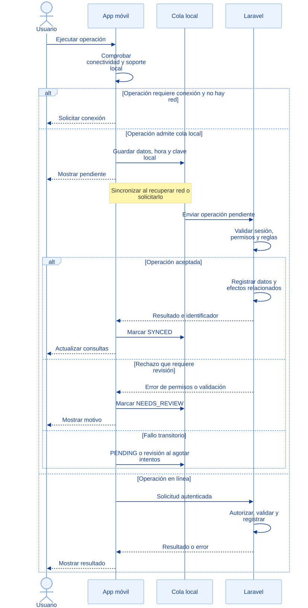

<div class="ec-flujos" markdown="1">
<div class="ec-flow-banner">11 · Integración móvil y web</div>
<div class="ec-flow-content" markdown="1">

<div class="ec-flow-hero" markdown="1">
<div markdown="1">

<span class="ec-flow-kicker">EcoLact / Flujos de negocio</span>

# Integración móvil y web

<p class="ec-flow-subtitle">Una operación local no es aún una confirmación</p>

La app combina consultas almacenadas y operaciones pendientes con solicitudes al backend Laravel. Los permisos, el stock y las reglas definitivas se comprueban en el servidor.

</div>
<figure markdown="1">

{ width="1200" height="800" }

<figcaption>Recurso visual del proyecto. Ilustración del proceso.</figcaption>
</figure>
</div>

<div class="ec-flow-actors" markdown="1">

<div class="ec-flow-card" markdown="1">

:material-account:

**Usuario**

Ejecuta la operación y atiende errores.

</div>

<div class="ec-flow-card" markdown="1">

:material-cellphone:

**App móvil**

Consulta conectividad, guarda datos y sincroniza.

</div>

<div class="ec-flow-card" markdown="1">

:material-server:

**Backend Laravel**

Autoriza, valida, registra y devuelve resultados.

</div>

</div>

## Así funciona el proceso

<div class="ec-flow-diagram" markdown="1">



[Ampliar diagrama](../assets/diagrams/flujos/integracion.svg) · [Descargar fuente Mermaid](../assets/diagrams/flujos/integracion.mmd)

<details markdown="1">
<summary>Ver la fuente editable del diagrama</summary>

```text
sequenceDiagram
  actor U as Usuario
  participant A as App móvil
  participant Q as Cola local
  participant B as Laravel
  U->>A: Ejecutar operación
  A->>A: Comprobar conectividad y soporte local
  alt Operación requiere conexión y no hay red
    A-->>U: Solicitar conexión
  else Operación admite cola local
    A->>Q: Guardar datos, hora y clave local
    A-->>U: Mostrar pendiente
    Note over A,Q: Sincronizar al recuperar red o solicitarlo
    Q->>B: Enviar operación pendiente
    B->>B: Validar sesión, permisos y reglas
    alt Operación aceptada
      B->>B: Registrar datos y efectos relacionados
      B-->>A: Resultado e identificador
      A->>Q: Marcar SYNCED
      A-->>U: Actualizar consultas
    else Rechazo que requiere revisión
      B-->>A: Error de permisos o validación
      A->>Q: Marcar NEEDS_REVIEW
      A-->>U: Mostrar motivo
    else Fallo transitorio
      A->>Q: PENDING o revisión al agotar intentos
    end
  else Operación en línea
    A->>B: Solicitud autenticada
    B->>B: Autorizar, validar y registrar
    B-->>A: Resultado o error
    A-->>U: Mostrar resultado
  end
```

</details>
</div>

## Paso a paso

<div class="ec-flow-steps" markdown="1">

1. El usuario inicia una consulta u operación. La app comprueba conectividad y los datos locales necesarios para esa funcionalidad.
2. Las operaciones que admiten cola guardan datos, hora del evento e identificador local. Otras exigen conexión y muestran el motivo.
3. Al sincronizar, el motor recorre pendientes en orden de creación y despacha cada tipo a su manejador. Un bloqueo evita barridos concurrentes.
4. Laravel valida sesión, rol, asistencia cuando corresponde y reglas de negocio. Los registros locales todavía pueden ser rechazados por stock, precio o permisos.
5. Una respuesta válida marca SYNCED y conserva el identificador del servidor. Los rechazos pasan a NEEDS_REVIEW; los fallos transitorios vuelven a PENDING hasta el límite.
6. La app actualiza los datos disponibles y presenta el resultado. Los portales web consultan los registros ya aceptados por el backend.

</div>

<div class="ec-flow-grid" markdown="1">

<div class="ec-flow-card orange" markdown="1">

### PENDING → SYNCING

Operación guardada que aún debe enviarse. No equivale a un registro confirmado en el servidor.

</div>

<div class="ec-flow-card green" markdown="1">

### SYNCED

El servidor respondió correctamente y se conserva su identificador.

</div>

<div class="ec-flow-card red" markdown="1">

### NEEDS_REVIEW

Error de validación, permisos o agotamiento de los cinco intentos transitorios. Requiere atención.

</div>

</div>

## Alcance real del trabajo sin conexión

<div class="ec-flow-table" markdown="1">

| Funcionalidad | Comportamiento comprobado |
| --- | --- |
| Acopio | Entregas, inicio y «No entregó» cuentan con operaciones de cola; la identificación puede usar datos locales disponibles |
| Finalizar recorrido | Requiere conexión en `AcopiadorRepository` |
| Calidad | Selección manual, captura de ticket y análisis tienen almacenamiento o cola; el OCR del servidor se procesa al enviar |
| Sorteo de muestra | Requiere conexión y firma del servidor |
| Planta | Inicio y cierre de producción y compra revisada tienen manejadores de sincronización; el servidor vuelve a validar |
| Ventas | Contado con precio y stock conocidos puede quedar pendiente; descuento de planilla requiere conexión |
| Boleta PDF y comprador nuevo | Requieren conexión en la app de ventas |
| Proveedor | Consultas con datos almacenados y actualización al conectar; no se promete información reciente sin sincronizar |

</div>

## Reintentos e idempotencia

`SyncManager` limita a **cinco intentos transitorios** antes de exigir revisión. Un rechazo de validación o permiso no se reintenta indefinidamente. Una operación sin manejador disponible permanece pendiente.

Las entregas reutilizan su token de idempotencia. Las rutas de inicio/cierre de producción, confirmación de compra y venta usan el middleware `idempotente`; sus clientes envían la clave correspondiente. No se extiende esa garantía a todas las rutas: el manejador de análisis de calidad no usa esa cabecera para guardar y finalizar. La selección de muestra tiene además su propia protección de reenvío en el dominio.

<div class="ec-flow-info warning" markdown="1">

**Dato local y dato confirmado son distintos.** Recuperar conectividad no implica aceptación automática: el usuario debe revisar las operaciones rechazadas. Tampoco se promete sincronización en segundo plano cuando la aplicación está cerrada.

</div>


<div class="ec-flow-result" markdown="1">

**Resultado del proceso**

Operaciones aceptadas reflejadas en consultas web y móviles; pendientes y errores identificables sin presentar una garantía universal de funcionamiento offline.

</div>

<details class="ec-flow-evidence" markdown="1">
<summary>Trazabilidad con el código revisado</summary>

Revisión documental: 28 de octubre de 2026. Las rutas siguientes identifican las fuentes locales; no implican haber ejecutado el sistema de negocio.

- `EcoLactWeb/app/Application/Acopio/RegistrarEntrega.php`
- `EcoLactWeb/app/Application/Calidad/SeleccionarMuestraCalidad.php`
- `EcoLactWeb/routes/web.php` y `EcoLactWeb/routes/api.php`
- `EcoLactMobile/shared/src/commonMain/kotlin/pe/edu/upeu/ecolactmobile/feature/` (rutas, repositorios y pantallas del rol correspondiente).
- `core/sync/SyncManager.kt`, `SyncQueueRepository.kt` y manejadores de sincronización de cada funcionalidad.

</details>

<div class="ec-flow-links" markdown="1">

[← Todos los flujos](index.md)

[Flujo de acopio de leche →](acopio.md)

[Consulta del proveedor →](consulta-proveedor.md)

[Flujo de ventas y compradores →](ventas-caja.md)

[Asistencia y personal →](personal-asistencia.md)

</div>
</div>
</div>
