<div class="ec-flujos" markdown="1">
<div class="ec-flow-banner">04 · Valorización y pagos</div>
<div class="ec-flow-content" markdown="1">

<div class="ec-flow-hero" markdown="1">
<div markdown="1">

<span class="ec-flow-kicker">EcoLact / Flujos de negocio</span>

# Valorización y pagos

<p class="ec-flow-subtitle">De los litros al pago semanal</p>

El flujo operativo agrupa las entregas por proveedor en semanas de jueves a miércoles. El importe pendiente combina precio vigente, resultado semanal de calidad y compras a cuenta del pago.

</div>
<figure markdown="1">

{ width="1200" height="800" }

<figcaption>Fotografía ilustrativa generada para esta documentación.</figcaption>
</figure>
</div>

<div class="ec-flow-actors" markdown="1">

<div class="ec-flow-card" markdown="1">

:material-account-cog:

**Administrador**

Configura, revisa y registra el pago.

</div>

<div class="ec-flow-card" markdown="1">

:material-flask:

**Calidad**

Aporta los resultados confirmados de la semana.

</div>

<div class="ec-flow-card" markdown="1">

:material-account-cash:

**Proveedor**

Recibe el neto y consulta su comprobante.

</div>

</div>

## Así funciona el proceso

<div class="ec-flow-diagram" markdown="1">



[Ampliar diagrama](../assets/diagrams/flujos/liquidacion-pagos.svg) · [Descargar fuente Mermaid](../assets/diagrams/flujos/liquidacion-pagos.mmd)

<details markdown="1">
<summary>Ver la fuente editable del diagrama</summary>

```text
flowchart TB
  A([Inicio · Entrega o análisis confirmado]) --> B[Agrupar proveedor y semana]
  B --> C{¿Configuración y precio?}
  C -->|No| D[Omitir entregas sin configuración suficiente]
  D --> Z([Fin · Completar configuración])
  C -->|Sí| E[Obtener peor resultado confirmado]
  E --> F{¿RECHAZADA?}
  F -->|Sí| G[NO_PAGABLE · Importe cero]
  G --> H[Trasladar compras a siguiente semana pagable]
  H --> Y([Fin · Visible, no se paga])
  F -->|No| I[Precio por entrega y ajuste de calidad]
  I --> J[Restar compras de planilla]
  J --> K{¿Neto positivo?}
  K -->|No| L[No generar pendiente pagable]
  K -->|Sí| M[PENDIENTE · Revisión administrativa]
  M --> N{¿Fecha habilitada y monto exacto?}
  N -->|No| M
  N -->|Sí| O[Registrar pago y comprobante]
  O --> P[PAGADO y salida de caja]
  P --> Q([Fin · Pago preservado])
  classDef default fill:#eaf3ff,stroke:#7ca5df,color:#123d91,rx:7,ry:7;
  classDef decision fill:#fff3df,stroke:#dca34d,color:#754c0c;
  classDef terminal fill:#e6f7ed,stroke:#72b692,color:#145d3b;
  class C,F,K,N decision;
  class A,Z,Y,Q terminal;
```

</details>
</div>

## Paso a paso

<div class="ec-flow-steps" markdown="1">

1. Registrar entregas y agruparlas por proveedor y semana de jueves a miércoles.
2. Obtener el precio vigente en la fecha de cada entrega y el peor resultado confirmado de la semana: RECHAZADA, luego OBSERVADA, luego ACEPTADA.
3. Sin análisis confirmado se usa el resultado de las otras entregas de la semana; sin resultados se conserva el precio base. OBSERVADA aplica el ajuste configurado si el pago aplica calidad.
4. Restar las compras con DESCUENTO_PLANILLA disponibles. Una semana RECHAZADA queda NO_PAGABLE, incluso si no se aplican ajustes de calidad; sus compras se trasladan a la siguiente semana pagable.
5. Revisar el pendiente. Registrar el pago desde el miércoles de cierre, por el importe exacto. El registro conserva datos del comprobante y permite su consulta o emisión por el flujo de pagos.
6. Marcar PAGADO y registrar la salida de caja en la misma transacción. Un pago efectuado queda fuera del recálculo automático.

</div>

<div class="ec-flow-grid" markdown="1">

<div class="ec-flow-card orange" markdown="1">

### PENDIENTE

Importe calculado y revisable. Puede cambiar por nuevas entregas, calidad confirmada y descuentos.

</div>

<div class="ec-flow-card green" markdown="1">

### PAGADO

Pago efectuado una sola vez. Las entregas posteriores de una semana ya pagada pasan a la siguiente semana disponible.

</div>

<div class="ec-flow-card red" markdown="1">

### NO_PAGABLE

Semana rechazada con importe cero. Se conserva visible, pero no puede pagarse.

</div>

</div>

## Factores del importe

**Bruto = suma de litros pagables × precio ajustado de cada entrega.** El neto resta las compras de planilla disponibles. Los precios ajustados no bajan de cero. Si falta regla OBSERVADA en el sincronizador, su ajuste es cero; si no hay precio para una entrega, se omite. Si los descuentos igualan o superan el bruto, no se genera un pendiente pagable.

## Dos cálculos que no deben confundirse

<div class="ec-flow-table" markdown="1">

| Aspecto | Sincronización operativa | Generación de liquidación tradicional |
| --- | --- | --- |
| Caso de uso | `SincronizarPagosProveedor` | `GenerarLiquidacion` y `CalcularLiquidacion` |
| Base | Entregas por asignar y pendientes | Entregas con valorizaciones existentes |
| Precio | Vigente por fecha de entrega | Un precio vigente al final del periodo |
| Calidad | Peor resultado confirmado semanal | Incidencias OBSERVADA o RECHAZADA seleccionan regla OBSERVADA; usa litros pagables de las valorizaciones |
| Semana rechazada | Toda la semana NO_PAGABLE | No implementa por sí mismo esa decisión semanal |
| Configuración insuficiente | Omite sin bloquear acopio o calidad | Lanza error si faltan valorizaciones, precio o regla necesaria |
| Ajustes | Descuentos de planilla disponibles | Compras del periodo y ajustes recibidos, incluidos manuales |
| Repetición | Recalcula pendientes; preserva pagados | Rechaza una liquidación duplicada del mismo periodo |

</div>

La generación tradicional recibe fechas explícitas; no impone por sí sola que el rango sea jueves a miércoles. Su comentario sobre leche rechazada que no ingresó a planta no describe el flujo actual de acopio: `RegistrarEntrega` sí ingresa la leche sin esperar calidad.

<div class="ec-flow-info warning" markdown="1">

**Pago exacto y sin duplicados.** `RegistrarPagoObligacion` rechaza pagos parciales, fechas futuras o anteriores al periodo y métodos que requieran número de operación si este falta. No existe todavía un flujo de regularización automática de un pago ya efectuado.

</div>


<div class="ec-flow-result" markdown="1">

**Resultado del proceso**

Pago, liquidación asociada y caja quedan relacionados. El proveedor puede consultar el estado; la contabilidad del dinero usa el importe neto realmente registrado.

</div>

<details class="ec-flow-evidence" markdown="1">
<summary>Trazabilidad con el código revisado</summary>

Revisión documental: 28 de octubre de 2026. Las rutas siguientes identifican las fuentes locales; no implican haber ejecutado el sistema de negocio.

- `EcoLactWeb/app/Application/Pago/SincronizarPagosProveedor.php`
- `EcoLactWeb/app/Application/Pago/RegistrarPagoObligacion.php`
- `EcoLactWeb/app/Application/Liquidacion/GenerarLiquidacion.php`
- `EcoLactWeb/app/Application/Liquidacion/CalcularLiquidacion.php`
- `EcoLactWeb/app/Application/Caja/RegistrarMovimientoCaja.php`
- `EcoLactWeb/routes/web.php` y `EcoLactWeb/routes/api.php`

</details>

<div class="ec-flow-links" markdown="1">

[← Todos los flujos](index.md)

[Flujo de control de calidad →](calidad.md)

[Flujo de ventas y compradores →](ventas-caja.md)

[Flujo de caja y finanzas →](finanzas.md)

</div>
</div>
</div>
