<div class="ec-flujos" markdown="1">
<div class="ec-flow-banner">10 · Asistencia y personal</div>
<div class="ec-flow-content" markdown="1">

<div class="ec-flow-hero" markdown="1">
<div markdown="1">

<span class="ec-flow-kicker">EcoLact / Flujos de negocio</span>

# Asistencia y personal

<p class="ec-flow-subtitle">De la marcación al pago del trabajador</p>

La asistencia se registra en una ventana diaria y alimenta el control del personal. Las obligaciones se acumulan por mes calendario y pasan a pago después del cierre correspondiente.

</div>
<figure markdown="1">

{ width="1200" height="800" }

<figcaption>Fotografía ilustrativa generada para esta documentación.</figcaption>
</figure>
</div>

<div class="ec-flow-actors" markdown="1">

<div class="ec-flow-card" markdown="1">

:material-badge-account:

**Trabajador**

Presenta su QR y consulta su asistencia.

</div>

<div class="ec-flow-card" markdown="1">

:material-account-cog:

**Administrador**

Registra, corrige dentro del horario y paga.

</div>

<div class="ec-flow-card" markdown="1">

:material-calendar-check:

**EcoLact**

Aplica cierre, faltas y cálculo del periodo.

</div>

</div>

## Así funciona el proceso

<div class="ec-flow-diagram" markdown="1">



[Ampliar diagrama](../assets/diagrams/flujos/personal-asistencia.svg) · [Descargar fuente Mermaid](../assets/diagrams/flujos/personal-asistencia.mmd)

<details markdown="1">
<summary>Ver la fuente editable del diagrama</summary>

```text
flowchart TB
  A([Inicio · Trabajador presenta QR]) --> B[Administrador identifica trabajador]
  B --> C{¿Activo y vigente hoy?}
  C -->|No| X[Rechazar marcación]
  C -->|Sí| D{¿Hoy antes de las 07:00?}
  D -->|No| E[Solo consulta del día cerrado]
  D -->|Sí| F{¿Ya existe jornada?}
  F -->|No| G[Registrar PRESENTE]
  F -->|Presente| H[Confirmar registro existente]
  F -->|Falta| I[Corrección administrativa con motivo]
  I --> G
  G --> J[Recalcular acumulado EN_CURSO]
  H --> J
  E --> K[Control de faltas de días cerrados]
  K --> J
  J --> L[Cerrar mes · PENDIENTE]
  L --> M[Administrador registra pago exacto]
  M --> N[PAGADO y salida de caja]
  N --> Z([Fin · Comprobante e historial])
  classDef default fill:#eaf3ff,stroke:#7ca5df,color:#123d91,rx:7,ry:7;
  classDef decision fill:#fff3df,stroke:#dca34d,color:#754c0c;
  classDef terminal fill:#e6f7ed,stroke:#72b692,color:#145d3b;
  class C,D,F decision;
  class A,Z terminal;
```

</details>
</div>

## Paso a paso

<div class="ec-flow-steps" markdown="1">

1. Identificar por QR al trabajador. Debe estar activo, haber ingresado y estar vigente en la fecha. El administrador no marca asistencia: cobra sueldo fijo mensual.
2. Registrar o corregir únicamente la asistencia de hoy antes de las 07:00, según la zona horaria configurada del negocio. Desde las 07:00:00 el día queda cerrado.
3. Registrar PRESENTE. Un segundo escaneo del mismo día no duplica la jornada; una FALTA existente requiere corrección administrativa expresa con motivo.
4. Controlar los días cerrados: MarcarFaltasAutomaticas registra faltas aplicables donde no hay jornada. No se corrigen días cerrados ni jornadas de periodos ya pagados.
5. Con sueldo configurado, abrir o recalcular la obligación EN_CURSO del mes calendario. El cierre de nómina transforma las obligaciones del mes terminado en PENDIENTE y abre el nuevo mes.
6. Registrar el pago por el monto calculado, conservar el comprobante y generar la salida de caja de TRABAJADOR.

</div>

<div class="ec-flow-grid" markdown="1">

<div class="ec-flow-card orange" markdown="1">

### Antes de las 07:00

Marcación y corrección de hoy. La restricción se comprueba en el servidor.

</div>

<div class="ec-flow-card purple" markdown="1">

### Durante el mes

La obligación **EN_CURSO** acumula el progreso con la configuración salarial del trabajador.

</div>

<div class="ec-flow-card green" markdown="1">

### Después del cierre

La obligación pasa a **PENDIENTE**; tras registrar el pago queda **PAGADO**.

</div>

</div>

## Permisos y excepciones

La corrección requiere motivo, un estado distinto y una jornada todavía abierta. No se sustituye silenciosamente una falta por un escaneo. Si no existe sueldo activo configurado, no se abre ni recalcula una obligación de personal mediante el generador.

El personal sin asistencia válida puede consultar, pero las rutas protegidas impiden operar. En peticiones móviles diferidas se comprueba la asistencia de la fecha del evento aceptada por el servidor; guardar algo localmente no garantiza que se autorice al sincronizar.

La programación de cierre mensual está declarada para el día 1 a las 00:05 en `routes/console.php`. Su ejecución efectiva depende de que el programador de tareas de Laravel esté funcionando; la documentación no verifica el despliegue del servidor.


<div class="ec-flow-result" markdown="1">

**Resultado del proceso**

Jornadas trazables, faltas y correcciones controladas, obligación mensual y pago ligado a su salida de caja.

</div>

<details class="ec-flow-evidence" markdown="1">
<summary>Trazabilidad con el código revisado</summary>

Revisión documental: 28 de octubre de 2026. Las rutas siguientes identifican las fuentes locales; no implican haber ejecutado el sistema de negocio.

- `EcoLactWeb/app/Application/Pago/RegistrarAsistenciaQr.php`
- `EcoLactWeb/app/Application/Pago/VentanaAsistencia.php`
- `EcoLactWeb/app/Application/Pago/CorregirJornada.php`
- `EcoLactWeb/app/Application/Pago/MarcarFaltasAutomaticas.php`
- `EcoLactWeb/app/Application/Pago/GenerarObligacionesPersonal.php`
- `EcoLactWeb/app/Application/Pago/CerrarNominaMensual.php`
- `EcoLactWeb/app/Application/Pago/RegistrarPagoObligacion.php`
- `EcoLactWeb/routes/web.php` y `EcoLactWeb/routes/api.php`

</details>

<div class="ec-flow-links" markdown="1">

[← Todos los flujos](index.md)

[Flujo de caja y finanzas →](finanzas.md)

[Integración móvil y web →](integracion.md)

</div>
</div>
</div>
