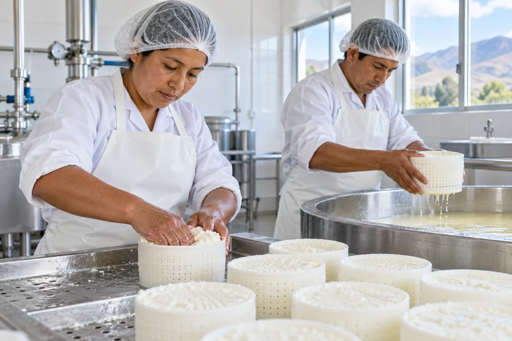

<div class="ec-flujos" markdown="1">
<div class="ec-flow-banner">06 · Flujo de producción</div>
<div class="ec-flow-content" markdown="1">

<div class="ec-flow-hero" markdown="1">
<div markdown="1">

<span class="ec-flow-kicker">EcoLact / Flujos de negocio</span>

# Flujo de producción

<p class="ec-flow-subtitle">De la materia prima al producto terminado</p>

La planta planifica productos con recetas vigentes, comprueba sus insumos y registra lo realmente obtenido. El inventario cambia en dos momentos distintos: al iniciar y al finalizar el lote.

</div>
<figure markdown="1">

{ width="1200" height="800" }

<figcaption>Fotografía ilustrativa generada para esta documentación.</figcaption>
</figure>
</div>

<div class="ec-flow-actors" markdown="1">

<div class="ec-flow-card" markdown="1">

:material-account-cog:

**Administrador**

Configura productos y recetas.

</div>

<div class="ec-flow-card" markdown="1">

:material-factory:

**Encargado de planta**

Planifica, inicia y finaliza los lotes.

</div>

<div class="ec-flow-card" markdown="1">

:material-package-variant:

**Inventario**

Conserva consumos y productos obtenidos.

</div>

</div>

## Así funciona el proceso

<div class="ec-flow-diagram" markdown="1">



[Ampliar diagrama](../assets/diagrams/flujos/produccion.svg) · [Descargar fuente Mermaid](../assets/diagrams/flujos/produccion.mmd)

<details markdown="1">
<summary>Ver la fuente editable del diagrama</summary>

```text
flowchart TB
  A([Inicio · Planta]) --> B[Consultar leche e insumos disponibles]
  B --> C[Seleccionar productos y cantidades]
  C --> D[Obtener recetas y calcular requerimientos]
  D --> E{¿Recetas válidas y stock suficiente?}
  E -->|No| F[Impedir inicio y mostrar faltantes]
  F --> C
  E -->|Sí| G[Iniciar lote EN_PROCESO]
  G --> H[Descontar leche e insumos]
  H --> I[Elaborar productos]
  I --> J[Registrar cantidades reales y merma]
  J --> K{¿Datos de todos los productos válidos?}
  K -->|No| J
  K -->|Sí| L[Finalizar lote]
  L --> M[Ingresar productos realmente obtenidos]
  M --> N[Estado FINALIZADO]
  N --> Z([Fin · Stock disponible para ventas])
  classDef default fill:#eaf3ff,stroke:#7ca5df,color:#123d91,rx:7,ry:7;
  classDef decision fill:#fff3df,stroke:#dca34d,color:#754c0c;
  classDef terminal fill:#e6f7ed,stroke:#72b692,color:#145d3b;
  class E,K decision;
  class A,Z terminal;
```

</details>
</div>

## Paso a paso

<div class="ec-flow-steps" markdown="1">

1. Consultar la leche ingresada desde Acopio y el stock de los demás insumos.
2. Seleccionar productos y cantidades previstas. EcoLact obtiene sus recetas y calcula los requerimientos.
3. Verificar recetas y stock. Al iniciar vuelve a calcular y bloquea los insumos para comprobar sus existencias; si faltan, impide crear el lote.
4. Crear el lote EN_PROCESO, guardar la receta y versión utilizadas y descontar insumos con CONSUMO_PRODUCCION.
5. Registrar la cantidad real obtenida de cada producto, incluida cero si corresponde. La diferencia respecto de lo planificado permite registrar la merma.
6. Finalizar el lote. Por cada cantidad obtenida positiva, registrar INGRESO_PRODUCCION y dejar el lote FINALIZADO.

</div>

<div class="ec-flow-grid" markdown="1">

<div class="ec-flow-card orange" markdown="1">

### EN_PROCESO

El lote ya consumió los insumos necesarios. Todavía no añade productos terminados al stock.

</div>

<div class="ec-flow-card green" markdown="1">

### FINALIZADO

Registra el resultado real e incorpora únicamente las cantidades obtenidas mayores que cero.

</div>

<div class="ec-flow-card purple" markdown="1">

### Trazabilidad

El lote conserva productos, cantidades previstas y obtenidas, consumos y versión de receta.

</div>

</div>

## Controles del cierre

Solo se finaliza un lote EN_PROCESO y con productos planificados. Hay que indicar cantidades numéricas no negativas para todos sus productos. El servidor bloquea el lote durante el cierre para impedir que dos confirmaciones ingresen dos veces los mismos productos.

Si la hora de cierre enviada por el teléfono precede al inicio, se utiliza la hora de inicio. El cierre no vuelve a descontar insumos. Una falla dentro de la transacción revierte los cambios de esa operación.

<div class="ec-flow-info" markdown="1">

**La leche ya está disponible desde Acopio.** La producción no espera obligatoriamente una aprobación de calidad por cada entrega. Las compras reponen los demás insumos; la leche no se incorpora por el formulario de compra de insumos.

</div>


<div class="ec-flow-result" markdown="1">

**Resultado del proceso**

Lote finalizado, consumo trazable y productos terminados disponibles para la venta. El stock refleja lo obtenido, no una suposición basada en lo planificado.

</div>

<details class="ec-flow-evidence" markdown="1">
<summary>Trazabilidad con el código revisado</summary>

Revisión documental: 28 de octubre de 2026. Las rutas siguientes identifican las fuentes locales; no implican haber ejecutado el sistema de negocio.

- `EcoLactWeb/app/Application/Produccion/CalcularRequerimientosProduccion.php`
- `EcoLactWeb/app/Application/Produccion/IniciarProduccion.php`
- `EcoLactWeb/app/Application/Produccion/FinalizarProduccion.php`
- `EcoLactWeb/app/Application/Produccion/RegistrarIngresoLecheDesdeEntrega.php`
- `EcoLactWeb/routes/web.php` y `EcoLactWeb/routes/api.php`

</details>

<div class="ec-flow-links" markdown="1">

[← Todos los flujos](index.md)

[Flujo de acopio de leche →](acopio.md)

[Flujo de insumos y compras →](insumos.md)

[Flujo de ventas y compradores →](ventas-caja.md)

</div>
</div>
</div>
