<div class="ec-flujos" markdown="1">
<div class="ec-flow-banner">08 · Flujo de ventas y compradores</div>
<div class="ec-flow-content" markdown="1">

<div class="ec-flow-hero" markdown="1">
<div markdown="1">

<span class="ec-flow-kicker">EcoLact / Flujos de negocio</span>

# Flujo de ventas y compradores

<p class="ec-flow-subtitle">Vender con stock y tarifa vigentes</p>

Ventas identifica al cliente, consulta el producto y registra la operación con su tarifa aplicable. El servidor determina el precio y comprueba las existencias al confirmar.

</div>
<figure markdown="1">

{ width="1200" height="800" }

<figcaption>Recurso visual del proyecto. Ilustración del proceso.</figcaption>
</figure>
</div>

<div class="ec-flow-actors" markdown="1">

<div class="ec-flow-card" markdown="1">

:material-cash-register:

**Personal de ventas**

Selecciona cliente, producto, cantidad y forma de pago.

</div>

<div class="ec-flow-card" markdown="1">

:material-account-group:

**Comprador**

Público general, comprador registrado o proveedor.

</div>

<div class="ec-flow-card" markdown="1">

:material-account-cog:

**Administrador**

Configura las tarifas de los productos.

</div>

</div>

## Así funciona el proceso

<div class="ec-flow-diagram" markdown="1">



[Ampliar diagrama](../assets/diagrams/flujos/ventas-caja.svg) · [Descargar fuente Mermaid](../assets/diagrams/flujos/ventas-caja.mmd)

<details markdown="1">
<summary>Ver la fuente editable del diagrama</summary>

```text
flowchart TB
  A([Inicio · Ventas]) --> B[Identificar comprador]
  B --> C[Seleccionar producto y cantidad]
  C --> D{¿Stock suficiente y producto activo?}
  D -->|No| E[Mostrar error y revisar]
  E --> C
  D -->|Sí| F[Determinar tarifa aplicable]
  F --> G{¿Forma de pago?}
  G -->|Contado| H[Registrar venta]
  G -->|Descuento de planilla| I{¿Proveedor con saldo suficiente?}
  I -->|No| E
  I -->|Sí| H
  H --> J[Descontar stock y habilitar comprobante]
  J --> K{¿Contado?}
  K -->|Sí| L[Entrada de caja · VENTA]
  K -->|No| M[Descuento en pago semanal]
  L --> Z([Fin · Venta REGISTRADA])
  M --> Z
  classDef default fill:#eaf3ff,stroke:#7ca5df,color:#123d91,rx:7,ry:7;
  classDef decision fill:#fff3df,stroke:#dca34d,color:#754c0c;
  classDef terminal fill:#e6f7ed,stroke:#72b692,color:#145d3b;
  class D,G,I,K decision;
  class A,Z terminal;
```

</details>
</div>

## Paso a paso

<div class="ec-flow-steps" markdown="1">

1. Identificar al cliente: público general, comprador registrado o proveedor activo. Una venta no puede asociarse a proveedor y comprador registrado simultáneamente.
2. Seleccionar un producto activo y una cantidad válida. Comprobar stock; el servidor vuelve a validarlo con el producto bloqueado dentro de la transacción.
3. Determinar la tarifa: PROVEEDOR para proveedor registrado, MAYORISTA si alcanza el mínimo configurado, o PUBLICO en los demás casos. Debe existir un precio aplicable.
4. Seleccionar CONTADO o DESCUENTO_PLANILLA. La segunda opción requiere proveedor y no puede superar su pago semanal estimado disponible.
5. Registrar la venta y descontar stock. Se guarda el precio aplicado para que futuros cambios de tarifa no alteren la operación pasada.
6. Consultar o generar la boleta disponible. La venta al contado registra entrada de caja; la de planilla se cobra descontando del pago al proveedor.

</div>

<div class="ec-flow-grid" markdown="1">

<div class="ec-flow-card green" markdown="1">

### CONTADO

Genera ingreso real de caja por el importe total de la venta.

</div>

<div class="ec-flow-card orange" markdown="1">

### DESCUENTO_PLANILLA

Solo para proveedor con saldo suficiente. **No genera entrada inmediata de efectivo.**

</div>

<div class="ec-flow-card purple" markdown="1">

### Tarifa del servidor

No la decide el navegador. Si el precio esperado enviado por el cliente cambió, se solicita revisar la venta.

</div>

</div>

## Cuando se trabaja desde el teléfono

La app implementa ventas pendientes al contado con catálogo, precio y stock conocidos. El servidor puede rechazarlas al sincronizar si cambiaron las existencias o la tarifa. El descuento de planilla necesita conexión para validar saldo. El PDF de boleta requiere una venta sincronizada y conexión; registrar un comprador nuevo también necesita conexión.


<div class="ec-flow-result" markdown="1">

**Resultado del proceso**

Venta REGISTRADA, salida de producto y comprobante consultable. La forma de pago decide si el dinero entra hoy a caja o se descuenta después de la liquidación.

</div>

<details class="ec-flow-evidence" markdown="1">
<summary>Trazabilidad con el código revisado</summary>

Revisión documental: 28 de octubre de 2026. Las rutas siguientes identifican las fuentes locales; no implican haber ejecutado el sistema de negocio.

- `EcoLactWeb/app/Application/Ventas/RegistrarVentaProducto.php`
- `EcoLactWeb/app/Application/Ventas/ObtenerTarifasProducto.php`
- `EcoLactWeb/app/Application/Ventas/EstimarSaldoDisponibleProveedor.php`
- `EcoLactWeb/app/Application/Caja/RegistrarMovimientoCaja.php`
- `EcoLactWeb/routes/web.php` y `EcoLactWeb/routes/api.php`
- `EcoLactMobile/shared/src/commonMain/kotlin/pe/edu/upeu/ecolactmobile/feature/` (rutas, repositorios y pantallas del rol correspondiente).

</details>

<div class="ec-flow-links" markdown="1">

[← Todos los flujos](index.md)

[Flujo de producción →](produccion.md)

[Valorización, liquidación y pagos →](liquidacion-pagos.md)

[Flujo de caja y finanzas →](finanzas.md)

[Integración móvil y web →](integracion.md)

</div>
</div>
</div>
