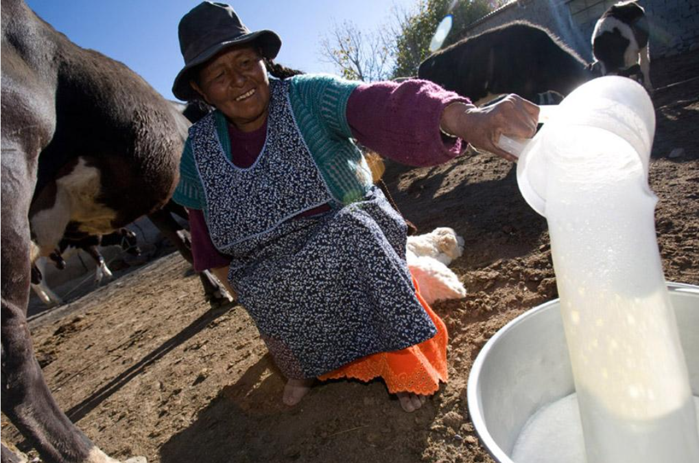
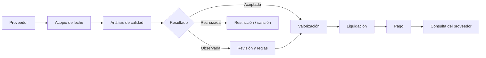
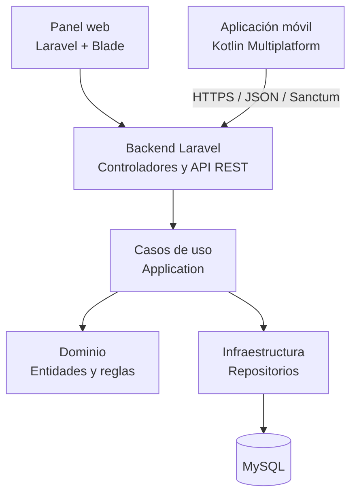

# EcoLact

PLATAFORMA DE GESTIÓN LÁCTEA

# EcoLact

### Tecnología para una gestión láctea más eficiente

Plataforma web y móvil diseñada para digitalizar el acopio de leche, controlar su calidad y gestionar la producción, las ventas y los pagos a proveedores en **Huata, Puno – Perú**.

  Laravel
  Kotlin Multiplatform
  MySQL
  API REST

[Explorar el sistema](sistema/index.md){ .md-button .md-button--primary }
[Conocer los flujos](flujos/index.md){ .md-button }

---

## Conoce EcoLact

EcoLact integra los procesos operativos y administrativos de un centro de acopio de leche en una única plataforma digital.

La solución permite organizar a los proveedores y acopiadores, registrar las entregas de leche, evaluar su calidad y realizar el seguimiento económico de cada operación.

Su propósito es mejorar la trazabilidad, reducir los errores de registro y facilitar el acceso a información confiable para la toma de decisiones.

## Explora la documentación

Conoce los componentes del sistema, sus procesos operativos
y las decisiones técnicas que permiten su funcionamiento.

-   

    **Sistema**

    ---

    Conoce los objetivos, actores, módulos y reglas
    de negocio de EcoLact.

    [Explorar sistema](sistema/index.md)

-   

    **Flujos de negocio**

    ---

    Descubre cómo se realizan el acopio, los análisis,
    la producción y los pagos.

    [Explorar flujos](flujos/index.md)

-   

    **Arquitectura**

    ---

    Explora Laravel, Kotlin Multiplatform,
    la base de datos y la integración mediante API REST.

    [Ver arquitectura](arquitectura/index.md)

---

## ¿Cómo funciona EcoLact?

El proceso comienza cuando el acopiador registra la leche entregada por un proveedor. Posteriormente, se realiza el análisis de calidad y se determina la valorización correspondiente.

Finalmente, las entregas valorizadas se consideran para generar las liquidaciones y registrar los pagos.

**Trazabilidad del proceso**

Cada etapa conserva información relacionada con el proveedor, la entrega y sus resultados. Esto permite consultar el historial de operaciones y verificar el estado de los pagos.

[Conocer el flujo completo :material-arrow-right:](flujos/index.md)

## Procesos complementarios

Además del acopio y la liquidación, EcoLact incorpora funciones para administrar la producción, los insumos, el inventario, las ventas y los movimientos de caja.

-   :material-factory:{ .lg .middle .ecolact-icon }

    **Producción**

    Gestión de recetas, lotes de producción y productos derivados de la leche.

-   :material-package-variant-closed:{ .lg .middle .ecolact-icon }

    **Inventario e insumos**

    Control de compras, insumos disponibles, movimientos y existencias.

-   :material-cash-register:{ .lg .middle .ecolact-icon }

    **Ventas y finanzas**

    Registro de ventas, compradores, ingresos, egresos y pagos.

---

## Ecosistema tecnológico

EcoLact combina una plataforma web y una aplicación móvil que se comunican mediante una API REST desarrollada con Laravel.

-   :material-monitor-dashboard:{ .lg .middle .ecolact-icon }

    **Plataforma web**

    Desarrollada con PHP y Laravel. Permite gestionar los procesos administrativos y operativos mediante paneles según el rol del usuario.

-   :material-cellphone:{ .lg .middle .ecolact-icon }

    **Aplicación móvil**

    Desarrollada con Kotlin Multiplatform. Facilita el acceso a las funciones de campo mediante interfaces adaptadas al dispositivo.

-   :material-api:{ .lg .middle .ecolact-icon }

    **API REST**

    Expone servicios bajo `/api/v1` y utiliza Laravel Sanctum para la autenticación mediante tokens.

[Explorar la arquitectura técnica :material-arrow-right:](arquitectura/index.md)

---

## Documentación para desarrolladores

La documentación técnica también incluye información necesaria para comprender, configurar, mantener y verificar el funcionamiento del proyecto.

-   :material-code-braces:{ .lg .middle .ecolact-icon }

    **Desarrollo**

    Estructura del repositorio, instalación del backend, configuración de la aplicación móvil y convenciones de desarrollo.

    [Ir a Desarrollo :material-arrow-right:](desarrollo/index.md)

-   :material-test-tube:{ .lg .middle .ecolact-icon }

    **Pruebas**

    Estrategia de validación, pruebas automatizadas, integración entre componentes y evidencias del funcionamiento.

    [Ir a Pruebas :material-arrow-right:](pruebas/index.md)

---

---

## Acerca de EcoLact

EcoLact es un proyecto académico de la Escuela Profesional
de Ingeniería de Sistemas de la **Universidad Peruana Unión**,
desarrollado durante el semestre 2026-II.

La plataforma toma como contexto las actividades de acopio,
evaluación de calidad y transformación de leche en
el distrito de Huata, Puno.

Su desarrollo integra conocimientos de ingeniería de software,
arquitectura de aplicaciones, bases de datos,
desarrollo web y aplicaciones móviles.

**EcoLact · Documentación técnica**

Ingeniería de Software I · Universidad Peruana Unión · 2026

[:material-github: Ver código fuente en GitHub](https://github.com/MilkonMamani/EcoLact)

