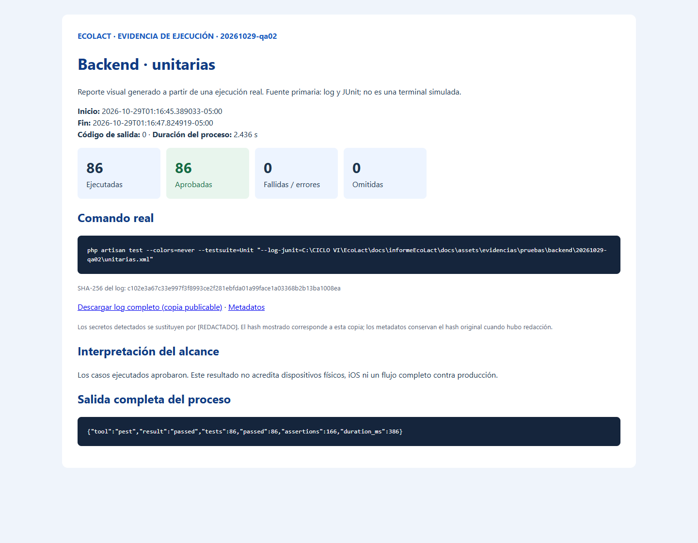
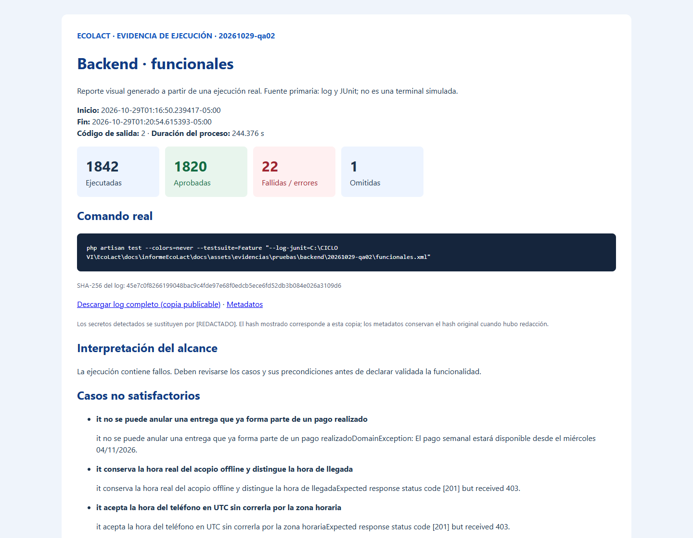

<div class="ec-pruebas" markdown="1">
<div class="ec-test-banner" markdown="1">

:material-test-tube: 2. Pruebas del backend

</div>
<div class="ec-test-content" markdown="1">

<span class="ec-test-kicker">EcoLact / 6. Pruebas / Ejecución verificable</span>

# Validación de Laravel y reglas del negocio

Se inspeccionaron `EcoLactWeb/tests/Unit` (13 archivos `*Test.php`), `tests/Feature` (260 archivos `*Test.php`), `phpunit.xml` y las dependencias instaladas. Los siete archivos prioritarios solicitados existen; sus rutas reales aparecen debajo. Los archivos pueden contener varias funciones y datasets: no equivalen al número de casos ejecutados.

<div class="ec-test-summary"><div class="ec-test-card ec-test-"><strong>1928</strong>Ejecutadas</div><div class="ec-test-card ec-test-passed"><strong>1906</strong>Aprobadas</div><div class="ec-test-card ec-test-failed"><strong>22</strong>Fallidas / errores</div><div class="ec-test-card ec-test-skipped"><strong>1</strong>Omitidas</div><div class="ec-test-card ec-test-"><strong>238.854 s</strong>Tiempo de casos</div></div>


## Procedimiento de ejecución

Primero se ejecutó `RegistrarEntregaTest.php`: 6 casos aprobados. A continuación se ejecutaron las suites Unit y Feature. Ambas cubren las suites declaradas en `phpunit.xml`; no se añadió una ejecución general redundante. El intento inicial con `--no-interaction` terminó con salida 2 antes de descubrir casos; el runner lo rechazó y se retiró únicamente ese argumento, conservando el log.

```powershell
php -v
composer --version
composer show --direct
php artisan test --colors=never --testsuite=Unit --log-junit=<ruta-unitarias.xml>
php artisan test --colors=never --testsuite=Feature --log-junit=<ruta-funcionales.xml>
```

Los argumentos de los procesos y el entorno aislado se registran en los metadatos. Para reproducir desde la raíz del repositorio con un identificador nuevo, se puede usar `python docs/informeEcoLact/scripts/ejecutar_evidencias.py <nuevo-id> backend unitarias` y después `backend funcionales`. El script aplica el aislamiento antes de iniciar Artisan. Las representaciones de argumentos en los reportes no incluyen las variables de entorno; no deben pegarse aisladamente en otra consola. No se modificaron reglas de negocio, pruebas PHP ni archivos Kotlin para cambiar los resultados.

## Clasificación funcional

<div class="ec-test-table" markdown="1">

|Grupo|Casos descubiertos|Aprobadas|Fallidas|Errores|Omitidas|
|---|---|---|---|---|---|
|Control de calidad|201|201|0|0|0|
|Producción e inventario|310|309|0|1|0|
|Transversal y otras comprobaciones|301|298|2|0|1|
|Registro de entregas|93|91|1|1|0|
|Pagos y liquidaciones|362|361|1|0|0|
|Proveedores y acopiadores|228|216|0|12|0|
|Zonas y recorridos|156|154|0|2|0|
|Ventas y caja|81|81|0|0|0|
|Autenticación y roles|114|114|0|0|0|
|API REST|83|81|2|0|0|

</div>


La clasificación asigna cada caso una sola vez: API y autenticación tienen prioridad, seguidas por palabras de la clase. Las categorías agrupan resultados, no representan cobertura de todos los requisitos de cada módulo. El inventario exhaustivo está en [casos CSV](../assets/evidencias/pruebas/resumen/20261029-qa02/casos.csv).

## Pruebas relevantes: objetivo, condición, procedimiento y resultado

<div class="ec-test-table" markdown="1">

|Grupo|Prueba o suite|Objetivo y condición|Procedimiento|Resultado real|Evidencia|
|---|---|---|---|---|---|
|Registro de entregas|`tests/Feature/Application/Acopio/RegistrarEntregaTest.php`|Registrar entrega válida, identidad DNI/QR, zona y estado|Crear proveedor y acopiador, ejecutar RegistrarEntrega y comprobar entidad y notificación.|6 aprobadas · 0 fallidas · 0 errores · 0 omitidas|[JUnit](../assets/evidencias/pruebas/backend/20261029-qa02/funcionales.xml)|
|Control de calidad|`tests/Feature/Application/Calidad/CalidadNoBloqueaProduccionTest.php`|Mantener independencia de calidad y producción|Registrar leche sin análisis, producir y comprobar stock tras analizar.|4 aprobadas · 0 fallidas · 0 errores · 0 omitidas|[JUnit](../assets/evidencias/pruebas/backend/20261029-qa02/funcionales.xml)|
|Pagos|`tests/Feature/Application/Pago/SincronizacionAutomaticaTest.php`|Generar y recalcular pagos pendientes sin duplicados|Registrar entregas, confirmar análisis y repetir sincronización; verificar transacción y saldos.|8 aprobadas · 0 fallidas · 0 errores · 0 omitidas|[JUnit](../assets/evidencias/pruebas/backend/20261029-qa02/funcionales.xml)|
|Liquidaciones|`tests/Feature/Application/Liquidacion/GenerarLiquidacionTest.php`|Aplicar precio semanal y evitar duplicación|Configurar precio e incidencias, generar liquidación y verificar importe y estado.|5 aprobadas · 0 fallidas · 0 errores · 0 omitidas|[JUnit](../assets/evidencias/pruebas/backend/20261029-qa02/funcionales.xml)|
|API REST|`tests/Feature/Http/Api/AcopiadorMovilApiTest.php`|Fechas offline, autorización e idempotencia|Enviar peticiones internas Laravel y comparar respuestas y filas SQLite.|10 aprobadas · 2 fallidas · 0 errores · 0 omitidas|[JUnit](../assets/evidencias/pruebas/backend/20261029-qa02/funcionales.xml)|
|Autenticación|`tests/Feature/Auth/RoleMiddlewareTest.php`|Permitir rol correcto y denegar acceso indebido|Ejecutar middleware con usuario correcto, incorrecto y sin autenticación.|4 aprobadas · 0 fallidas · 0 errores · 0 omitidas|[JUnit](../assets/evidencias/pruebas/backend/20261029-qa02/funcionales.xml)|
|Ventas y caja|`tests/Feature/Web/CajaTest.php`|Saldo, movimientos únicos y atomicidad|Registrar eventos financieros y consultar caja; provocar fallo para verificar reversión.|8 aprobadas · 0 fallidas · 0 errores · 0 omitidas|[JUnit](../assets/evidencias/pruebas/backend/20261029-qa02/funcionales.xml)|

</div>


Un caso aprobado respalda las condiciones y aserciones que ese test ejecutó; no verifica automáticamente todas las combinaciones, el navegador ni MySQL. Los casos fallidos no sostienen el comportamiento esperado.

## Fallos y errores conservados

<div class="ec-test-table" markdown="1">

|Caso|Tipo|Mensaje real|Evidencia|
|---|---|---|---|
|EntregaAlimentaLecheTest · it no se puede anular una entrega que ya forma parte de un pago realizado|error|it no se puede anular una entrega que ya forma parte de un pago realizadoDomainException: El pago semanal estará disponible desde el miércoles 04/11/2026.
|[JUnit y traza](../assets/evidencias/pruebas/backend/20261029-qa02/funcionales.xml)|
|AcopiadorMovilApiTest · it conserva la hora real del acopio offline y distingue la hora de llegada|fallida|it conserva la hora real del acopio offline y distingue la hora de llegadaExpected response status code [201] but received 403.|[JUnit y traza](../assets/evidencias/pruebas/backend/20261029-qa02/funcionales.xml)|
|AcopiadorMovilApiTest · it acepta la hora del teléfono en UTC sin correrla por la zona horaria|fallida|it acepta la hora del teléfono en UTC sin correrla por la zona horariaExpected response status code [201] but received 403.|[JUnit y traza](../assets/evidencias/pruebas/backend/20261029-qa02/funcionales.xml)|
|EloquentProductosListadoQueryTest · it calcula los KPIs y arma las filas con stock, receta y última producción|error|it calcula los KPIs y arma las filas con stock, receta y última producciónErrorException: Undefined property: App\Application\Produccion\ProductosListadoData::$kpis
|[JUnit y traza](../assets/evidencias/pruebas/backend/20261029-qa02/funcionales.xml)|
|EloquentZonasListadoQueryTest · it calcula los KPIs y arma las filas con conteo de proveedores y acopiadores|error|it calcula los KPIs y arma las filas con conteo de proveedores y acopiadoresArgumentCountError: Too few arguments to function App\Infrastructure\Persistence\Queries\EloquentZonasListadoQuery::__construct(), 0 passed in C:\CICLO VI\EcoLact\EcoLactWeb\tests\Feature\Infrastructure\Persistence\Queries\EloquentZonasListadoQueryTest.php on line 25 and exactly 1 expected
|[JUnit y traza](../assets/evidencias/pruebas/backend/20261029-qa02/funcionales.xml)|
|EloquentZonasListadoQueryTest · it filtra por nombre y por estado|error|it filtra por nombre y por estadoArgumentCountError: Too few arguments to function App\Infrastructure\Persistence\Queries\EloquentZonasListadoQuery::__construct(), 0 passed in C:\CICLO VI\EcoLact\EcoLactWeb\tests\Feature\Infrastructure\Persistence\Queries\EloquentZonasListadoQueryTest.php on line 43 and exactly 1 expected
|[JUnit y traza](../assets/evidencias/pruebas/backend/20261029-qa02/funcionales.xml)|
|AcopioViewTest · it los enlaces de paginación conservan búsqueda y filtros|fallida|it los enlaces de paginación conservan búsqueda y filtrosFailed asserting that &#x27;&lt;!DOCTYPE html&gt;|[JUnit y traza](../assets/evidencias/pruebas/backend/20261029-qa02/funcionales.xml)|
|DashboardViewTest · it muestra el encabezado del resumen con el rango aplicado y el filtro activo|fallida|it muestra el encabezado del resumen con el rango aplicado y el filtro activoFailed asserting that two strings are identical.
|[JUnit y traza](../assets/evidencias/pruebas/backend/20261029-qa02/funcionales.xml)|
|LoginViewTest · it muestra el login independiente con controles accesibles y CSRF|fallida|it muestra el login independiente con controles accesibles y CSRFFailed asserting that &#x27;&lt;!DOCTYPE html&gt;\n|[JUnit y traza](../assets/evidencias/pruebas/backend/20261029-qa02/funcionales.xml)|
|PagoSemanalTodosYPagadosTest · it la fila de un pagado tiene el checkbox deshabilitado y las de pendientes no|fallida|it la fila de un pagado tiene el checkbox deshabilitado y las de pendientes noFailed asserting that &#x27;&lt;tr data-fila data-id=&quot;2&quot; data-pendiente=&quot;0&quot; data-estado=&quot;PENDIENTE&quot;\n|[JUnit y traza](../assets/evidencias/pruebas/backend/20261029-qa02/funcionales.xml)|
|ProveedorPagosModalTest · it el historial del proveedor devuelve exclusivamente sus pagos|error|it el historial del proveedor devuelve exclusivamente sus pagosIlluminate\Database\UniqueConstraintViolationException: SQLSTATE[23000]: Integrity constraint violation: 19 UNIQUE constraint failed: obligaciones_pago.proveedor_id, obligaciones_pago.semana_proveedor (Connection: sqlite, Database: :memory:, SQL: insert into &quot;obligaciones_pago&quot; (&quot;tipo_beneficiario&quot;, &quot;proveedor_id&quot;, &quot;beneficiario_nombre&quot;, &quot;periodo_inicio&quot;, &quot;periodo_fin&quot;, &quot;periodicidad&quot;, &quot;concepto&quot;, &quot;base_calculo&quot;, &quot;monto_calculado&quot;, &quot;estado&quot;, &quot;clave_unicidad&quot;, &quot;fecha_pago_programada&quot;, &quot;updated_at&quot;, &quot;created_at&quot;) values (PROVEEDOR, 1, Milkon Mamani, 2026-09-10 00:00:00, 2026-09-16 00:00:00, SEMANAL, Pago semanal a proveedor, {&quot;litros_pagables&quot;:20,&quot;precio_base_litro&quot;:1.7,&quot;subtotal&quot;:34}, 34, PENDIENTE, modal-1-2026-09-10-2026-09-16, 2026-09-16 00:00:00, 2026-09-20 10:00:00, 2026-09-20 10:00:00))
|[JUnit y traza](../assets/evidencias/pruebas/backend/20261029-qa02/funcionales.xml)|
|ProveedorPagosModalTest · it nunca aparecen pagos de otros proveedores, ni siquiera manipulando el request|error|it nunca aparecen pagos de otros proveedores, ni siquiera manipulando el requestIlluminate\Database\UniqueConstraintViolationException: SQLSTATE[23000]: Integrity constraint violation: 19 UNIQUE constraint failed: obligaciones_pago.proveedor_id, obligaciones_pago.semana_proveedor (Connection: sqlite, Database: :memory:, SQL: insert into &quot;obligaciones_pago&quot; (&quot;tipo_beneficiario&quot;, &quot;proveedor_id&quot;, &quot;beneficiario_nombre&quot;, &quot;periodo_inicio&quot;, &quot;periodo_fin&quot;, &quot;periodicidad&quot;, &quot;concepto&quot;, &quot;base_calculo&quot;, &quot;monto_calculado&quot;, &quot;estado&quot;, &quot;clave_unicidad&quot;, &quot;fecha_pago_programada&quot;, &quot;updated_at&quot;, &quot;created_at&quot;) values (PROVEEDOR, 1, Milkon Mamani, 2026-09-10 00:00:00, 2026-09-16 00:00:00, SEMANAL, Pago semanal a proveedor, {&quot;litros_pagables&quot;:20,&quot;precio_base_litro&quot;:1.7,&quot;subtotal&quot;:34}, 34, PENDIENTE, modal-1-2026-09-10-2026-09-16, 2026-09-16 00:00:00, 2026-09-20 10:00:00, 2026-09-20 10:00:00))
|[JUnit y traza](../assets/evidencias/pruebas/backend/20261029-qa02/funcionales.xml)|
|ProveedorPagosModalTest · it Semana Todos abarca todas las semanas del proveedor y las semanas del combo no se repiten|error|it Semana Todos abarca todas las semanas del proveedor y las semanas del combo no se repitenIlluminate\Database\UniqueConstraintViolationException: SQLSTATE[23000]: Integrity constraint violation: 19 UNIQUE constraint failed: obligaciones_pago.proveedor_id, obligaciones_pago.semana_proveedor (Connection: sqlite, Database: :memory:, SQL: insert into &quot;obligaciones_pago&quot; (&quot;tipo_beneficiario&quot;, &quot;proveedor_id&quot;, &quot;beneficiario_nombre&quot;, &quot;periodo_inicio&quot;, &quot;periodo_fin&quot;, &quot;periodicidad&quot;, &quot;concepto&quot;, &quot;base_calculo&quot;, &quot;monto_calculado&quot;, &quot;estado&quot;, &quot;clave_unicidad&quot;, &quot;fecha_pago_programada&quot;, &quot;updated_at&quot;, &quot;created_at&quot;) values (PROVEEDOR, 1, Milkon Mamani, 2026-09-10 00:00:00, 2026-09-16 00:00:00, SEMANAL, Pago semanal a proveedor, {&quot;litros_pagables&quot;:20,&quot;precio_base_litro&quot;:1.7,&quot;subtotal&quot;:34}, 34, PENDIENTE, modal-1-2026-09-10-2026-09-16, 2026-09-16 00:00:00, 2026-09-20 10:00:00, 2026-09-20 10:00:00))
|[JUnit y traza](../assets/evidencias/pruebas/backend/20261029-qa02/funcionales.xml)|
|ProveedorPagosModalTest · it una semana específica solo devuelve los registros de esa semana, incluido el periodo parcial|error|it una semana específica solo devuelve los registros de esa semana, incluido el periodo parcialIlluminate\Database\UniqueConstraintViolationException: SQLSTATE[23000]: Integrity constraint violation: 19 UNIQUE constraint failed: obligaciones_pago.proveedor_id, obligaciones_pago.semana_proveedor (Connection: sqlite, Database: :memory:, SQL: insert into &quot;obligaciones_pago&quot; (&quot;tipo_beneficiario&quot;, &quot;proveedor_id&quot;, &quot;beneficiario_nombre&quot;, &quot;periodo_inicio&quot;, &quot;periodo_fin&quot;, &quot;periodicidad&quot;, &quot;concepto&quot;, &quot;base_calculo&quot;, &quot;monto_calculado&quot;, &quot;estado&quot;, &quot;clave_unicidad&quot;, &quot;fecha_pago_programada&quot;, &quot;updated_at&quot;, &quot;created_at&quot;) values (PROVEEDOR, 1, Milkon Mamani, 2026-09-10 00:00:00, 2026-09-16 00:00:00, SEMANAL, Pago semanal a proveedor, {&quot;litros_pagables&quot;:20,&quot;precio_base_litro&quot;:1.7,&quot;subtotal&quot;:34}, 34, PENDIENTE, modal-1-2026-09-10-2026-09-16, 2026-09-16 00:00:00, 2026-09-20 10:00:00, 2026-09-20 10:00:00))
|[JUnit y traza](../assets/evidencias/pruebas/backend/20261029-qa02/funcionales.xml)|
|ProveedorPagosModalTest · it filtra por estado y combina semana con estado|error|it filtra por estado y combina semana con estadoIlluminate\Database\UniqueConstraintViolationException: SQLSTATE[23000]: Integrity constraint violation: 19 UNIQUE constraint failed: obligaciones_pago.proveedor_id, obligaciones_pago.semana_proveedor (Connection: sqlite, Database: :memory:, SQL: insert into &quot;obligaciones_pago&quot; (&quot;tipo_beneficiario&quot;, &quot;proveedor_id&quot;, &quot;beneficiario_nombre&quot;, &quot;periodo_inicio&quot;, &quot;periodo_fin&quot;, &quot;periodicidad&quot;, &quot;concepto&quot;, &quot;base_calculo&quot;, &quot;monto_calculado&quot;, &quot;estado&quot;, &quot;clave_unicidad&quot;, &quot;fecha_pago_programada&quot;, &quot;updated_at&quot;, &quot;created_at&quot;) values (PROVEEDOR, 1, Milkon Mamani, 2026-09-10 00:00:00, 2026-09-16 00:00:00, SEMANAL, Pago semanal a proveedor, {&quot;litros_pagables&quot;:20,&quot;precio_base_litro&quot;:1.7,&quot;subtotal&quot;:34}, 34, PENDIENTE, modal-1-2026-09-10-2026-09-16, 2026-09-16 00:00:00, 2026-09-20 10:00:00, 2026-09-20 10:00:00))
|[JUnit y traza](../assets/evidencias/pruebas/backend/20261029-qa02/funcionales.xml)|
|ProveedorPagosModalTest · it muestra la base de cálculo, el periodo real, el monto y el estado de cada fila|error|it muestra la base de cálculo, el periodo real, el monto y el estado de cada filaIlluminate\Database\UniqueConstraintViolationException: SQLSTATE[23000]: Integrity constraint violation: 19 UNIQUE constraint failed: obligaciones_pago.proveedor_id, obligaciones_pago.semana_proveedor (Connection: sqlite, Database: :memory:, SQL: insert into &quot;obligaciones_pago&quot; (&quot;tipo_beneficiario&quot;, &quot;proveedor_id&quot;, &quot;beneficiario_nombre&quot;, &quot;periodo_inicio&quot;, &quot;periodo_fin&quot;, &quot;periodicidad&quot;, &quot;concepto&quot;, &quot;base_calculo&quot;, &quot;monto_calculado&quot;, &quot;estado&quot;, &quot;clave_unicidad&quot;, &quot;fecha_pago_programada&quot;, &quot;updated_at&quot;, &quot;created_at&quot;) values (PROVEEDOR, 1, Milkon Mamani, 2026-09-10 00:00:00, 2026-09-16 00:00:00, SEMANAL, Pago semanal a proveedor, {&quot;litros_pagables&quot;:20,&quot;precio_base_litro&quot;:1.7,&quot;subtotal&quot;:34}, 34, PENDIENTE, modal-1-2026-09-10-2026-09-16, 2026-09-16 00:00:00, 2026-09-20 10:00:00, 2026-09-20 10:00:00))
|[JUnit y traza](../assets/evidencias/pruebas/backend/20261029-qa02/funcionales.xml)|
|ProveedorPagosModalTest · it un pago histórico usa el snapshot: ni la lista ni el detalle se recalculan con precios de hoy|error|it un pago histórico usa el snapshot: ni la lista ni el detalle se recalculan con precios de hoyIlluminate\Database\UniqueConstraintViolationException: SQLSTATE[23000]: Integrity constraint violation: 19 UNIQUE constraint failed: obligaciones_pago.proveedor_id, obligaciones_pago.semana_proveedor (Connection: sqlite, Database: :memory:, SQL: insert into &quot;obligaciones_pago&quot; (&quot;tipo_beneficiario&quot;, &quot;proveedor_id&quot;, &quot;beneficiario_nombre&quot;, &quot;periodo_inicio&quot;, &quot;periodo_fin&quot;, &quot;periodicidad&quot;, &quot;concepto&quot;, &quot;base_calculo&quot;, &quot;monto_calculado&quot;, &quot;estado&quot;, &quot;clave_unicidad&quot;, &quot;fecha_pago_programada&quot;, &quot;updated_at&quot;, &quot;created_at&quot;) values (PROVEEDOR, 1, Milkon Mamani, 2026-09-10 00:00:00, 2026-09-16 00:00:00, SEMANAL, Pago semanal a proveedor, {&quot;litros_pagables&quot;:20,&quot;precio_base_litro&quot;:1.7,&quot;subtotal&quot;:34}, 34, PENDIENTE, modal-1-2026-09-10-2026-09-16, 2026-09-16 00:00:00, 2026-09-20 10:00:00, 2026-09-20 10:00:00))
|[JUnit y traza](../assets/evidencias/pruebas/backend/20261029-qa02/funcionales.xml)|
|ProveedorPagosModalTest · it el detalle de un pago pendiente muestra el comprobante con los datos del proveedor|error|it el detalle de un pago pendiente muestra el comprobante con los datos del proveedorIlluminate\Database\UniqueConstraintViolationException: SQLSTATE[23000]: Integrity constraint violation: 19 UNIQUE constraint failed: obligaciones_pago.proveedor_id, obligaciones_pago.semana_proveedor (Connection: sqlite, Database: :memory:, SQL: insert into &quot;obligaciones_pago&quot; (&quot;tipo_beneficiario&quot;, &quot;proveedor_id&quot;, &quot;beneficiario_nombre&quot;, &quot;periodo_inicio&quot;, &quot;periodo_fin&quot;, &quot;periodicidad&quot;, &quot;concepto&quot;, &quot;base_calculo&quot;, &quot;monto_calculado&quot;, &quot;estado&quot;, &quot;clave_unicidad&quot;, &quot;fecha_pago_programada&quot;, &quot;updated_at&quot;, &quot;created_at&quot;) values (PROVEEDOR, 1, Milkon Mamani, 2026-09-10 00:00:00, 2026-09-16 00:00:00, SEMANAL, Pago semanal a proveedor, {&quot;litros_pagables&quot;:20,&quot;precio_base_litro&quot;:1.7,&quot;subtotal&quot;:34}, 34, PENDIENTE, modal-1-2026-09-10-2026-09-16, 2026-09-16 00:00:00, 2026-09-20 10:00:00, 2026-09-20 10:00:00))
|[JUnit y traza](../assets/evidencias/pruebas/backend/20261029-qa02/funcionales.xml)|
|ProveedorPagosModalTest · it con filtros que no coinciden muestra "No se encontraron pagos" y no el vacío general|error|it con filtros que no coinciden muestra &quot;No se encontraron pagos&quot; y no el vacío generalIlluminate\Database\UniqueConstraintViolationException: SQLSTATE[23000]: Integrity constraint violation: 19 UNIQUE constraint failed: obligaciones_pago.proveedor_id, obligaciones_pago.semana_proveedor (Connection: sqlite, Database: :memory:, SQL: insert into &quot;obligaciones_pago&quot; (&quot;tipo_beneficiario&quot;, &quot;proveedor_id&quot;, &quot;beneficiario_nombre&quot;, &quot;periodo_inicio&quot;, &quot;periodo_fin&quot;, &quot;periodicidad&quot;, &quot;concepto&quot;, &quot;base_calculo&quot;, &quot;monto_calculado&quot;, &quot;estado&quot;, &quot;clave_unicidad&quot;, &quot;fecha_pago_programada&quot;, &quot;updated_at&quot;, &quot;created_at&quot;) values (PROVEEDOR, 1, Milkon Mamani, 2026-09-10 00:00:00, 2026-09-16 00:00:00, SEMANAL, Pago semanal a proveedor, {&quot;litros_pagables&quot;:20,&quot;precio_base_litro&quot;:1.7,&quot;subtotal&quot;:34}, 34, PENDIENTE, modal-1-2026-09-10-2026-09-16, 2026-09-16 00:00:00, 2026-09-20 10:00:00, 2026-09-20 10:00:00))
|[JUnit y traza](../assets/evidencias/pruebas/backend/20261029-qa02/funcionales.xml)|
|ProveedorPagosModalTest · it abrir el recurso del modal directamente en el navegador lleva al detalle del proveedor, no a otra pantalla|error|it abrir el recurso del modal directamente en el navegador lleva al detalle del proveedor, no a otra pantallaIlluminate\Database\UniqueConstraintViolationException: SQLSTATE[23000]: Integrity constraint violation: 19 UNIQUE constraint failed: obligaciones_pago.proveedor_id, obligaciones_pago.semana_proveedor (Connection: sqlite, Database: :memory:, SQL: insert into &quot;obligaciones_pago&quot; (&quot;tipo_beneficiario&quot;, &quot;proveedor_id&quot;, &quot;beneficiario_nombre&quot;, &quot;periodo_inicio&quot;, &quot;periodo_fin&quot;, &quot;periodicidad&quot;, &quot;concepto&quot;, &quot;base_calculo&quot;, &quot;monto_calculado&quot;, &quot;estado&quot;, &quot;clave_unicidad&quot;, &quot;fecha_pago_programada&quot;, &quot;updated_at&quot;, &quot;created_at&quot;) values (PROVEEDOR, 1, Milkon Mamani, 2026-09-10 00:00:00, 2026-09-16 00:00:00, SEMANAL, Pago semanal a proveedor, {&quot;litros_pagables&quot;:20,&quot;precio_base_litro&quot;:1.7,&quot;subtotal&quot;:34}, 34, PENDIENTE, modal-1-2026-09-10-2026-09-16, 2026-09-16 00:00:00, 2026-09-20 10:00:00, 2026-09-20 10:00:00))
|[JUnit y traza](../assets/evidencias/pruebas/backend/20261029-qa02/funcionales.xml)|
|ProveedorPagosModalTest · it solo el administrador consulta el historial de pagos de un proveedor|error|it solo el administrador consulta el historial de pagos de un proveedorIlluminate\Database\UniqueConstraintViolationException: SQLSTATE[23000]: Integrity constraint violation: 19 UNIQUE constraint failed: obligaciones_pago.proveedor_id, obligaciones_pago.semana_proveedor (Connection: sqlite, Database: :memory:, SQL: insert into &quot;obligaciones_pago&quot; (&quot;tipo_beneficiario&quot;, &quot;proveedor_id&quot;, &quot;beneficiario_nombre&quot;, &quot;periodo_inicio&quot;, &quot;periodo_fin&quot;, &quot;periodicidad&quot;, &quot;concepto&quot;, &quot;base_calculo&quot;, &quot;monto_calculado&quot;, &quot;estado&quot;, &quot;clave_unicidad&quot;, &quot;fecha_pago_programada&quot;, &quot;updated_at&quot;, &quot;created_at&quot;) values (PROVEEDOR, 1, Milkon Mamani, 2026-09-10 00:00:00, 2026-09-16 00:00:00, SEMANAL, Pago semanal a proveedor, {&quot;litros_pagables&quot;:20,&quot;precio_base_litro&quot;:1.7,&quot;subtotal&quot;:34}, 34, PENDIENTE, modal-1-2026-09-10-2026-09-16, 2026-09-16 00:00:00, 2026-09-20 10:00:00, 2026-09-20 10:00:00))
|[JUnit y traza](../assets/evidencias/pruebas/backend/20261029-qa02/funcionales.xml)|
|ProveedorPagosModalTest · it el panel del proveedor abre "Ver pagos" en un modal sin enlazar al módulo de pagos|error|it el panel del proveedor abre &quot;Ver pagos&quot; en un modal sin enlazar al módulo de pagosIlluminate\Database\UniqueConstraintViolationException: SQLSTATE[23000]: Integrity constraint violation: 19 UNIQUE constraint failed: obligaciones_pago.proveedor_id, obligaciones_pago.semana_proveedor (Connection: sqlite, Database: :memory:, SQL: insert into &quot;obligaciones_pago&quot; (&quot;tipo_beneficiario&quot;, &quot;proveedor_id&quot;, &quot;beneficiario_nombre&quot;, &quot;periodo_inicio&quot;, &quot;periodo_fin&quot;, &quot;periodicidad&quot;, &quot;concepto&quot;, &quot;base_calculo&quot;, &quot;monto_calculado&quot;, &quot;estado&quot;, &quot;clave_unicidad&quot;, &quot;fecha_pago_programada&quot;, &quot;updated_at&quot;, &quot;created_at&quot;) values (PROVEEDOR, 1, Milkon Mamani, 2026-09-10 00:00:00, 2026-09-16 00:00:00, SEMANAL, Pago semanal a proveedor, {&quot;litros_pagables&quot;:20,&quot;precio_base_litro&quot;:1.7,&quot;subtotal&quot;:34}, 34, PENDIENTE, modal-1-2026-09-10-2026-09-16, 2026-09-16 00:00:00, 2026-09-20 10:00:00, 2026-09-20 10:00:00))
|[JUnit y traza](../assets/evidencias/pruebas/backend/20261029-qa02/funcionales.xml)|

</div>


**Análisis de la selección de integración:** los dos casos de `AcopiadorMovilApiTest` calculan el evento con `now()->subHours(2)` y `subMinutes(90)`, mientras el fixture registra asistencia de hoy. La ejecución ocurrió cerca de la 01:18 en Lima; esos eventos corresponden al día anterior. `RequiereAsistencia` valida el día del evento. Esto es consistente con el HTTP 403 observado y apunta a dependencia del reloj en el escenario; no demuestra un defecto en conversión UTC. Se recomienda fijar fecha/hora y asistencia coherentes en una revisión posterior del test.

En `EntregaAlimentaLecheTest`, la preparación intenta pagar una obligación semanal antes de su fecha programada. `RegistrarPagoObligacion` lanza la excepción con fecha **04/11/2026**, antes de llegar a la comprobación de anulación. El objetivo de ese caso permanece sin validar en esta ejecución.

Los otros **15 errores** son discrepancias concretas entre fixtures y contratos actuales: 12 casos de `ProveedorPagosModalTest` intentan crear dos obligaciones del mismo proveedor en la misma semana y chocan con la restricción única `(proveedor_id, semana_proveedor)`; 2 casos de `EloquentZonasListadoQueryTest` construyen la consulta sin el argumento `Reloj` obligatorio; 1 caso de `EloquentProductosListadoQueryTest` consulta `kpis`, propiedad que el DTO actual no contiene. Los tests no alcanzan sus comprobaciones finales.

Los **4 fallos de vistas** restantes corresponden a texto de paginación esperado en acopio, diferencia de título/rango en dashboard, texto de bienvenida esperado en login y `data-pendiente="1"` esperado en una fila de pagos que devuelve `0`. Se requiere revisar cada expectativa frente al comportamiento deseado; no se cambiaron textos, contratos ni reglas para ocultarlos.

## Evidencias del backend

<div class="ec-test-evidence" markdown="1">

### Pruebas unitarias

**2026-10-29T01:16:45.389033-05:00 · salida 0 · 2.436 s de proceso.**

```powershell
php artisan test --colors=never --testsuite=Unit "--log-junit=C:\CICLO VI\EcoLact\docs\informeEcoLact\docs\assets\evidencias\pruebas\backend\20261029-qa02\unitarias.xml"
```

86 aprobadas · 0 fallidas · 0 errores · 0 omitidas.



*Reporte visual generado a partir de una ejecución real. Es una captura del reporte HTML; no es una captura directa de la terminal. La imagen resume; el log conserva toda la salida.*

[Log completo](../assets/evidencias/pruebas/backend/20261029-qa02/unitarias.log) · [Comando, fecha, duración y salida](../assets/evidencias/pruebas/backend/20261029-qa02/unitarias.json) · [Reporte HTML completo](../assets/evidencias/pruebas/backend/20261029-qa02/unitarias.html)

</div>

<div class="ec-test-evidence" markdown="1">

### Pruebas funcionales

**2026-10-29T01:16:50.239417-05:00 · salida 2 · 244.376 s de proceso.**

```powershell
php artisan test --colors=never --testsuite=Feature "--log-junit=C:\CICLO VI\EcoLact\docs\informeEcoLact\docs\assets\evidencias\pruebas\backend\20261029-qa02\funcionales.xml"
```

1820 aprobadas · 6 fallidas · 16 errores · 1 omitidas.



*Reporte visual generado a partir de una ejecución real. Es una captura del reporte HTML; no es una captura directa de la terminal. La imagen resume; el log conserva toda la salida.*

[Log completo](../assets/evidencias/pruebas/backend/20261029-qa02/funcionales.log) · [Comando, fecha, duración y salida](../assets/evidencias/pruebas/backend/20261029-qa02/funcionales.json) · [Reporte HTML completo](../assets/evidencias/pruebas/backend/20261029-qa02/funcionales.html)

</div>

## Conclusión

La suite unitaria aprobó sus 86 casos. Feature obtuvo 1820 aprobadas · 6 fallidas · 16 errores · 1 omitidas. Los resultados respaldan los casos aprobados bajo SQLite y muestran condiciones pendientes de corrección o revisión. No permiten afirmar que todo el backend esté validado. La equivalencia del esquema MySQL sigue omitida por seguridad.


<div class="ec-test-conclusion" markdown="1">

Consulta la [estrategia](index.md), el [backend](backend.md), la [app móvil](mobile.md), la [integración](integracion.md) y el [archivo de evidencias](evidencias.md).

</div>
</div>
</div>
