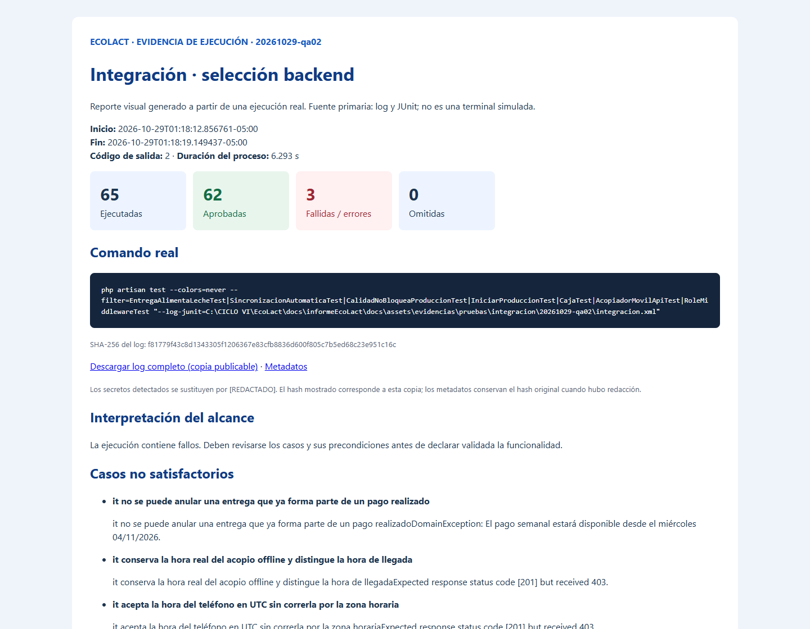

<div class="ec-pruebas" markdown="1">
<div class="ec-test-banner" markdown="1">

:material-test-tube: 4. Pruebas de integración

</div>
<div class="ec-test-content" markdown="1">

<span class="ec-test-kicker">EcoLact / 6. Pruebas / Ejecución verificable</span>

# Integración entre componentes de EcoLact

Esta sección distingue integración entre componentes dentro del proceso de prueba e integración extremo a extremo con infraestructura desplegada. La selección backend repite casos de Feature para observar flujos representativos; **no aumenta el total de pruebas únicas**.

<div class="ec-test-summary"><div class="ec-test-card ec-test-"><strong>65</strong>Ejecutadas</div><div class="ec-test-card ec-test-passed"><strong>62</strong>Aprobadas</div><div class="ec-test-card ec-test-failed"><strong>3</strong>Fallidas / errores</div><div class="ec-test-card ec-test-skipped"><strong>0</strong>Omitidas</div><div class="ec-test-card ec-test-"><strong>3.596 s</strong>Tiempo de casos</div></div>


## Integración del backend

<div class="ec-test-table" markdown="1">

|Suite seleccionada|Resultado real|Evidencia|
|---|---|---|
|EntregaAlimentaLecheTest|11 aprobadas · 0 fallidas · 1 errores · 0 omitidas|[JUnit](../assets/evidencias/pruebas/integracion/20261029-qa02/integracion.xml)|
|SaldoInicialCajaTest|2 aprobadas · 0 fallidas · 0 errores · 0 omitidas|[JUnit](../assets/evidencias/pruebas/integracion/20261029-qa02/integracion.xml)|
|CalidadNoBloqueaProduccionTest|4 aprobadas · 0 fallidas · 0 errores · 0 omitidas|[JUnit](../assets/evidencias/pruebas/integracion/20261029-qa02/integracion.xml)|
|SincronizacionAutomaticaTest|8 aprobadas · 0 fallidas · 0 errores · 0 omitidas|[JUnit](../assets/evidencias/pruebas/integracion/20261029-qa02/integracion.xml)|
|IniciarProduccionTest|15 aprobadas · 0 fallidas · 0 errores · 0 omitidas|[JUnit](../assets/evidencias/pruebas/integracion/20261029-qa02/integracion.xml)|
|RoleMiddlewareTest|4 aprobadas · 0 fallidas · 0 errores · 0 omitidas|[JUnit](../assets/evidencias/pruebas/integracion/20261029-qa02/integracion.xml)|
|AcopiadorMovilApiTest|10 aprobadas · 2 fallidas · 0 errores · 0 omitidas|[JUnit](../assets/evidencias/pruebas/integracion/20261029-qa02/integracion.xml)|
|CajaTest|8 aprobadas · 0 fallidas · 0 errores · 0 omitidas|[JUnit](../assets/evidencias/pruebas/integracion/20261029-qa02/integracion.xml)|

</div>


`EntregaAlimentaLecheTest` comprueba altas, actualización y anulación de entrega junto con stock; el escenario que primero paga una obligación produjo una excepción antes de verificar la anulación. `SincronizacionAutomaticaTest` conecta entrega, inventario, pago pendiente, análisis y recálculo: también comprueba reversión transaccional e idempotencia. `CalidadNoBloqueaProduccionTest` verifica que calidad no bloquee uso de leche. `IniciarProduccionTest` comprueba consumo de insumos. `CajaTest` integra pagos, ventas, compras y movimientos financieros. Los tests API y roles verifican el ingreso al caso de uso y sus restricciones.

El procedimiento fue ejecutar los tests existentes con un filtro explícito, fixtures sintéticos y `RefreshDatabase` sobre SQLite. No se inició un servidor web remoto ni se modificaron los casos para obtener aprobaciones.

## Integración de la app móvil

<div class="ec-test-table" markdown="1">

|Interacción|Componentes reales|Parte simulada|Resultado / evidencia|
|---|---|---|---|
|SQLite ↔ repositorio|SQLDelight, JDBC en memoria, caché y cola|Datos de prueba y reloj controlado en ciertos casos|Aprobada en los casos host; ver mobile.md|
|Cola ↔ sincronización|SyncManager y handlers|Disponibilidad de red y respuestas HTTP|AcopiadorOfflineTest, CalidadMuestreoSyncTest, VentasSyncTest aprobados|
|HTTP ↔ procesamiento|Ktor Client y serialización|MockEngine sustituye Laravel|Respuesta, error y reconciliación controlados; no es API desplegada|
|Idempotencia y reintento|Claves y estado de operaciones|Timeout, rechazo y conflicto preparados por el test|Los casos host aprobaron; validación equivalente de API en Feature tiene alcance separado|

</div>


## Recorrido de integración

<div class="ec-test-flow" role="img" aria-label="KMP, repositorio móvil, SQLite SQLDelight, cliente Ktor, API Laravel, casos de uso y MySQL">
<div class="ec-test-node">Aplicación KMP</div><span>↓</span>
<div class="ec-test-node">Repositorio móvil ↔ SQLite / SQLDelight</div><span>↓</span>
<div class="ec-test-node">Ktor Client</div><span>↓ HTTP</span>
<div class="ec-test-node">API Laravel</div><span>↓</span>
<div class="ec-test-node">Casos de uso</div><span>↓</span>
<div class="ec-test-node">MySQL</div>
</div>

**El diagrama representa la arquitectura objetivo.** En esta ejecución, el tramo móvil termina en MockEngine; el tramo backend empieza en peticiones internas Laravel y termina en SQLite en memoria. La flecha Ktor → API real → MySQL **no fue ejecutada**.

## Evidencias e interpretación

<div class="ec-test-evidence" markdown="1">

### Integración del backend

**2026-10-29T01:18:12.856761-05:00 · salida 2 · 6.293 s de proceso.**

```powershell
php artisan test --colors=never --filter=EntregaAlimentaLecheTest|SincronizacionAutomaticaTest|CalidadNoBloqueaProduccionTest|IniciarProduccionTest|CajaTest|AcopiadorMovilApiTest|RoleMiddlewareTest "--log-junit=C:\CICLO VI\EcoLact\docs\informeEcoLact\docs\assets\evidencias\pruebas\integracion\20261029-qa02\integracion.xml"
```

62 aprobadas · 2 fallidas · 1 errores · 0 omitidas.



*Reporte visual generado a partir de una ejecución real. Es una captura del reporte HTML; no es una captura directa de la terminal. La imagen resume; el log conserva toda la salida.*

[Log completo](../assets/evidencias/pruebas/integracion/20261029-qa02/integracion.log) · [Comando, fecha, duración y salida](../assets/evidencias/pruebas/integracion/20261029-qa02/integracion.json) · [Reporte HTML completo](../assets/evidencias/pruebas/integracion/20261029-qa02/integracion.html)

</div>

La evidencia móvil se reutiliza desde [Android Host](mobile.md#evidencia-de-android-host); no se fabricó un segundo reporte de ejecución. Su log y reportes JUnit corresponden al mismo proceso.

## Cobertura pendiente y conclusión

La selección obtuvo 62 aprobadas · 2 fallidas · 1 errores · 0 omitidas. Las interacciones aprobadas funcionan para sus escenarios en SQLite, mientras los casos no satisfactorios requieren revisar fecha de evento, asistencia y fecha de pago. Falta una prueba automática completa **App → API real → MySQL** en un entorno desechable, con dispositivo, autenticación real y conectividad variable. También faltan pruebas de concurrencia y recuperación frente a interrupciones físicas; no se les asigna un número de casos inventado.


<div class="ec-test-conclusion" markdown="1">

Consulta la [estrategia](index.md), el [backend](backend.md), la [app móvil](mobile.md), la [integración](integracion.md) y el [archivo de evidencias](evidencias.md).

</div>
</div>
</div>
