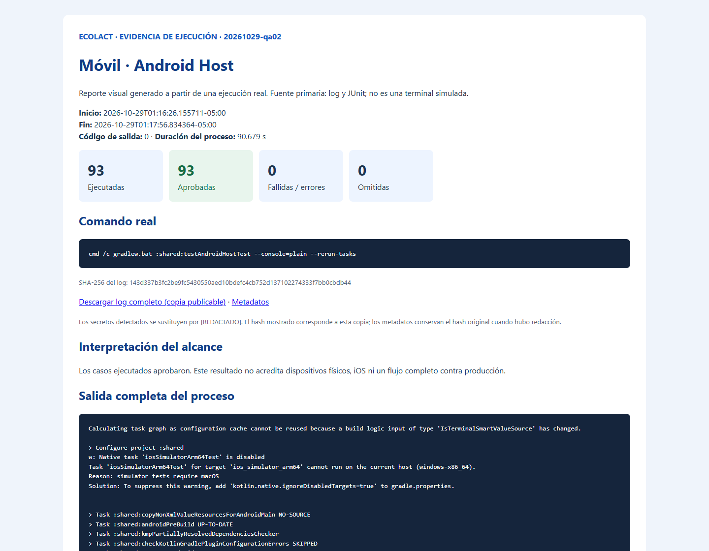

<div class="ec-pruebas" markdown="1">
<div class="ec-test-banner" markdown="1">

:material-test-tube: 3. Pruebas de aplicación móvil

</div>
<div class="ec-test-content" markdown="1">

<span class="ec-test-kicker">EcoLact / 6. Pruebas / Ejecución verificable</span>

# Validación de Kotlin Multiplatform y offline-first

Se inspeccionaron `shared/src/commonTest`, `shared/src/androidHostTest`, `shared/src/iosTest` y `shared/build.gradle.kts`. La tarea host ejecuta pruebas comunes y Android JVM; no requiere arrancar un emulador.

<div class="ec-test-summary"><div class="ec-test-card ec-test-"><strong>93</strong>Ejecutadas</div><div class="ec-test-card ec-test-passed"><strong>93</strong>Aprobadas</div><div class="ec-test-card ec-test-failed"><strong>0</strong>Fallidas / errores</div><div class="ec-test-card ec-test-skipped"><strong>0</strong>Omitidas</div><div class="ec-test-card ec-test-"><strong>2.174 s</strong>Tiempo de casos</div></div>


## Preparación y comando real

```powershell
java -version
.\gradlew.bat --version
.\gradlew.bat :shared:testAndroidHostTest --console=plain --rerun-tasks
```

Se usó `--rerun-tasks` para forzar la ejecución actual y evitar presentar un resultado `UP-TO-DATE` como prueba nueva. Gradle informó **33 tareas ejecutadas** y salida **0**. Java del lanzador es Temurin **17.0.17**; el archivo `gradle-daemon-jvm.properties` solicita un daemon **Java 21 Azul**. No se deben confundir ambos entornos. Se conservaron advertencias de Kotlin sobre clases `expect/actual` en beta.

## Casos y alcance real

<div class="ec-test-table" markdown="1">

|Archivo real|Objetivo y condición comprobada|Casos JUnit|Resultado|Evidencia|
|---|---|---|---|---|
|`shared/src/commonTest/kotlin/pe/edu/upeu/ecolactmobile/SharedCommonTest.kt`|Aserciones de lógica compartida, modelos, formato o presentación; consultar nombres de casos en JUnit.|1|1 aprobadas · 0 fallidas · 0 errores · 0 omitidas|[JUnit](../assets/evidencias/pruebas/mobile/20261029-qa02/junit/TEST-pe.edu.upeu.ecolactmobile.SharedCommonTest.xml)|
|`shared/src/androidHostTest/kotlin/pe/edu/upeu/ecolactmobile/SharedLogicAndroidHostTest.kt`|Aserciones de lógica compartida, modelos, formato o presentación; consultar nombres de casos en JUnit.|1|1 aprobadas · 0 fallidas · 0 errores · 0 omitidas|[JUnit](../assets/evidencias/pruebas/mobile/20261029-qa02/junit/TEST-pe.edu.upeu.ecolactmobile.SharedLogicAndroidHostTest.xml)|
|`shared/src/androidHostTest/kotlin/pe/edu/upeu/ecolactmobile/core/ui/state/LocalFirstViewModelTest.kt`|Conservar datos locales ante fallos de red y mostrar estados offline sin ocultar la copia existente.|4|4 aprobadas · 0 fallidas · 0 errores · 0 omitidas|[JUnit](../assets/evidencias/pruebas/mobile/20261029-qa02/junit/TEST-pe.edu.upeu.ecolactmobile.core.ui.state.LocalFirstViewModelTest.xml)|
|`shared/src/commonTest/kotlin/pe/edu/upeu/ecolactmobile/core/util/FormatTest.kt`|Aserciones de lógica compartida, modelos, formato o presentación; consultar nombres de casos en JUnit.|8|8 aprobadas · 0 fallidas · 0 errores · 0 omitidas|[JUnit](../assets/evidencias/pruebas/mobile/20261029-qa02/junit/TEST-pe.edu.upeu.ecolactmobile.core.util.FormatTest.xml)|
|`shared/src/androidHostTest/kotlin/pe/edu/upeu/ecolactmobile/feature/acopiador/AcopiadorOfflineTest.kt`|QR/DNI cacheado, entrega pendiente persistente, reconciliación sin duplicados, hora original, error de zona y recorrido offline.|13|13 aprobadas · 0 fallidas · 0 errores · 0 omitidas|[JUnit](../assets/evidencias/pruebas/mobile/20261029-qa02/junit/TEST-pe.edu.upeu.ecolactmobile.feature.acopiador.AcopiadorOfflineTest.xml)|
|`shared/src/commonTest/kotlin/pe/edu/upeu/ecolactmobile/feature/calidad/CalidadModelsTest.kt`|Aserciones de lógica compartida, modelos, formato o presentación; consultar nombres de casos en JUnit.|2|2 aprobadas · 0 fallidas · 0 errores · 0 omitidas|[JUnit](../assets/evidencias/pruebas/mobile/20261029-qa02/junit/TEST-pe.edu.upeu.ecolactmobile.feature.calidad.CalidadModelsTest.xml)|
|`shared/src/androidHostTest/kotlin/pe/edu/upeu/ecolactmobile/feature/calidad/CalidadMuestreoSyncTest.kt`|Selección aleatoria autorizada por servidor simulado, reconexión ordenada y conflictos; OCR queda pendiente de revisión humana.|4|4 aprobadas · 0 fallidas · 0 errores · 0 omitidas|[JUnit](../assets/evidencias/pruebas/mobile/20261029-qa02/junit/TEST-pe.edu.upeu.ecolactmobile.feature.calidad.CalidadMuestreoSyncTest.xml)|
|`shared/src/commonTest/kotlin/pe/edu/upeu/ecolactmobile/feature/calidad/CalidadMuestreoTest.kt`|Aserciones de lógica compartida, modelos, formato o presentación; consultar nombres de casos en JUnit.|10|10 aprobadas · 0 fallidas · 0 errores · 0 omitidas|[JUnit](../assets/evidencias/pruebas/mobile/20261029-qa02/junit/TEST-pe.edu.upeu.ecolactmobile.feature.calidad.CalidadMuestreoTest.xml)|
|`shared/src/androidHostTest/kotlin/pe/edu/upeu/ecolactmobile/feature/calidad/CalidadOfflineTest.kt`|Selección, foto, análisis, conflicto y migración local. Usa HttpClient sin MockEngine, pero el repositorio se fuerza offline; las respuestas posteriores se aplican localmente.|6|6 aprobadas · 0 fallidas · 0 errores · 0 omitidas|[JUnit](../assets/evidencias/pruebas/mobile/20261029-qa02/junit/TEST-pe.edu.upeu.ecolactmobile.feature.calidad.CalidadOfflineTest.xml)|
|`shared/src/commonTest/kotlin/pe/edu/upeu/ecolactmobile/feature/planta/PlantaModelsTest.kt`|Aserciones de lógica compartida, modelos, formato o presentación; consultar nombres de casos en JUnit.|10|10 aprobadas · 0 fallidas · 0 errores · 0 omitidas|[JUnit](../assets/evidencias/pruebas/mobile/20261029-qa02/junit/TEST-pe.edu.upeu.ecolactmobile.feature.planta.PlantaModelsTest.xml)|
|`shared/src/androidHostTest/kotlin/pe/edu/upeu/ecolactmobile/feature/planta/PlantaOfflineTest.kt`|QR local, producción rechazada como conflicto, comprobante pendiente de OCR y compra encolada una sola vez.|4|4 aprobadas · 0 fallidas · 0 errores · 0 omitidas|[JUnit](../assets/evidencias/pruebas/mobile/20261029-qa02/junit/TEST-pe.edu.upeu.ecolactmobile.feature.planta.PlantaOfflineTest.xml)|
|`shared/src/commonTest/kotlin/pe/edu/upeu/ecolactmobile/feature/proveedor/ProveedorPresentacionTest.kt`|Aserciones de lógica compartida, modelos, formato o presentación; consultar nombres de casos en JUnit.|7|7 aprobadas · 0 fallidas · 0 errores · 0 omitidas|[JUnit](../assets/evidencias/pruebas/mobile/20261029-qa02/junit/TEST-pe.edu.upeu.ecolactmobile.feature.proveedor.ProveedorPresentacionTest.xml)|
|`shared/src/androidHostTest/kotlin/pe/edu/upeu/ecolactmobile/feature/trabajador/AsistenciaGateTest.kt`|Solo asistencia confirmada para hoy permite operar offline; la asistencia anterior no autoriza y el servidor simulado revalida.|6|6 aprobadas · 0 fallidas · 0 errores · 0 omitidas|[JUnit](../assets/evidencias/pruebas/mobile/20261029-qa02/junit/TEST-pe.edu.upeu.ecolactmobile.feature.trabajador.AsistenciaGateTest.xml)|
|`shared/src/androidHostTest/kotlin/pe/edu/upeu/ecolactmobile/feature/trabajador/MiQrTrabajadorTest.kt`|Disponibilidad local del QR propio y tratamiento de respuesta remota controlada.|2|2 aprobadas · 0 fallidas · 0 errores · 0 omitidas|[JUnit](../assets/evidencias/pruebas/mobile/20261029-qa02/junit/TEST-pe.edu.upeu.ecolactmobile.feature.trabajador.MiQrTrabajadorTest.xml)|
|`shared/src/commonTest/kotlin/pe/edu/upeu/ecolactmobile/feature/ventas/VentasModelsTest.kt`|Aserciones de lógica compartida, modelos, formato o presentación; consultar nombres de casos en JUnit.|7|7 aprobadas · 0 fallidas · 0 errores · 0 omitidas|[JUnit](../assets/evidencias/pruebas/mobile/20261029-qa02/junit/TEST-pe.edu.upeu.ecolactmobile.feature.ventas.VentasModelsTest.xml)|
|`shared/src/androidHostTest/kotlin/pe/edu/upeu/ecolactmobile/feature/ventas/VentasSyncTest.kt`|Venta en efectivo, boleta tras sincronizar, stock reservado, usuario distinto, rechazos y reintento con misma clave y fecha.|8|8 aprobadas · 0 fallidas · 0 errores · 0 omitidas|[JUnit](../assets/evidencias/pruebas/mobile/20261029-qa02/junit/TEST-pe.edu.upeu.ecolactmobile.feature.ventas.VentasSyncTest.xml)|

</div>


**Procedimiento común:** crear el esquema SQLDelight sobre `JdbcSqliteDriver.IN_MEMORY`, sembrar datos de prueba, ejecutar el repositorio o handler y verificar filas, estados o respuestas. Los tests de modelos y ViewModel pueden prescindir de la base de datos. Los detalles por función y sus tiempos están en [el inventario por caso](../assets/evidencias/pruebas/resumen/20261029-qa02/casos.csv).

## Offline-first e integración simulada

SQLite JDBC y las consultas SQLDelight son componentes reales ejecutados en memoria. `CacheRepository`, `SyncQueueRepository`, repositorios y handlers trabajan sobre esos datos. En los tests de sincronización, **Ktor MockEngine reemplaza al servidor HTTP**. El caso `CalidadOfflineTest` configura `isOnline = { false }` y cambia estados de forma local; tampoco constituye una conexión con Laravel.

Se comprueban persistencia de pendientes, claves idempotentes, conflictos visibles, reintentos y restricciones de asistencia. La reapertura que simulan los tests no acredita recuperación ante apagado físico, batería agotada, cambio real de red ni restricciones del sistema Android.

## Evidencia de Android Host

<div class="ec-test-evidence" markdown="1">

### Pruebas Android Host

**2026-10-29T01:16:26.155711-05:00 · salida 0 · 90.679 s de proceso.**

```powershell
cmd /c gradlew.bat :shared:testAndroidHostTest --console=plain --rerun-tasks
```

93 aprobadas · 0 fallidas · 0 errores · 0 omitidas.



*Reporte visual generado a partir de una ejecución real. Es una captura del reporte HTML; no es una captura directa de la terminal. La imagen resume; el log conserva toda la salida.*

[Log completo](../assets/evidencias/pruebas/mobile/20261029-qa02/mobile-android-host.log) · [Comando, fecha, duración y salida](../assets/evidencias/pruebas/mobile/20261029-qa02/mobile-android-host.json) · [Reporte HTML completo](../assets/evidencias/pruebas/mobile/20261029-qa02/mobile-android-host.html)

</div>

También está disponible el [reporte HTML original de Gradle](../assets/evidencias/pruebas/mobile/20261029-qa02/gradle-report/index.html) con clases, métodos y tiempos.

## Compatibilidad iOS

<div class="ec-test-not-run ec-test-card" markdown="1">

**NO EJECUTADA:** `shared/src/iosTest/kotlin/pe/edu/upeu/ecolactmobile/SharedLogicIOSTest.kt` contiene una prueba `example`. Windows no dispone de Xcode ni de un destino Apple para ejecutar `iosArm64` o `iosSimulatorArm64`. Los casos commonTest aprobados en JVM no certifican su ejecución en iOS.

</div>

## Conclusión

Los 93 casos host aprobaron y respaldan los escenarios controlados descritos. Quedan pendientes la ejecución nativa iOS, pruebas instrumentadas en dispositivos y un flujo completo con API real y MySQL aislado. No se midió cobertura de líneas ni rendimiento de producción.


<div class="ec-test-conclusion" markdown="1">

Consulta la [estrategia](index.md), el [backend](backend.md), la [app móvil](mobile.md), la [integración](integracion.md) y el [archivo de evidencias](evidencias.md).

</div>
</div>
</div>
